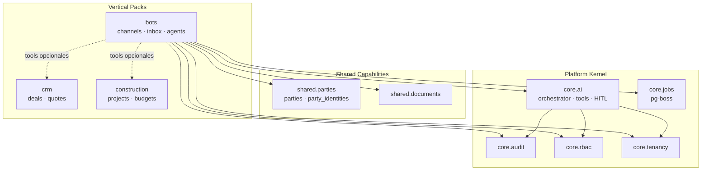
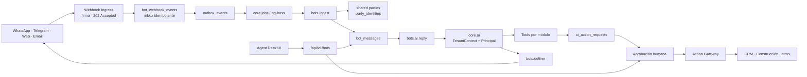
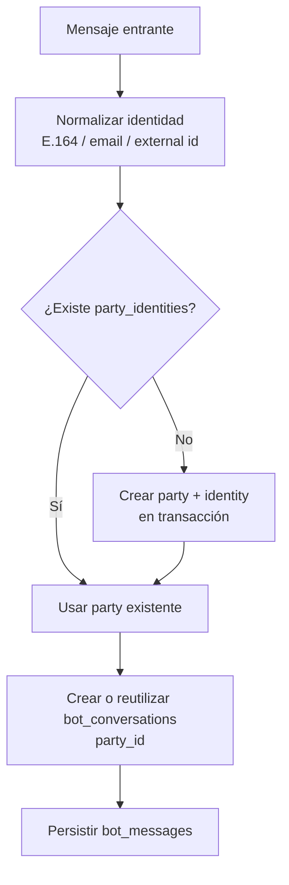
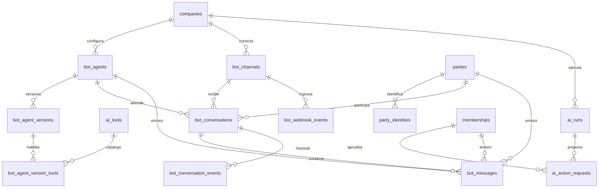
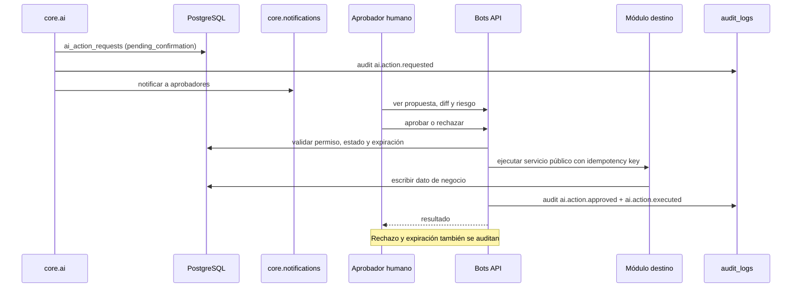

# Pack de Bots y Atención de Agentes

> **Tipo:** diseño de vertical pack futuro.
> **Estado:** propuesta para preparar la base; no implementado.
> **Alcance:** creación de bots, canales chat/webhooks, bandeja de agentes, respuestas con IA y acciones con confirmación humana.
> **Documentos relacionados:** `PROPOSED_ARCHITECTURE.md`, `DATABASE_DESIGN.md`, `TECHNICAL_DECISIONS.md` y `IMPLEMENTATION_ROADMAP.md`.

---

## 1. Decisión en una frase

El pack `bots` será un **vertical pack independiente**, registrado por manifest, que ingiere eventos por webhook en una **inbox transaccional + outbox + pg-boss**, resuelve cada contacto contra **`shared.parties`** y usa **`core.ai`** con un principal de mínimo privilegio; cualquier mutación de negocio propuesta por la IA pasa por **Human-in-the-loop** y se audita en `audit_logs`.

---

## 2. Posición en la arquitectura



**Regla de oro:** las flechas punteadas son contratos de herramientas, no imports de código ni acceso a tablas. El kernel no conoce `bots`; `bots` conoce interfaces públicas del kernel y de shared.

---

## 3. Module Registry y manifest

### 3.1 Código y naturaleza

| Elemento | Valor |
|---|---|
| Código del pack | `bots` |
| Nombre | Bots & Agent Desk |
| Tipo | Vertical pack |
| Vertical | `bots` |
| Primer release | Futuro, después de validar `core.ai` con CRM |
| Núcleo | No; nunca forma parte de `core.*` |

### 3.2 Manifest propuesto

```ts
export const botsManifest: ModuleManifest = {
  code: 'bots',
  name: 'Bots & Agent Desk',
  version: '1.0.0',
  vertical: 'bots',

  dependsOn: [
    'core.iam',
    'core.tenancy',
    'core.rbac',
    'core.jobs',
    'core.audit',
    'core.ai',
    'core.files',
    'core.notifications',
    'shared.parties',
    'shared.documents',
  ],

  // Capacidades opcionales: no se importan, se descubren por tool registry.
  optionalDependsOn: ['crm', 'construction.projects'],

  permissions: [
    'bots.channels.read',
    'bots.channels.manage',
    'bots.agents.read',
    'bots.agents.manage',
    'bots.conversations.read',
    'bots.conversations.reply',
    'bots.conversations.assign',
    'bots.conversations.close',
    'bots.actions.read',
    'bots.actions.approve',
    'bots.analytics.read',
    'bots.settings.manage',
  ],

  entitlements: [
    { code: 'bots.messages_month', type: 'quota', period: 'month', hard: true },
    { code: 'bots.ai_credits_month', type: 'quota', period: 'month', hard: true },
    { code: 'bots.concurrent_conversations', type: 'gauge', hard: false },
    { code: 'bots.channels', type: 'count', hard: true },
    { code: 'bots.agents', type: 'count', hard: true },
    { code: 'bots.storage_mb', type: 'quota', hard: true },
  ],

  webhooks: [
    {
      code: 'bots.channel.events',
      path: '/api/v1/bots/webhooks/:channelKey',
      auth: 'signature',
      idempotency: 'provider_event_id',
    },
  ],

  aiTools: [
    {
      code: 'bots.conversation.reply',
      moduleCode: 'bots',
      risk: 'conversational',
      requiresConfirmation: false,
      permission: 'bots.conversations.reply',
    },
    {
      code: 'bots.conversation.handoff',
      moduleCode: 'bots',
      risk: 'conversational',
      requiresConfirmation: false,
      permission: 'bots.conversations.assign',
    },
  ],

  jobQueues: [
    { name: 'bots.ingest', concurrency: 20, retryLimit: 5, singletonKey: 'conversation_id' },
    { name: 'bots.ai.reply', concurrency: 10, retryLimit: 3, singletonKey: 'conversation_id' },
    { name: 'bots.deliver', concurrency: 20, retryLimit: 5, singletonKey: 'conversation_id' },
    { name: 'bots.actions.execute', concurrency: 5, retryLimit: 3, singletonKey: 'action_request_id' },
  ],
};
```

> Los tipos concretos viven en `packages/shared`; el ejemplo muestra la forma, no una API cerrada.

### 3.3 Registro y activación

1. **Build-time validation**
   - Código único, permisos namespaced `bots.*`.
   - Dependencias existentes y sin ciclos.
   - Tools, webhooks y colas con códigos únicos.
   - Entitlements declarados.
2. **Seed**
   - Fila en `modules` con `vertical='bots'`, `is_core=false`.
   - Filas en `module_dependencies`.
   - Permisos en `permissions`.
   - Tools en `ai_tools` (catálogo global, sembrado desde manifests).
3. **Planes**
   - `plan_modules` decide qué planes incluyen `bots`.
   - `plan_limits` define los límites de mensajes, créditos, canales, agentes y almacenamiento.
4. **Empresa**
   - `company_modules` habilita el pack y dispara el seed de roles template.
   - Sin `company_modules`, las rutas, webhooks y jobs del pack quedan inactivos.
5. **Runtime**
   - `ModuleGuard` valida `company_modules`.
   - `EntitlementGuard` valida límites antes de crear canales, agentes o ejecutar IA.
   - El shell solo muestra el módulo si está habilitado y el usuario tiene permiso.

### 3.4 Independencia del kernel

- `core.*` no importa `modules/bots` ni conoce tablas `bot_*`.
- `core.ai` guarda `ai_runs` y `ai_action_requests` con referencias genéricas (`module_code`, `subject_type`, `subject_id`), sin FKs hacia bots.
- `core.jobs` solo conoce nombres de cola y handlers registrados; no conoce el dominio.
- `shared.parties` no conoce bots; bots usa su servicio público.
- Un test de arquitectura en CI falla si `kernel/` o `shared/` importan `modules/bots`, o si una tabla core tiene FK a una tabla de pack.

### 3.5 Dependencias opcionales y tools

`crm` y `construction.projects` no son dependencias duras. Si están habilitados, registran tools como:

| Tool | Módulo | Riesgo | Confirmación |
|---|---|---|---|
| `crm.quotes.create` | `crm` | `business_write` | Obligatoria |
| `crm.deals.read` | `crm` | `read` | No |
| `construction.projects.read` | `construction.projects` | `read` | No |
| `construction.budgets.draft` | `construction.budgets` | `business_write` | Obligatoria |
| `bots.conversation.reply` | `bots` | `conversational` | Según modo del agente |
| `bots.conversation.handoff` | `bots` | `conversational` | No |

`bots` solo puede usar tools incluidas en la versión activa de su agente y permitidas por su rol. Si CRM no está habilitado, `crm.quotes.create` no existe para el orquestador.

---

## 4. Arquitectura de ejecución



### 4.1 Ingesta: inbox + outbox

El endpoint de webhook **no procesa el mensaje**. Solo:

1. Verifica firma HMAC, timestamp y ventana anti-replay.
2. Resuelve el canal por `channelKey` y obtiene `company_id`; nunca confía en un `company_id` del payload.
3. Inserta `bot_webhook_events` con unique `(company_id, channel_id, provider_event_id)`.
4. Inserta `outbox_events` con `event_type='bots.webhook.received'` en la misma transacción.
5. Responde `202 Accepted` en pocos milisegundos.

Un publicador de outbox encola un job `bots.ingest`. El worker normaliza el evento, resuelve la identidad del contacto, crea o actualiza la conversación y persiste el mensaje. Si el mismo evento llega dos veces, la unique de inbox y la idempotencia del job evitan duplicados.

### 4.2 Colas y concurrencia

| Cola | Propósito | Orden | Reintentos | Dead-letter |
|---|---|---|---|---|
| `bots.ingest` | Normalizar webhook, resolver party, persistir mensaje | Paralelo por evento | 5 con backoff | Sí |
| `bots.ai.reply` | Generar respuesta o propuesta con IA | Singleton por conversación | 3 | Sí |
| `bots.deliver` | Enviar mensaje al proveedor | Singleton por conversación | 5 | Sí |
| `bots.actions.execute` | Ejecutar acción aprobada | Singleton por acción | 3 | Sí |

**Reglas:**

- `singletonKey = conversation_id` en IA y entrega para no responder en paralelo a la misma conversación.
- `singletonKey = action_request_id` para no ejecutar dos veces una acción aprobada.
- El payload del job contiene IDs y `company_id`, no el cuerpo completo del mensaje ni PII.
- El worker reconstruye el `TenantContext` desde la base y valida que el `company_id` del job coincida.
- Reintentos con backoff exponencial y *jitter*; después de N intentos, dead-letter y alerta.
- Un job debe ser idempotente: la misma entrada produce el mismo efecto.

### 4.3 Backpressure y ráfagas

- Rate limit por canal, IP y tenant en el ingreso.
- Límite de tamaño de payload y de adjuntos.
- Si la cola supera el umbral, el webhook responde `429` o `503` para que el proveedor reintente; nunca se pierde el evento silenciosamente.
- Métricas de profundidad de cola y *lag* por cola y tenant.
- *Debounce* por conversación para agrupar ráfagas de mensajes antes de llamar a la IA.
- Concurrencia por tenant limitada para evitar que un cliente monopolice los workers.
- Workers escalables horizontalmente; el API sigue stateless.

### 4.4 Tiempo real en la bandeja

- La UI de agentes usa SSE o polling con cursor; no mantiene una petición abierta mientras la IA piensa.
- Los mensajes se persisten antes de notificar.
- Para múltiples instancias, `LISTEN/NOTIFY` de PostgreSQL o polling con cursor; no se introduce Redis en esta etapa.
- La asignación de conversación usa `version` para evitar que dos agentes la tomen a la vez.

---

## 5. Integración con shared.parties

### 5.1 Identidad de canal

Los usuarios externos **no se guardan en tablas propias de bots**. Se resuelven contra `shared.parties` mediante `party_identities`:

| Columna | Ejemplo |
|---|---|
| `company_id` | Empresa |
| `party_id` | Persona en `parties` |
| `kind` | `whatsapp`, `telegram`, `email`, `phone`, `web`, `external` |
| `value` | Número normalizado E.164 o email en minúsculas |
| `normalized_value` | Valor usado para búsqueda y unique |

**Unique:** `(company_id, kind, normalized_value)`.

### 5.2 Resolución de contacto



- Si dos mensajes del mismo contacto nuevo llegan en paralelo, la unique de `party_identities` y un `INSERT ... ON CONFLICT` garantizan una sola party.
- Para visitantes web anónimos se usa un identificador estable de sesión; no se crea una party nueva por mensaje.
- Si la persona representa una organización, se enlaza con `party_contacts`; la conversación conserva la party persona y el contexto de la organización.
- CRM y Construcción reutilizan `parties.id`; no hay `bot_contacts` ni una base de contactos paralela.

### 5.3 Historial compartido

- `bot_conversations.party_id` referencia `parties (company_id, id)`.
- `bot_messages.sender_party_id` referencia `parties` para mensajes entrantes.
- CRM puede mostrar el historial de conversaciones de una party mediante un servicio público de bots o una proyección de lectura; no consulta `bot_messages` directamente.
- Construcción puede abrir la conversación desde el cliente del proyecto con el mismo `party_id`.
- Si el pack `bots` se deshabilita, las parties y su historial de negocio permanecen; el historial de conversaciones queda en solo lectura según retención.

---

## 6. Modelo de datos

### 6.1 ERD



### 6.2 Tablas del pack

| Tabla | Propósito | Claves |
|---|---|---|
| `bot_agents` | Configuración del bot y rol de servicio | `UNIQUE (company_id, code)` |
| `bot_agent_versions` | Versiones inmutables de prompt/modelo/tools | `UNIQUE (bot_agent_id, version_number)` |
| `bot_agent_version_tools` | Tools permitidas por versión | PK `(company_id, bot_agent_version_id, tool_code)` |
| `bot_channels` | Canales y credenciales referenciadas | `UNIQUE (company_id, channel_type, external_id)` |
| `bot_conversations` | Conversación con una party | `UNIQUE (company_id, channel_id, external_thread_id)` |
| `bot_messages` | Mensajes inmutables | Índice `(conversation_id, occurred_at)` |
| `bot_conversation_events` | Asignaciones, handoffs y estados | Append-only |
| `bot_webhook_events` | Inbox de eventos crudos | `UNIQUE (company_id, channel_id, provider_event_id)` |

### 6.3 Tablas de kernel y shared

| Tabla | Capa | Propósito |
|---|---|---|
| `ai_tools` | `core.ai` | Catálogo de tools declaradas por manifests |
| `ai_runs` | `core.ai` | Ejecución de IA, tokens, costo y estado |
| `ai_action_requests` | `core.ai` | Propuestas de escritura pendientes de HITL |
| `party_identities` | `shared.parties` | Identidades de canal por party |

### 6.4 Reglas de integridad

- `company_id NOT NULL` en todas las tablas de negocio.
- `UNIQUE (company_id, id)` en `bot_agents`, `bot_channels`, `bot_conversations`, `bot_agent_versions` y `ai_runs`.
- FKs compuestas para conversaciones, mensajes, canales y parties.
- `bot_messages` y `bot_conversation_events` son append-only.
- `bot_agent_versions` activas son inmutables; editar crea una versión nueva.
- `ai_action_requests.payload` es una **propuesta** para revisión; la fuente de verdad es la tabla relacional del módulo destino.
- Secretos de canales en gestor de secretos; en BD solo `credential_ref`.
- Adjuntos en `shared.documents`/object storage; el mensaje guarda la referencia.

### 6.5 Índices y particiones

- Conversaciones: `(company_id, status, last_message_at DESC)` y `(company_id, assigned_membership_id, status)`.
- Mensajes: `(company_id, conversation_id, occurred_at DESC)`.
- Webhooks: parcial por `status` y `received_at`.
- Acciones pendientes: `(company_id, status, created_at)` parcial.
- Identidades: `(company_id, kind, normalized_value)` unique y `(company_id, party_id)`.
- `bot_messages` y `bot_webhook_events` se diseñan para particionar por mes cuando el volumen lo exija; la primera versión puede usar tabla única con índices y migrar a particiones con ventana de mantenimiento.

### 6.6 Retención

| Tabla | Retención inicial | Nota |
|---|---|---|
| `bot_messages` | 12–24 meses configurable | Puede contener PII; cifrado y acceso restringido |
| `bot_webhook_events` | 7–90 días | Payload crudo; conservar IDs de idempotencia el tiempo necesario |
| `ai_runs` | 12 meses | Sin prompt/output crudo por defecto; hash y salida redactada |
| `ai_action_requests` | 24 meses | Evidencia de aprobación/rechazo |
| `bot_conversation_events` | 24 meses | Historial de asignación |
| `audit_logs` | Según política legal | Append-only |

---

## 7. Seguridad y control de la IA

### 7.1 Principios

La IA del bot se ejecuta bajo **`core.ai`**, no dentro del pack. El orquestador:

1. Exige `TenantContext`; sin empresa no ejecuta.
2. Construye un `Principal` con el rol y los permisos efectivos.
3. Carga solo las tools permitidas por la versión del agente y el módulo habilitado.
4. Valida el permiso de cada tool antes de invocarla.
5. Trata el contenido del mensaje como entrada no confiable.
6. No permite SQL, URLs arbitrarias, secretos ni cambios de política.

### 7.2 Principal del bot vs. principal humano

| Modo | Actor | Permisos |
|---|---|---|
| Bot autónomo | `actorType='bot'`, `actorId=bot_agent.id` | Rol dedicado de mínimo privilegio del agente |
| Humano asistido | `actorType='user'`, membership del agente humano | Permisos del membership |
| Sugerencia a humano | Intersección | Permisos del humano ∩ tools del agente |

- El bot **nunca** hereda el rol de owner ni permisos de administrador.
- El rol del agente se define en `bot_agents.role_id` y debe ser un rol de empresa o global de mínimo privilegio.
- Si un humano pide a la IA crear una cotización, la propuesta se valida contra los permisos del humano y contra las tools permitidas del agente.
- Cambiar prompt, modelo o tools requiere `bots.agents.manage` y queda auditado.

### 7.3 Clasificación de acciones

| Riesgo | Ejemplo | Confirmación |
|---|---|---|
| `read` | Consultar un deal o un presupuesto | No; permiso de lectura |
| `conversational` | Responder un mensaje o hacer handoff | Según modo `suggest`/`auto_reply`; auditado |
| `business_write` | Crear cotización, proyecto, ajustar stock | **Sí, obligatoria** |
| `external` | Enviar email, webhook o documento a tercero | **Sí, obligatoria** |

> Una respuesta de chat es una acción operativa del canal, no una mutación de negocio. Aun así queda registrada en `bot_messages` y asociada a `ai_runs`; las mutaciones de negocio siempre requieren HITL.

### 7.4 Flujo Human-in-the-loop



**Reglas:**

- La IA no puede aprobar su propia acción.
- El aprobador necesita `bots.actions.approve` **y** el permiso del módulo destino (por ejemplo, `crm.quotes.create`).
- La propuesta expira (por ejemplo, 24 horas) y no se ejecuta automáticamente.
- La ejecución usa `idempotency_key` para evitar cotizaciones duplicadas.
- Si el módulo destino está deshabilitado o el permiso falta, la acción falla cerrada.
- El payload de la propuesta se muestra redactado; secretos y datos innecesarios no se incluyen.

### 7.5 Auditoría

Cada acción relevante genera filas en `audit_logs` con:

- `module_code='bots'` o el módulo destino.
- `source='ai'` cuando corresponde.
- `actor_type` (`user`, `bot`, `system`, `ai`) y `actor_id`.
- `subject_type`, `subject_id`.
- `correlation_id` = `ai_run.id` o `request_id` del webhook.
- `payload_hash` y resumen redactado; no el cuerpo completo del mensaje.
- `before`/`after` cuando la acción modifica una entidad.

Eventos mínimos:

| Evento | Cuándo |
|---|---|
| `bots.channel.created` / `updated` | Alta o cambio de canal |
| `bots.agent.version.activated` | Activación de prompt/modelo |
| `bots.conversation.assigned` / `closed` | Cambio operativo |
| `ai.action.requested` | La IA propone una escritura |
| `ai.action.approved` / `rejected` | Decisión humana |
| `ai.action.executed` / `failed` | Resultado |
| `ai.run.failed` | Error de modelo, timeout o política |

No se audita cada mensaje individual para no multiplicar escrituras; el historial conversacional vive en `bot_messages` y cada respuesta se vincula a `ai_runs`.

### 7.6 Defensas adicionales

- Firma HMAC, timestamp y ventana anti-replay en webhooks.
- Límite de tamaño, tipo de archivo y análisis de adjuntos.
- Redacción de PII antes de enviar al proveedor de IA.
- Política de no entrenamiento con datos del cliente.
- Allowlist de tools y esquemas JSON estrictos.
- Detección de prompt injection y salida moderada.
- Límite de tokens, costo y frecuencia por tenant.
- Secretos en gestor; rotación y mínimo privilegio.
- Logs sin cuerpos de mensajes, tokens ni credenciales.

---

## 8. Límites y planes

| Feature | Tipo | Comportamiento en el límite |
|---|---|---|
| `bots.messages_month` | Cuota mensual | Inbound se guarda; se desactivan respuestas IA y envíos; se alerta |
| `bots.ai_credits_month` | Cuota mensual | IA se desactiva; la conversación pasa a cola humana |
| `bots.concurrent_conversations` | Gauge | Se encola o asigna; no se descarta el mensaje |
| `bots.channels` | Conteo | No se pueden crear canales |
| `bots.agents` | Conteo | No se pueden crear agentes |
| `bots.storage_mb` | Cuota | Se bloquean adjuntos nuevos |
| `bots.webhook_events_month` | Cuota | Alerta y rate limit; el proveedor reintenta |

**Política:** perder un mensaje entrante es peor que exceder una cuota. Por eso el inbound se acepta y almacena; lo que se limita es la IA, la respuesta saliente y la creación de recursos.

Los contadores se incrementan de forma idempotente por `event_id`/`message_id` y se reconcilian periódicamente contra `bot_messages`, `ai_runs` y `bot_webhook_events`.

---

## 9. API y frontend

### 9.1 Endpoints principales

| Método | Ruta | Auth | Permiso |
|---|---|---|---|
| POST | `/api/v1/bots/webhooks/:channelKey` | Firma del proveedor | — |
| GET | `/api/v1/bots/conversations` | JWT + tenant | `bots.conversations.read` |
| GET | `/api/v1/bots/conversations/:id/messages` | JWT + tenant | `bots.conversations.read` |
| POST | `/api/v1/bots/conversations/:id/messages` | JWT + tenant | `bots.conversations.reply` |
| POST | `/api/v1/bots/conversations/:id/assign` | JWT + tenant | `bots.conversations.assign` |
| POST | `/api/v1/bots/conversations/:id/close` | JWT + tenant | `bots.conversations.close` |
| GET/POST | `/api/v1/bots/agents` | JWT + tenant | `bots.agents.read` / `manage` |
| POST | `/api/v1/bots/agents/:id/versions` | JWT + tenant | `bots.agents.manage` |
| POST | `/api/v1/bots/agents/:id/versions/:version/activate` | JWT + tenant | `bots.agents.manage` |
| GET | `/api/v1/bots/actions?status=pending_confirmation` | JWT + tenant | `bots.actions.read` |
| POST | `/api/v1/bots/actions/:id/approve` | JWT + tenant | `bots.actions.approve` + permiso destino |
| POST | `/api/v1/bots/actions/:id/reject` | JWT + tenant | `bots.actions.approve` |
| GET | `/api/v1/bots/analytics` | JWT + tenant | `bots.analytics.read` |

- El webhook responde `202` y no devuelve datos del mensaje.
- El resto usa el envelope y los códigos de error de `core.api`.
- Los endpoints de acciones devuelven la propuesta, el riesgo, la expiración y el diff.

### 9.2 Frontend

- **Agent Desk:** bandeja, filtros, conversación, contexto de party, sugerencias de IA, handoff, cierre y tarjetas de aprobación.
- **Bot Builder:** agentes, versiones de prompt/modelo, tools, canales, sandbox de prueba y activación.
- **Analytics:** volumen, tiempo de primera respuesta, contención IA, handoff, CSAT y costo.
- **Tiempo real:** SSE o polling con cursor; sin bloquear el request.
- **Accesibilidad:** navegación por teclado, foco, estados vacíos y mensajes de error claros.
- **Permisos:** la UI oculta canales, agentes y acciones no permitidas; el backend siempre impone.

---

## 10. Observabilidad y SLOs

| Métrica | Objetivo inicial |
|---|---|
| Webhook p95 | < 200 ms, respuesta `202` |
| Tasa de firmas inválidas | < 0.1 % |
| Lag de ingesta p95 | < 5 s |
| Lag de respuesta IA p95 | < 10 s |
| Entrega exitosa | > 99 % |
| Duplicados detectados | < 0.1 % |
| Dead-letter | 0 en operación normal |
| Costo IA por conversación | Medible y limitado por plan |

Alertas:

- Cola supera umbral o lag crece.
- Dead-letter > 0.
- Errores del proveedor o de firma.
- Pico de costo de IA.
- Webhooks 5xx.
- Denegaciones RLS inesperadas.

Trazabilidad: `correlation_id` desde el webhook hasta el mensaje, la ejecución de IA, la aprobación y la escritura en el módulo destino.

---

## 11. Testing

| Nivel | Casos |
|---|---|
| Unitario | Firma, normalización de identidad, permisos, cuotas, clasificación de riesgo |
| Integración | Webhook → inbox → outbox → job → party → mensaje; duplicados; RLS cross-tenant |
| HITL | Propuesta, aprobación, rechazo, expiración, doble aprobación, auto-aprobación bloqueada |
| Concurrencia | Dos mensajes del mismo contacto nuevo; dos agentes asignando; reintentos |
| Carga | Ráfaga de webhooks, conversaciones concurrentes, límite de workers |
| Seguridad | Firma inválida, replay, prompt injection, fuga cross-tenant, secreto en logs |
| Golden | Respuestas y acciones esperadas con fixtures deterministas |

**Regla:** el pack no se considera terminado sin pruebas de duplicados, cross-tenant, HITL y carga.

---

## 12. Roadmap y prerrequisitos

### Prerrequisitos que se preparan antes

| Fase | Preparación |
|---|---|
| Fase 1 | TenantContext, RLS, auditoría transaccional, outbox, memberships |
| Fase 2 | Module registry, `core.ai` esqueleto, jobs/outbox, entitlements, API v1 |
| Fase 3 | `parties` y `party_identities`; deduplicación de contactos |
| Fase 5 | IA piloto con tools de lectura y HITL; validación de `core.ai` con CRM |
| Fase 6 | Métricas de IA, HITL y operación; decisión de construir bots |

### Fase 7 — Bots & Agent Desk (futura)

**Alcance:** canales, inbox, bot builder versionado, respuestas IA, HITL, analytics y límites.
**Esfuerzo indicativo:** 10–14 semanas.
**No incluye:** constructor visual de flujos complejos, voz, marketplace de bots, entrenamiento propio.

**Criterios de salida:**

- [ ] Un webhook firmado se acepta con `202` y se procesa asíncronamente.
- [ ] Un evento duplicado no duplica mensaje ni conversación.
- [ ] Todo contacto externo queda en `parties` con identidad de canal.
- [ ] CRM y Construcción ven la misma party.
- [ ] Una ráfaga de mensajes no bloquea el API ni pierde eventos.
- [ ] La IA no lee datos de otra empresa.
- [ ] Toda escritura de negocio requiere aprobación humana y queda auditada.
- [ ] El límite de mensajes/créditos se impone en servidor.
- [ ] Dead-letter y reintentos funcionan.
- [ ] Pruebas de carga y seguridad pasan.

---

## 13. Riesgos

| Riesgo | Impacto | Mitigación |
|---|---|---|
| Ráfaga de webhooks | Cola saturada, latencia | Inbox rápida, backpressure, workers escalables |
| Duplicados de contacto | Historial fragmentado | `party_identities` unique + upsert idempotente |
| Prompt injection | Acción no deseada o fuga | Tools allowlist, HITL, sanitización, pruebas |
| Fuga cross-tenant | Incidente grave | TenantContext, RLS, tests, validación de job |
| Costo de IA | Margen negativo | Créditos, límites, modelos económicos, cache |
| Cumplimiento WhatsApp | Bloqueo del canal | Ventanas de 24 h, templates, revisión legal |
| Retención de PII | Riesgo legal | Retención configurable, redacción, borrado |
| Acoplamiento a CRM | Rompe arquitectura | Tool contracts, optional dependencies, CI |
| Webhook no idempotente | Mensajes duplicados | Inbox unique, job idempotente, provider event ID |

---

## 14. Resumen

El pack de bots se integra sin romper el diseño aprobado:

1. **Module Registry:** `bots` es un vertical pack con manifest, permisos, límites y dependencias; el kernel no depende de él.
2. **Outbox y pg-boss:** el webhook solo persiste y responde `202`; inbox, outbox y workers procesan el resto.
3. **Shared parties:** toda identidad externa vive en `parties`/`party_identities`; el historial se une por `party_id`.
4. **IA segura:** `core.ai` inyecta tenant y permisos; las escrituras de negocio pasan por HITL y auditoría.

La implementación detallada de tablas y DDL está en `DATABASE_DESIGN.md`; la posición en la arquitectura y el manifest en `PROPOSED_ARCHITECTURE.md`; las decisiones en `TECHNICAL_DECISIONS.md` (ADR-029 a ADR-033).
