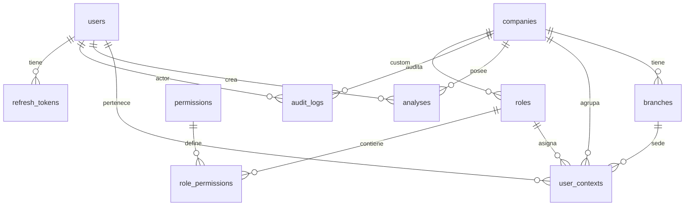
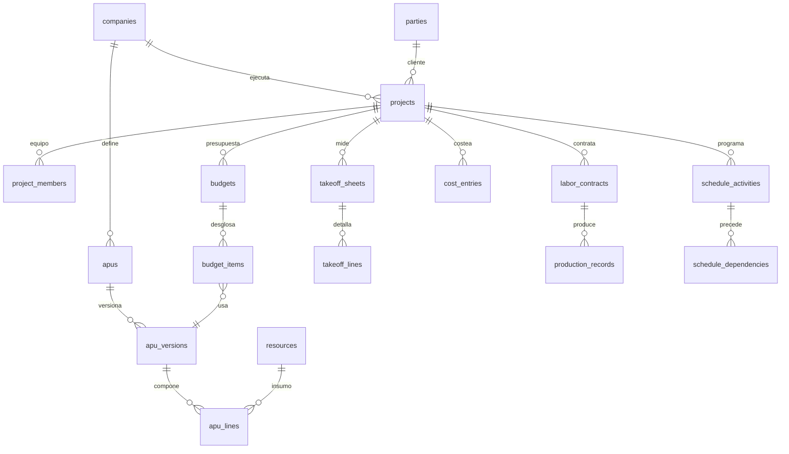
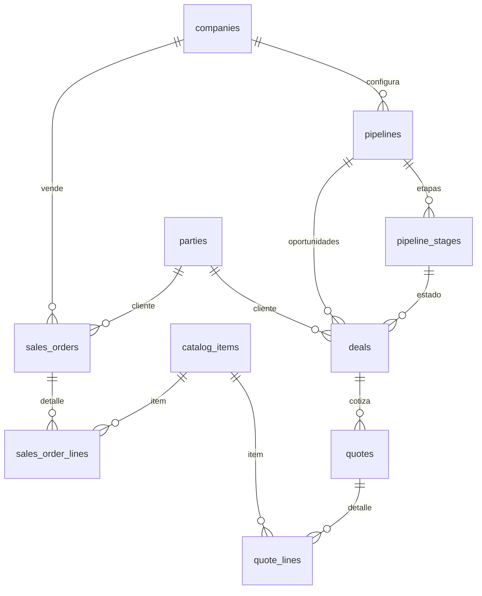
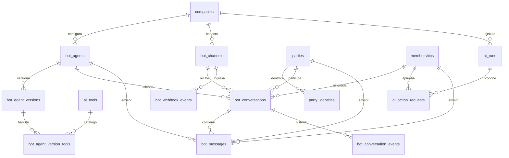

# Diseño de base de datos

> **Tipo:** propuesta de evolución del esquema.
> **Base:** backup `saas.sql` y migraciones 000–019.
> **Alcance:** kernel, capacidades compartidas, construcción, CRM, comercio, energía y preparación del pack de bots.
> **Regla:** este documento no ejecuta migraciones. Los DDL son orientativos y deben validarse en una copia de producción.

---

## 1. Principios

1. **Una empresa es el tenant.** `companies` sigue siendo la raíz; no se introduce un segundo nivel de tenancy sin necesidad real.
2. **Toda tabla de negocio tiene `company_id NOT NULL`.**
3. **Integridad cross-tenant en la base de datos**, no solo en la aplicación.
4. **Dinero y cantidades exactos:** `numeric`, moneda explícita y redondeo definido.
5. **Documentos financieros inmutables:** versiones, snapshots y reversos.
6. **Soft delete en maestros; `voided`/reverso en finanzas.**
7. **Auditoría append-only y transaccional.**
8. **Concurrencia explícita:** `version`, row locks e idempotencia.
9. **Migraciones incrementales y reversibles.**
10. **No duplicar datos entre verticales:** parties, catálogo e inventario son compartidos.
11. **Eventos de canal idempotentes:** inbox/outbox y colas; nunca procesar webhooks de bots dentro del request.
12. **La IA no escribe sin HITL:** las propuestas viven en `ai_action_requests`; la fuente de verdad es la tabla destino.

---

## 2. Esquema actual

### 2.1 Tablas `public`

| Tabla | Propósito | PK | Observaciones |
|---|---|---|---|
| `users` | Identidad global | `id` | Email único parcial, `is_super_admin`, `locked_until` |
| `companies` | Tenant | `id` | `slug` único global, soft delete |
| `branches` | Sedes | `id` | `is_main` único parcial |
| `roles` | Roles | `id` | Globales (`company_id NULL`) o por empresa |
| `permissions` | Permisos | `id` | `code` único |
| `role_permissions` | M:N | `(role_id, permission_id)` | — |
| `user_contexts` | Membership + rol + sede | `id` | Unique solo con `branch_id` no nulo |
| `analyses` | Análisis JSONB | `id` | Solo energía validada |
| `audit_logs` | Auditoría | `(id, created_at)` | Particionada por rango |
| `password_history` | Historial | `id` | Sin retención explícita |
| `refresh_tokens` | Refresh | `id` | Hash, expiración, revocado |
| `token_blacklist` | Access revocados | `id` | Hash único |

### 2.2 Relaciones actuales



### 2.3 Constraints relevantes

- `companies.slug` único **incluyendo soft-deleted**.
- `users.email` único solo con `deleted_at IS NULL` y **case-sensitive**.
- `user_contexts` unique `(user_id, company_id, branch_id)` solo si `branch_id IS NOT NULL`.
- `roles` sin unique de nombre por empresa.
- `role_permissions` PK compuesta.
- `audit_logs` PK `(id, created_at)`.
- FKs con `ON DELETE CASCADE` desde empresa y `SET NULL` desde usuario en auditoría.

### 2.4 Índices actuales

- `idx_analyses_company_created`, `idx_analyses_company_type`.
- `idx_branches_company_id`.
- `idx_roles_company_id`, `idx_roles_name` parcial.
- `idx_user_contexts_lookup`, `idx_user_contexts_company_id`, `idx_user_contexts_branch_id`.
- `idx_users_email` parcial.
- Índices de auditoría por empresa/fecha, entidad, usuario y keyset.
- `uq_branches_main_per_company` parcial.

### 2.5 RLS

RLS está habilitado en tablas `public`, pero **no hay políticas para `public`** y el backend usa una conexión privilegiada. No hay defensa en profundidad.

---

## 3. Diagnóstico

### Fortalezas

- UUID y `timestamptz`.
- Soft delete en entidades principales.
- FKs y cascadas razonables.
- Índices por empresa/fecha.
- Auditoría particionada.
- Migraciones versionadas.
- Email único parcial y sede principal única parcial.

### Problemas

| Problema | Consecuencia |
|---|---|
| FKs independientes | `user_contexts` puede mezclar empresa, sede y rol de tenants distintos |
| Sin `UNIQUE (company_id, id)` en padres | No se pueden usar FKs compuestas |
| RLS sin políticas | Falsa sensación de seguridad |
| `user_contexts` sin estado | No hay invitación, suspensión ni baja por empresa |
| Unique incompleto | Duplicados de membership |
| `locked_until` global | Inactivación afecta a todas las empresas |
| Roles sin unique | Roles homónimos |
| CASCADE en roles/sedes | Pérdida silenciosa de memberships |
| Email case-sensitive | Identidades duplicadas |
| Slug soft-deleted | No se reutiliza |
| Auditoría fire-and-forget | Trazabilidad incompleta |
| CASCADE de empresa a auditoría | Pérdida de historial |
| Sin dinero/moneda | No apto para presupuestos/costos |
| Sin `version` | Lost updates |
| Sin idempotencia | Duplicados financieros |
| Sin jobs | Imports/reportes bloquean requests |
| Particiones manuales | Riesgo operativo |

---

## 4. ERD objetivo

### 4.1 Kernel y shared

```mermaid
erDiagram
  companies ||--o{ branches : tiene
  companies ||--o{ memberships : agrupa
  users ||--o{ memberships : pertenece
  memberships ||--o{ membership_roles : recibe
  roles ||--o{ membership_roles : asigna
  roles ||--o{ role_permissions : contiene
  permissions ||--o{ role_permissions : define
  companies ||--o{ company_modules : habilita
  modules ||--o{ company_modules : define
  modules ||--o{ module_dependencies : depende
  plans ||--o{ plan_modules : incluye
  modules ||--o{ plan_modules : incluido
  plans ||--o{ plan_limits : limita
  plans ||--o{ subscriptions : ofrece
  companies ||--o{ subscriptions : contrata
  companies ||--o{ parties : posee
  parties ||--o{ party_roles : cumple
  parties ||--o{ party_identities : identifica
  companies ||--o{ catalog_items : cataloga
  companies ||--o{ warehouses : almacena
  warehouses ||--o{ stock_movements : mueve
  catalog_items ||--o{ stock_movements : item
  companies ||--o{ audit_logs : audita
  companies ||--o{ outbox_events : emite
  companies ||--o{ ai_runs : ejecuta
  ai_runs ||--o{ ai_action_requests : propone
  memberships ||--o{ ai_action_requests : aprueba
```



### 4.2 Construcción



### 4.3 CRM y comercio



### 4.4 Bots y atención de agentes



---

## 5. Diccionario de tablas

### 5.1 Kernel

#### `users` (evolucionar)

Columnas actuales +:

| Columna | Tipo | Regla |
|---|---|---|
| `email` | `citext` o `text` con unique `lower(email)` | Normalizado |
| `status` | `text` | `active`, `suspended`, `pending` |
| `token_version` | `integer` | Invalida JWT al cambiar roles |
| `last_password_change_at` | `timestamptz` | Política de expiración |
| `deleted_at` | `timestamptz` | Soft delete |

#### `companies` (evolucionar)

Añadir:

| Columna | Tipo | Regla |
|---|---|---|
| `currency_code` | `char(3)` | FK a `currencies` |
| `country_code` | `char(2)` | ISO 3166-1 |
| `slug` | `varchar(100)` | Unique parcial `WHERE deleted_at IS NULL` |
| `settings` | `jsonb` | Solo configuración no crítica |

La configuración tipada va en `company_settings`.

#### `branches` (evolucionar)

- `code varchar(20) NOT NULL` con unique `(company_id, code) WHERE deleted_at IS NULL`.
- `is_active boolean NOT NULL DEFAULT true`.
- `manager_membership_id` en lugar de `manager_user_id` si se quiere integridad con membership.
- FKs compuestas con empresa.

#### `memberships` (nueva, reemplaza `user_contexts`)

| Columna | Tipo | Regla |
|---|---|---|
| `id` | `uuid` | PK |
| `company_id` | `uuid` | FK companies |
| `user_id` | `uuid` | FK users |
| `status` | `text` | `invited`, `active`, `suspended`, `removed` |
| `primary_branch_id` | `uuid` | FK compuesta con company |
| `invited_by` | `uuid` | FK users |
| `invited_at` | `timestamptz` | — |
| `joined_at` | `timestamptz` | — |
| `created_at` / `updated_at` | `timestamptz` | — |
| `deleted_at` | `timestamptz` | Soft delete |

**Constraints:**

- `UNIQUE (company_id, user_id) WHERE deleted_at IS NULL`.
- `UNIQUE (company_id, id)` para FKs compuestas.
- `FOREIGN KEY (company_id, primary_branch_id) REFERENCES branches(company_id, id)`.
- `CHECK (status IN ('invited','active','suspended','removed'))`.

#### `membership_roles`

| Columna | Tipo | Regla |
|---|---|---|
| `membership_id` | `uuid` | FK memberships |
| `role_id` | `uuid` | FK roles |
| `company_id` | `uuid` | Tenant |
| `assigned_by` | `uuid` | FK users |
| `assigned_at` | `timestamptz` | — |

**PK:** `(membership_id, role_id)`.
**Trigger/check:** el rol debe ser global (`company_id NULL`) o de la misma empresa.

#### `membership_branches`

- `membership_id`, `branch_id`, `company_id`.
- PK `(membership_id, branch_id)`.
- FKs compuestas.
- Solo se usa si la sede es una frontera de acceso.

#### `invitations`

| Columna | Tipo | Regla |
|---|---|---|
| `id` | `uuid` | PK |
| `company_id` | `uuid` | Tenant |
| `email` | `citext` | Normalizado |
| `role_id` | `uuid` | Rol inicial |
| `branch_id` | `uuid` | Opcional |
| `token_hash` | `text` | No guardar token plano |
| `status` | `text` | `pending`, `accepted`, `expired`, `revoked` |
| `expires_at` | `timestamptz` | — |
| `invited_by` | `uuid` | FK users |
| `accepted_at` | `timestamptz` | — |
| `created_at` | `timestamptz` | — |

**Unique:** `(company_id, lower(email)) WHERE status = 'pending'`.

#### `roles` (evolucionar)

- `is_system boolean NOT NULL DEFAULT false`.
- `scope text NOT NULL DEFAULT 'company'` (`company`, `branch`, `project`).
- `is_assignable boolean NOT NULL DEFAULT true`.
- `UNIQUE (company_id, lower(name)) WHERE deleted_at IS NULL AND company_id IS NOT NULL`.
- `UNIQUE (lower(name)) WHERE deleted_at IS NULL AND company_id IS NULL`.
- Bloquear borrado si existe `membership_roles`.

#### `permissions` (evolucionar)

- `module_code text NOT NULL`.
- `description text`.
- `is_sensitive boolean NOT NULL DEFAULT false`.
- `code` namespaced (`core.users.read`, `construction.apu.create`).
- Mantener aliases para permisos legacy durante la migración.

#### `sessions` / `refresh_tokens`

Añadir a `refresh_tokens` o crear `sessions`:

- `family_id uuid NOT NULL`.
- `company_id uuid NULL` para revocación por empresa.
- `replaced_by uuid`.
- `revoked_reason text`.
- `ip inet`, `user_agent text`, `last_used_at timestamptz`.
- `UNIQUE (token_hash)`.
- Detección de reuso: si se usa un token rotado, revocar la familia.

#### `modules`

| Columna | Tipo |
|---|---|
| `code` | `text` PK |
| `name` | `text` |
| `vertical` | `text NULL` |
| `version` | `text` |
| `is_core` | `boolean` |
| `status` | `text` |
| `created_at` | `timestamptz` |

#### `module_dependencies`

- `module_code`, `depends_on_module_code`.
- PK compuesta.
- Check: no auto-dependencia.
- Validación de ciclos en aplicación.

#### `company_modules`

- `company_id`, `module_code`, `status`, `enabled_at`, `disabled_at`, `config jsonb`.
- PK `(company_id, module_code)`.
- FK a modules.
- Check de estado.

#### `plans`, `plan_modules`, `plan_limits`, `subscriptions`, `company_entitlements`, `usage_counters`

- `plans`: código, nombre, trial, intervalo, precio, moneda, activo.
- `plan_modules`: qué módulos incluye.
- `plan_limits`: `(plan_id, module_code, feature_code, limit_value, period, is_hard)`.
- `subscriptions`: empresa, plan, estado, período, proveedor, ID externo.
- `company_entitlements`: overrides con expiración.
- `usage_counters`: consumo por empresa/módulo/feature/período.

**Unique:** una suscripción activa por empresa (`WHERE status IN ('trialing','active','past_due')`).

#### `audit_logs` (evolucionar)

Añadir:

- `request_id text`.
- `module_code text`.
- `actor_type text` (`user`, `bot`, `system`, `ai`).
- `actor_id uuid` y `actor_email text`, `actor_name text` (snapshot).
- `subject_type text`, `subject_id uuid`.
- `payload_hash text` (para acciones de IA, sin cuerpo sensible).
- `schema_version integer`.
- `source text` (`api`, `job`, `ai`, `system`).
- `correlation_id uuid`.

Cambiar:

- `company_id` a `ON DELETE RESTRICT`.
- `user_id` a `ON DELETE SET NULL` + snapshot.
- Particiones automáticas.

#### `outbox_events`

- `id uuid`, `company_id`, `aggregate_type`, `aggregate_id`, `event_type`, `payload jsonb`, `occurred_at`, `published_at`, `attempts`, `last_error`.
- Índice parcial `WHERE published_at IS NULL`.
- `event_id` único para idempotencia; el payload no contiene PII innecesaria.

#### `ai_tools`

- Catálogo global sembrado desde los manifests de módulos.
- `code text PK`, `module_code`, `name`, `risk_level` (`read`, `conversational`, `business_write`, `external`), `requires_confirmation`, `schema_hash`, `status`.
- No contiene datos de tenant.

#### `ai_runs`

| Columna | Tipo | Regla |
|---|---|---|
| `id` | `uuid` | PK |
| `company_id` | `uuid` | Tenant |
| `module_code` | `text` | Módulo que origina el run |
| `subject_type` / `subject_id` | `text` / `uuid` | Referencia genérica; sin FK a packs |
| `actor_type` | `text` | `user`, `bot`, `system` |
| `actor_id` | `uuid` | Membership o bot agent |
| `actor_version_id` | `uuid` | Versión del agente, si aplica |
| `model` | `text` | Modelo usado |
| `prompt_version` | `text` | Versión de prompt |
| `input_tokens` / `output_tokens` | `integer` | Consumo |
| `cost_amount` | `numeric(18,6)` | Costo |
| `currency_code` | `char(3)` | Moneda |
| `risk_level` | `text` | `low`, `medium`, `high` |
| `status` | `text` | `queued`, `running`, `succeeded`, `failed`, `blocked` |
| `input_hash` | `text` | Hash, sin prompt crudo |
| `output_redacted` | `text` | Salida redactada |
| `correlation_id` | `uuid` | Trazabilidad |
| `started_at` / `finished_at` | `timestamptz` | — |

**Reglas:** `UNIQUE (company_id, id)`; sin FK a `bot_*`; retención 12 meses por defecto.

#### `ai_action_requests`

| Columna | Tipo | Regla |
|---|---|---|
| `id` | `uuid` | PK |
| `company_id` | `uuid` | Tenant |
| `run_id` | `uuid` | FK compuesta a `ai_runs` |
| `module_code` | `text` | Módulo destino |
| `action_code` | `text` | Tool que se ejecutará |
| `target_type` / `target_id` | `text` / `uuid` | Entidad destino opcional |
| `payload` | `jsonb` | Propuesta para revisión, no fuente de verdad |
| `summary` | `text` | Resumen legible y redactado |
| `risk_level` | `text` | `low`, `medium`, `high` |
| `status` | `text` | `pending_confirmation`, `approved`, `rejected`, `executed`, `failed`, `expired` |
| `requested_by_type` / `requested_by_id` | `text` / `uuid` | Bot o usuario |
| `decided_by_membership_id` | `uuid` | Aprobador humano |
| `decided_at` / `decision_comment` | `timestamptz` / `text` | Decisión |
| `executed_at` | `timestamptz` | Ejecución |
| `result` | `jsonb` | Resultado de la ejecución |
| `idempotency_key` | `text` | Evita doble ejecución |
| `expires_at` | `timestamptz` | Expiración de la propuesta |

**Constraints:** `UNIQUE (company_id, idempotency_key)`; `FOREIGN KEY (company_id, run_id) REFERENCES ai_runs(company_id, id)`; `decided_by_membership_id` FK compuesta a memberships; estado y expiración validadas en servicio y check.

> `payload` y `result` son JSONB porque describen una propuesta y su resultado, no el modelo de negocio. La escritura real ocurre en las tablas relacionales del módulo destino.

#### `documents`, `notifications`, `api_keys`, `webhook_endpoints`, `webhook_deliveries`

- `documents`: metadata, storage path, checksum, versión, uploaded_by.
- `notifications`: empresa, usuario, tipo, payload, read_at.
- `api_keys`: hash, prefix, scopes, expiración, revocación.
- `webhooks`: endpoint, secret hash, eventos, entregas.

### 5.2 Shared

#### `parties`

| Columna | Tipo | Regla |
|---|---|---|
| `id` | `uuid` | PK |
| `company_id` | `uuid` | Tenant |
| `party_type` | `text` | `person`, `organization` |
| `name` | `text` | — |
| `legal_name` | `text` | — |
| `tax_id` | `text` | Unique parcial por empresa |
| `email` | `citext` | — |
| `phone` | `text` | — |
| `status` | `text` | `active`, `inactive` |
| `created_by` / `updated_by` | `uuid` | — |
| `created_at` / `updated_at` | `timestamptz` | — |
| `deleted_at` | `timestamptz` | Soft delete |

**Unique:** `(company_id, tax_id) WHERE tax_id IS NOT NULL AND deleted_at IS NULL`.

#### `party_identities`

| Columna | Tipo | Regla |
|---|---|---|
| `id` | `uuid` | PK |
| `company_id` | `uuid` | Tenant |
| `party_id` | `uuid` | FK compuesta a parties |
| `kind` | `text` | `email`, `phone`, `whatsapp`, `telegram`, `web`, `external` |
| `value` | `text` | Valor original |
| `normalized_value` | `text` | Búsqueda y unique |
| `is_verified` | `boolean` | Verificación |
| `source_module` | `text` | Módulo que la creó |
| `created_at` | `timestamptz` | — |

**Unique:** `(company_id, kind, normalized_value)`.
**Índice:** `(company_id, party_id)`.

Esta tabla pertenece a **shared.parties**, no a bots. Permite que WhatsApp, Telegram, email, web y CRM resuelvan la misma persona sin duplicar contactos.

#### `party_roles`

- `party_id`, `company_id`, `role`.
- Roles: `customer`, `supplier`, `contractor`, `employee`, `contact`.
- PK `(party_id, role)`.
- Índice `(company_id, role)`.

#### `party_contacts`, `party_addresses`

- Contactos y direcciones con `is_primary` parcial.

#### `catalog_items`

- `company_id`, `sku`, `name`, `description`, `item_type` (`product`, `service`), `category_id`, `unit_id`, `tax_rate_id`, `cost`, `price`, `currency_code`, `is_stockable`, `status`, timestamps, `deleted_at`.
- Unique `(company_id, sku) WHERE deleted_at IS NULL`.

#### `item_categories`

- `company_id`, `parent_id`, `name`, `path`.
- Evitar ciclos con trigger o validación.

#### `units_of_measure`

- `company_id NULL` para globales, `code`, `name`, `kind`, `precision`, `is_active`.
- Unique global/empresa.

#### `tax_rates`

- `company_id`, `code`, `name`, `rate numeric(9,4)`, `country_code`, `is_active`.

#### `price_lists`, `item_prices`

- Listas por empresa/moneda/vigencia.
- Precios por item y cantidad mínima.

#### `warehouses`

- `company_id`, `branch_id`, `code`, `name`, `address`, `is_active`.
- Unique `(company_id, code)`.

#### `stock_balances`

- `warehouse_id`, `item_id`, `quantity_on_hand`, `quantity_reserved`, `avg_unit_cost`, `updated_at`.
- PK `(warehouse_id, item_id)`.
- Check `quantity_on_hand >= 0` salvo configuración explícita.

#### `stock_movements`

- `company_id`, `warehouse_id`, `item_id`, `movement_type`, `quantity`, `unit_cost`, `total_cost`, `source_type`, `source_id`, `transfer_id`, `occurred_at`, `created_by`, `notes`.
- Append-only.
- Check `quantity <> 0`.

#### `stock_transfers`

- `company_id`, `from_warehouse_id`, `to_warehouse_id`, `status`, `created_by`, `created_at`.
- Check warehouses distintas.

#### `purchase_orders`, `purchase_order_lines`, `goods_receipts`, `goods_receipt_lines`

- Compras compartidas.
- `purchase_orders.project_id` nullable: si existe, el costo se imputa al proyecto.
- Líneas referencian `catalog_items` o `resources` según el caso.
- Recepciones alimentan stock y costo.

### 5.3 Construcción

#### `projects`

- `company_id`, `branch_id`, `client_party_id`, `code`, `name`, `description`, `status`, `currency_code`, `start_date`, `end_date`, `timezone`, `address`, `created_by`, `updated_by`, timestamps, `deleted_at`.
- Unique `(company_id, code) WHERE deleted_at IS NULL`.

#### `project_members`

- `project_id`, `membership_id`, `project_role`, `created_at`.
- PK `(project_id, membership_id)`.
- Roles: `manager`, `estimator`, `resident`, `supervisor`, `viewer`.

#### `resources`

- `company_id`, `resource_type` (`material`, `labor`, `equipment`, `transport`, `subcontract`), `code`, `name`, `unit_id`, `base_cost`, `currency_code`, `catalog_item_id`, `attributes jsonb`, `status`, timestamps, `deleted_at`.
- Unique `(company_id, code) WHERE deleted_at IS NULL`.
- `catalog_item_id` solo para materiales que existen en catálogo.
- `attributes` para metadata variable, no para costos críticos.

#### `resource_prices`

- `resource_id`, `company_id`, `supplier_party_id`, `price`, `currency_code`, `valid_from`, `valid_to`, `source`, `created_at`.
- Índice `(resource_id, valid_from DESC)`.
- Evitar solapamientos por recurso/proveedor/moneda con trigger o exclusión.

#### `apus`

- `company_id`, `code`, `name`, `unit_id`, `description`, `status`, `current_version_id`, `created_by`, timestamps, `deleted_at`.
- Unique `(company_id, code) WHERE deleted_at IS NULL`.

#### `apu_versions`

- `apu_id`, `company_id`, `version_number`, `status`, `output_quantity`, `unit_id`, `indirect_pct`, `profit_pct`, `tax_pct`, `notes`, `approved_by`, `approved_at`, `created_at`.
- Unique `(apu_id, version_number)`.
- Status: `draft`, `approved`, `superseded`.

#### `apu_lines`

- `apu_version_id`, `company_id`, `resource_id`, `component_type`, `quantity`, `waste_pct`, `unit_cost_snapshot`, `currency_code`, `sort_order`, `notes`.
- Checks: `quantity > 0`, `waste_pct >= 0`.
- `unit_cost_snapshot` congela el precio al aprobar.

#### `takeoff_sheets`, `takeoff_lines`

- `takeoff_sheets`: proyecto, APU opcional, nombre, descripción.
- `takeoff_lines`: descripción, unidad, cantidad, dimensiones, fórmula, orden.
- Permite memoria de cantidades sin usar JSONB opaco.

#### `budgets`

- `company_id`, `project_id`, `code`, `name`, `version`, `status`, `currency_code`, `valid_from`, `approved_by`, `approved_at`, `subtotal`, `indirect_total`, `tax_total`, `total`, `created_by`, timestamps, `deleted_at`.
- Unique `(company_id, project_id, code, version)`.
- Status: `draft`, `in_review`, `approved`, `superseded`, `rejected`.

#### `budget_items`

- `budget_id`, `company_id`, `parent_id`, `wbs_code`, `path`, `description`, `unit_id`, `quantity`, `unit_price`, `total`, `pricing_mode`, `apu_version_id`, `sort_order`, `is_group`.
- Checks: `quantity >= 0`, `unit_price >= 0`, `total >= 0`.
- `pricing_mode`: `apu` o `manual`.
- Si `pricing_mode = 'apu'`, `apu_version_id` obligatorio.
- Trigger para evitar ciclos de `parent_id`.

#### `budget_approvals`

- `budget_id`, `status`, `approved_by`, `comments`, `created_at`.

#### `labor_contracts`

- `company_id`, `project_id`, `contractor_party_id` o `worker_party_id`, `contract_type`, `resource_id`, `rate`, `currency_code`, `quantity_contracted`, `unit_id`, `start_date`, `end_date`, `status`, `created_by`, timestamps.
- Check: exactamente uno de contractor/worker.
- Tipos: `piecework`, `hourly`, `fixed`.

#### `production_records`

- `labor_contract_id`, `company_id`, `period_date`, `quantity`, `unit_id`, `amount`, `status`, `approved_by`, `approved_at`, `notes`.
- Check `quantity > 0`.
- Status: `draft`, `approved`, `rejected`.

#### `cost_entries`

- `company_id`, `project_id`, `budget_item_id`, `cost_type`, `entry_type` (`commitment`, `actual`), `source_type`, `source_id`, `amount`, `currency_code`, `transaction_date`, `description`, `reversal_of_id`, `created_by`, `created_at`.
- Append-only.
- Unique por origen para evitar doble posteo: `(company_id, source_type, source_id, entry_type, cost_type)`.
- `reversal_of_id` para corregir sin updates.

#### `schedule_activities`

- `company_id`, `project_id`, `budget_item_id`, `parent_id`, `name`, `start_date`, `end_date`, `duration_days`, `progress_pct`, `status`, `sort_order`.
- Check `progress_pct BETWEEN 0 AND 100`.

#### `schedule_dependencies`

- `predecessor_id`, `successor_id`, `dependency_type` (`FS`, `SS`, `FF`, `SF`), `lag_days`.
- PK compuesta.
- Trigger para evitar ciclos.

### 5.4 CRM

#### `pipelines`, `pipeline_stages`

- Pipeline por empresa; etapas ordenadas, probabilidad y estado ganado/perdido.

#### `deals`

- `company_id`, `pipeline_id`, `stage_id`, `party_id`, `name`, `amount`, `currency_code`, `expected_close_date`, `owner_user_id`, `status`, timestamps.
- Unique de código si se agrega.

#### `deal_stage_history`

- `deal_id`, `from_stage_id`, `to_stage_id`, `changed_by`, `changed_at`.

#### `quotes`, `quote_lines`

- Quote con ítems del catálogo, impuestos y totales.
- Estados: `draft`, `sent`, `accepted`, `rejected`, `expired`.

#### `activities`, `activity_links`

- Actividad genérica con links a party/deal/project.
- Evitar FKs polimórficas sin validación; usar `entity_type` + `entity_id` con trigger o servicio.

### 5.5 Comercio

#### `sales_orders`, `sales_order_lines`

- Venta con almacén, cliente, ítems, impuestos y totales.
- Estados: `draft`, `confirmed`, `fulfilled`, `canceled`.

### 5.6 Energía

- Mantener `analyses` como tabla legacy del pack energía.
- Añadir `module_code = 'energy'` o `CHECK (analysis_type = 'energy')` si se congela.
- No crear tablas de APU dentro de energía.

### 5.7 Bots y atención de agentes

> Diseño funcional y de seguridad: `BOTS_PACK_DESIGN.md`. Estas tablas pertenecen al pack `bots`; las de IA y parties pertenecen a kernel/shared.

#### `bot_agents`

- `id uuid`, `company_id`, `code`, `name`, `role_id`, `current_version_id`, `status` (`active`, `paused`, `archived`), `created_by`, timestamps, `deleted_at`.
- Unique `(company_id, code) WHERE deleted_at IS NULL`.
- `role_id` debe ser un rol global o de la misma empresa; se valida en servicio/trigger.
- `current_version_id` se agrega como FK diferida a `bot_agent_versions` después de crear ambas tablas.

#### `bot_agent_versions`

- `id`, `company_id`, `bot_agent_id`, `version_number`, `model`, `system_prompt`, `temperature`, `max_output_tokens`, `mode` (`suggest`, `auto_reply`, `human_only`), `status` (`draft`, `active`, `superseded`), `created_by`, `created_at`, `activated_at`.
- Unique `(bot_agent_id, version_number)`.
- Una versión `active` es inmutable; editar crea una nueva versión.
- El prompt puede contener datos sensibles: acceso restringido y auditoría al activar.

#### `bot_agent_version_tools`

- `company_id`, `bot_agent_version_id`, `tool_code`.
- PK `(company_id, bot_agent_version_id, tool_code)`.
- FK compuesta a `bot_agent_versions` y FK a `ai_tools(code)`.
- Solo se permiten tools existentes y habilitadas para el módulo.

#### `bot_channels`

- `id`, `company_id`, `channel_type` (`whatsapp`, `telegram`, `web`, `email`, `webhook`), `provider`, `external_id`, `webhook_key` unique global, `name`, `default_bot_agent_id`, `credential_ref`, `status`, `config jsonb`, timestamps, `deleted_at`.
- Unique `(company_id, channel_type, external_id) WHERE deleted_at IS NULL`.
- `credential_ref` apunta al gestor de secretos; nunca se guarda el secreto en BD.
- `webhook_key` es la clave de ruteo del webhook; no es un secreto y se puede rotar.

#### `bot_conversations`

- `id`, `company_id`, `channel_id`, `party_id`, `external_thread_id`, `bot_agent_id`, `bot_agent_version_id`, `assigned_membership_id`, `status` (`open`, `pending`, `assigned`, `closed`, `archived`), `mode` (`bot`, `human`, `hybrid`), `last_message_at`, `version`, timestamps.
- Unique `(company_id, channel_id, external_thread_id)`.
- FKs compuestas a `bot_channels`, `parties`, `bot_agents`, `bot_agent_versions` y `memberships`.
- `version` para asignación concurrente y `If-Match`.

#### `bot_messages`

- `id`, `company_id`, `conversation_id`, `channel_id`, `direction` (`inbound`, `outbound`), `sender_type` (`party`, `membership`, `bot`, `system`), `sender_party_id`, `sender_membership_id`, `sender_bot_agent_id`, `message_type`, `body`, `provider_message_id`, `status`, `occurred_at`, `created_at`, `metadata jsonb`.
- Check: exactamente un emisor según `sender_type`.
- Unique parcial `(company_id, channel_id, provider_message_id) WHERE provider_message_id IS NOT NULL`.
- Append-only; no se edita el cuerpo. Los adjuntos se enlazan vía `shared.documents`.
- `metadata` solo para datos no críticos del proveedor.

#### `bot_conversation_events`

- `id`, `company_id`, `conversation_id`, `event_type` (`assigned`, `handoff`, `status_changed`, `mode_changed`, `closed`), `from_value`, `to_value`, `actor_type`, `actor_id`, `occurred_at`.
- Append-only; alimenta el timeline de atención.

#### `bot_webhook_events`

- `id`, `company_id`, `channel_id`, `provider_event_id`, `event_type`, `payload jsonb`, `status` (`received`, `queued`, `processing`, `processed`, `failed`, `ignored`), `attempts`, `last_error`, `received_at`, `processed_at`, `expires_at`.
- Unique `(company_id, channel_id, provider_event_id)`.
- Inbox idempotente; el payload crudo es transitorio y no es fuente de verdad del negocio.
- Se escribe junto con `outbox_events` en la misma transacción.

---

## 6. DDL orientativo

> Los siguientes snippets son **diseño**, no migraciones ejecutables. Deben adaptarse a convenciones, extensiones y versiones de PostgreSQL del entorno.

### 6.1 Memberships

```sql
CREATE TABLE memberships (
  id uuid PRIMARY KEY DEFAULT gen_random_uuid(),
  company_id uuid NOT NULL REFERENCES companies(id) ON DELETE RESTRICT,
  user_id uuid NOT NULL REFERENCES users(id) ON DELETE RESTRICT,
  status text NOT NULL DEFAULT 'invited'
    CHECK (status IN ('invited','active','suspended','removed')),
  primary_branch_id uuid,
  invited_by uuid REFERENCES users(id) ON DELETE SET NULL,
  invited_at timestamptz,
  joined_at timestamptz,
  created_at timestamptz NOT NULL DEFAULT now(),
  updated_at timestamptz NOT NULL DEFAULT now(),
  deleted_at timestamptz,
  UNIQUE (company_id, id)
);

-- Solo una membership activa por usuario y empresa; permite reutilizar tras soft delete.
CREATE UNIQUE INDEX uq_membership_active
  ON memberships (company_id, user_id)
  WHERE deleted_at IS NULL;

ALTER TABLE memberships
  ADD CONSTRAINT fk_membership_branch
  FOREIGN KEY (company_id, primary_branch_id)
  REFERENCES branches (company_id, id);
```

> Para la FK compuesta, `branches` debe tener `UNIQUE (company_id, id)`.

### 6.2 Módulos y planes

```sql
CREATE TABLE modules (
  code text PRIMARY KEY,
  name text NOT NULL,
  vertical text,
  version text NOT NULL DEFAULT '1.0.0',
  is_core boolean NOT NULL DEFAULT false,
  status text NOT NULL DEFAULT 'active'
    CHECK (status IN ('active','beta','deprecated','disabled')),
  created_at timestamptz NOT NULL DEFAULT now()
);

CREATE TABLE company_modules (
  company_id uuid NOT NULL REFERENCES companies(id) ON DELETE CASCADE,
  module_code text NOT NULL REFERENCES modules(code) ON DELETE RESTRICT,
  status text NOT NULL DEFAULT 'enabled'
    CHECK (status IN ('enabled','disabled','trial','read_only')),
  enabled_at timestamptz,
  disabled_at timestamptz,
  config jsonb NOT NULL DEFAULT '{}'::jsonb,
  PRIMARY KEY (company_id, module_code)
);

CREATE TABLE plans (
  id uuid PRIMARY KEY DEFAULT gen_random_uuid(),
  code text NOT NULL UNIQUE,
  name text NOT NULL,
  trial_days integer NOT NULL DEFAULT 0,
  billing_interval text NOT NULL DEFAULT 'month'
    CHECK (billing_interval IN ('month','year')),
  price numeric(18,2) NOT NULL DEFAULT 0,
  currency_code char(3) NOT NULL DEFAULT 'COP',
  is_active boolean NOT NULL DEFAULT true,
  created_at timestamptz NOT NULL DEFAULT now()
);

CREATE TABLE plan_limits (
  plan_id uuid NOT NULL REFERENCES plans(id) ON DELETE CASCADE,
  module_code text NOT NULL REFERENCES modules(code) ON DELETE CASCADE,
  feature_code text NOT NULL,
  limit_value numeric(18,2),
  period text NOT NULL DEFAULT 'none'
    CHECK (period IN ('none','month','year')),
  is_hard boolean NOT NULL DEFAULT true,
  PRIMARY KEY (plan_id, module_code, feature_code)
);
```

### 6.3 Parties

```sql
CREATE TABLE parties (
  id uuid PRIMARY KEY DEFAULT gen_random_uuid(),
  company_id uuid NOT NULL REFERENCES companies(id) ON DELETE RESTRICT,
  party_type text NOT NULL CHECK (party_type IN ('person','organization')),
  name text NOT NULL,
  legal_name text,
  tax_id text,
  email citext,
  phone text,
  status text NOT NULL DEFAULT 'active'
    CHECK (status IN ('active','inactive')),
  created_by uuid REFERENCES users(id) ON DELETE SET NULL,
  updated_by uuid REFERENCES users(id) ON DELETE SET NULL,
  created_at timestamptz NOT NULL DEFAULT now(),
  updated_at timestamptz NOT NULL DEFAULT now(),
  deleted_at timestamptz,
  UNIQUE (company_id, id)
);

CREATE UNIQUE INDEX uq_party_tax_id
  ON parties (company_id, tax_id)
  WHERE tax_id IS NOT NULL AND deleted_at IS NULL;
```

### 6.4 APUs y presupuestos

```sql
CREATE TABLE apus (
  id uuid PRIMARY KEY DEFAULT gen_random_uuid(),
  company_id uuid NOT NULL REFERENCES companies(id) ON DELETE RESTRICT,
  code text NOT NULL,
  name text NOT NULL,
  unit_id uuid NOT NULL REFERENCES units_of_measure(id),
  description text,
  status text NOT NULL DEFAULT 'draft'
    CHECK (status IN ('draft','active','archived')),
  current_version_id uuid,
  created_by uuid REFERENCES users(id) ON DELETE SET NULL,
  created_at timestamptz NOT NULL DEFAULT now(),
  updated_at timestamptz NOT NULL DEFAULT now(),
  deleted_at timestamptz,
  UNIQUE (company_id, id)
);

CREATE UNIQUE INDEX uq_apu_code
  ON apus (company_id, code)
  WHERE deleted_at IS NULL;

CREATE TABLE apu_versions (
  id uuid PRIMARY KEY DEFAULT gen_random_uuid(),
  apu_id uuid NOT NULL REFERENCES apus(id) ON DELETE CASCADE,
  company_id uuid NOT NULL REFERENCES companies(id) ON DELETE RESTRICT,
  version_number integer NOT NULL,
  status text NOT NULL DEFAULT 'draft'
    CHECK (status IN ('draft','approved','superseded')),
  output_quantity numeric(18,6) NOT NULL DEFAULT 1 CHECK (output_quantity > 0),
  unit_id uuid NOT NULL REFERENCES units_of_measure(id),
  indirect_pct numeric(9,4) NOT NULL DEFAULT 0,
  profit_pct numeric(9,4) NOT NULL DEFAULT 0,
  tax_pct numeric(9,4) NOT NULL DEFAULT 0,
  notes text,
  approved_by uuid REFERENCES users(id) ON DELETE SET NULL,
  approved_at timestamptz,
  created_at timestamptz NOT NULL DEFAULT now(),
  UNIQUE (apu_id, version_number)
);

CREATE TABLE apu_lines (
  id uuid PRIMARY KEY DEFAULT gen_random_uuid(),
  apu_version_id uuid NOT NULL REFERENCES apu_versions(id) ON DELETE CASCADE,
  company_id uuid NOT NULL REFERENCES companies(id) ON DELETE RESTRICT,
  resource_id uuid NOT NULL REFERENCES resources(id),
  component_type text NOT NULL
    CHECK (component_type IN ('material','labor','equipment','transport','subcontract')),
  quantity numeric(18,6) NOT NULL CHECK (quantity > 0),
  waste_pct numeric(9,4) NOT NULL DEFAULT 0 CHECK (waste_pct >= 0),
  unit_cost_snapshot numeric(18,6) NOT NULL CHECK (unit_cost_snapshot >= 0),
  currency_code char(3) NOT NULL,
  sort_order integer NOT NULL DEFAULT 0,
  notes text
);
```

### 6.5 Stock y costos

```sql
CREATE TABLE stock_movements (
  id uuid PRIMARY KEY DEFAULT gen_random_uuid(),
  company_id uuid NOT NULL REFERENCES companies(id) ON DELETE RESTRICT,
  warehouse_id uuid NOT NULL,
  item_id uuid NOT NULL,
  movement_type text NOT NULL
    CHECK (movement_type IN ('receipt','issue','transfer_in','transfer_out','adjustment','return')),
  quantity numeric(18,6) NOT NULL CHECK (quantity <> 0),
  unit_cost numeric(18,6) NOT NULL DEFAULT 0 CHECK (unit_cost >= 0),
  total_cost numeric(18,2) NOT NULL DEFAULT 0,
  source_type text NOT NULL,
  source_id uuid,
  transfer_id uuid,
  occurred_at timestamptz NOT NULL DEFAULT now(),
  created_by uuid REFERENCES users(id) ON DELETE SET NULL,
  notes text
);

CREATE TABLE cost_entries (
  id uuid PRIMARY KEY DEFAULT gen_random_uuid(),
  company_id uuid NOT NULL REFERENCES companies(id) ON DELETE RESTRICT,
  project_id uuid NOT NULL,
  budget_item_id uuid,
  cost_type text NOT NULL,
  entry_type text NOT NULL CHECK (entry_type IN ('commitment','actual')),
  source_type text NOT NULL,
  source_id uuid NOT NULL,
  amount numeric(18,2) NOT NULL CHECK (amount >= 0),
  currency_code char(3) NOT NULL,
  transaction_date date NOT NULL,
  description text,
  reversal_of_id uuid REFERENCES cost_entries(id),
  created_by uuid REFERENCES users(id) ON DELETE SET NULL,
  created_at timestamptz NOT NULL DEFAULT now(),
  UNIQUE (company_id, source_type, source_id, entry_type, cost_type)
);
```

### 6.6 Bots, IA y party identities

```sql
-- shared.parties: identidad de canal única por empresa.
CREATE TABLE party_identities (
  id uuid PRIMARY KEY DEFAULT gen_random_uuid(),
  company_id uuid NOT NULL REFERENCES companies(id) ON DELETE RESTRICT,
  party_id uuid NOT NULL,
  kind text NOT NULL
    CHECK (kind IN ('email','phone','whatsapp','telegram','web','external')),
  value text NOT NULL,
  normalized_value text NOT NULL,
  is_verified boolean NOT NULL DEFAULT false,
  source_module text NOT NULL DEFAULT 'shared.parties',
  created_at timestamptz NOT NULL DEFAULT now(),
  UNIQUE (company_id, id),
  UNIQUE (company_id, kind, normalized_value),
  FOREIGN KEY (company_id, party_id)
    REFERENCES parties (company_id, id) ON DELETE CASCADE
);

-- core.ai: catálogo de tools y ledger de ejecuciones.
CREATE TABLE ai_tools (
  code text PRIMARY KEY,
  module_code text NOT NULL,
  name text NOT NULL,
  risk_level text NOT NULL
    CHECK (risk_level IN ('read','conversational','business_write','external')),
  requires_confirmation boolean NOT NULL DEFAULT false,
  schema_hash text NOT NULL,
  status text NOT NULL DEFAULT 'active'
    CHECK (status IN ('active','deprecated','disabled')),
  created_at timestamptz NOT NULL DEFAULT now()
);

CREATE TABLE ai_runs (
  id uuid PRIMARY KEY DEFAULT gen_random_uuid(),
  company_id uuid NOT NULL REFERENCES companies(id) ON DELETE RESTRICT,
  module_code text NOT NULL,
  subject_type text NOT NULL,
  subject_id uuid,
  actor_type text NOT NULL CHECK (actor_type IN ('user','bot','system')),
  actor_id uuid,
  actor_version_id uuid,
  model text NOT NULL,
  prompt_version text,
  input_tokens integer,
  output_tokens integer,
  cost_amount numeric(18,6),
  currency_code char(3),
  risk_level text NOT NULL CHECK (risk_level IN ('low','medium','high')),
  status text NOT NULL
    CHECK (status IN ('queued','running','succeeded','failed','blocked')),
  input_hash text,
  output_redacted text,
  correlation_id uuid NOT NULL,
  started_at timestamptz,
  finished_at timestamptz,
  created_at timestamptz NOT NULL DEFAULT now(),
  UNIQUE (company_id, id)
);

CREATE TABLE ai_action_requests (
  id uuid PRIMARY KEY DEFAULT gen_random_uuid(),
  company_id uuid NOT NULL REFERENCES companies(id) ON DELETE RESTRICT,
  run_id uuid NOT NULL,
  module_code text NOT NULL,
  action_code text NOT NULL,
  target_type text,
  target_id uuid,
  payload jsonb NOT NULL,
  summary text NOT NULL,
  risk_level text NOT NULL CHECK (risk_level IN ('low','medium','high')),
  status text NOT NULL
    CHECK (status IN ('pending_confirmation','approved','rejected','executed','failed','expired')),
  requested_by_type text NOT NULL CHECK (requested_by_type IN ('user','bot','system')),
  requested_by_id uuid,
  decided_by_membership_id uuid,
  decided_at timestamptz,
  decision_comment text,
  executed_at timestamptz,
  result jsonb,
  idempotency_key text NOT NULL,
  expires_at timestamptz NOT NULL,
  created_at timestamptz NOT NULL DEFAULT now(),
  UNIQUE (company_id, id),
  UNIQUE (company_id, idempotency_key),
  FOREIGN KEY (company_id, run_id)
    REFERENCES ai_runs (company_id, id) ON DELETE RESTRICT,
  FOREIGN KEY (company_id, decided_by_membership_id)
    REFERENCES memberships (company_id, id)
);

-- pack bots: agentes, versiones y canales.
CREATE TABLE bot_agents (
  id uuid PRIMARY KEY DEFAULT gen_random_uuid(),
  company_id uuid NOT NULL REFERENCES companies(id) ON DELETE RESTRICT,
  code text NOT NULL,
  name text NOT NULL,
  role_id uuid NOT NULL REFERENCES roles(id) ON DELETE RESTRICT,
  current_version_id uuid,
  status text NOT NULL DEFAULT 'active'
    CHECK (status IN ('active','paused','archived')),
  created_by uuid REFERENCES users(id) ON DELETE SET NULL,
  created_at timestamptz NOT NULL DEFAULT now(),
  updated_at timestamptz NOT NULL DEFAULT now(),
  deleted_at timestamptz,
  UNIQUE (company_id, id)
);

CREATE UNIQUE INDEX uq_bot_agent_code
  ON bot_agents (company_id, code)
  WHERE deleted_at IS NULL;

CREATE TABLE bot_agent_versions (
  id uuid PRIMARY KEY DEFAULT gen_random_uuid(),
  company_id uuid NOT NULL REFERENCES companies(id) ON DELETE RESTRICT,
  bot_agent_id uuid NOT NULL,
  version_number integer NOT NULL,
  model text NOT NULL,
  system_prompt text NOT NULL,
  temperature numeric(3,2) NOT NULL DEFAULT 0.20,
  max_output_tokens integer NOT NULL DEFAULT 1024,
  mode text NOT NULL CHECK (mode IN ('suggest','auto_reply','human_only')),
  status text NOT NULL DEFAULT 'draft'
    CHECK (status IN ('draft','active','superseded')),
  created_by uuid REFERENCES users(id) ON DELETE SET NULL,
  created_at timestamptz NOT NULL DEFAULT now(),
  activated_at timestamptz,
  UNIQUE (company_id, id),
  UNIQUE (bot_agent_id, version_number),
  FOREIGN KEY (company_id, bot_agent_id)
    REFERENCES bot_agents (company_id, id) ON DELETE CASCADE
);

ALTER TABLE bot_agents
  ADD CONSTRAINT fk_bot_agent_current_version
  FOREIGN KEY (company_id, current_version_id)
  REFERENCES bot_agent_versions (company_id, id)
  DEFERRABLE INITIALLY DEFERRED;

CREATE TABLE bot_agent_version_tools (
  company_id uuid NOT NULL REFERENCES companies(id) ON DELETE RESTRICT,
  bot_agent_version_id uuid NOT NULL,
  tool_code text NOT NULL REFERENCES ai_tools(code) ON DELETE RESTRICT,
  PRIMARY KEY (company_id, bot_agent_version_id, tool_code),
  FOREIGN KEY (company_id, bot_agent_version_id)
    REFERENCES bot_agent_versions (company_id, id) ON DELETE CASCADE
);

CREATE TABLE bot_channels (
  id uuid PRIMARY KEY DEFAULT gen_random_uuid(),
  company_id uuid NOT NULL REFERENCES companies(id) ON DELETE RESTRICT,
  channel_type text NOT NULL
    CHECK (channel_type IN ('whatsapp','telegram','web','email','webhook')),
  provider text NOT NULL,
  external_id text NOT NULL,
  webhook_key uuid NOT NULL UNIQUE DEFAULT gen_random_uuid(),
  name text NOT NULL,
  default_bot_agent_id uuid,
  credential_ref text NOT NULL,
  status text NOT NULL DEFAULT 'active'
    CHECK (status IN ('active','paused','revoked')),
  config jsonb NOT NULL DEFAULT '{}'::jsonb,
  created_at timestamptz NOT NULL DEFAULT now(),
  updated_at timestamptz NOT NULL DEFAULT now(),
  deleted_at timestamptz,
  UNIQUE (company_id, id),
  FOREIGN KEY (company_id, default_bot_agent_id)
    REFERENCES bot_agents (company_id, id)
);

CREATE UNIQUE INDEX uq_bot_channel_external
  ON bot_channels (company_id, channel_type, external_id)
  WHERE deleted_at IS NULL;

CREATE TABLE bot_conversations (
  id uuid PRIMARY KEY DEFAULT gen_random_uuid(),
  company_id uuid NOT NULL REFERENCES companies(id) ON DELETE RESTRICT,
  channel_id uuid NOT NULL,
  party_id uuid NOT NULL,
  external_thread_id text NOT NULL,
  bot_agent_id uuid,
  bot_agent_version_id uuid,
  assigned_membership_id uuid,
  status text NOT NULL DEFAULT 'open'
    CHECK (status IN ('open','pending','assigned','closed','archived')),
  mode text NOT NULL DEFAULT 'bot'
    CHECK (mode IN ('bot','human','hybrid')),
  last_message_at timestamptz,
  version integer NOT NULL DEFAULT 1,
  created_at timestamptz NOT NULL DEFAULT now(),
  updated_at timestamptz NOT NULL DEFAULT now(),
  UNIQUE (company_id, id),
  UNIQUE (company_id, channel_id, external_thread_id),
  FOREIGN KEY (company_id, channel_id)
    REFERENCES bot_channels (company_id, id),
  FOREIGN KEY (company_id, party_id)
    REFERENCES parties (company_id, id),
  FOREIGN KEY (company_id, bot_agent_id)
    REFERENCES bot_agents (company_id, id),
  FOREIGN KEY (company_id, bot_agent_version_id)
    REFERENCES bot_agent_versions (company_id, id),
  FOREIGN KEY (company_id, assigned_membership_id)
    REFERENCES memberships (company_id, id)
);

CREATE TABLE bot_messages (
  id uuid PRIMARY KEY DEFAULT gen_random_uuid(),
  company_id uuid NOT NULL REFERENCES companies(id) ON DELETE RESTRICT,
  conversation_id uuid NOT NULL,
  channel_id uuid NOT NULL,
  direction text NOT NULL CHECK (direction IN ('inbound','outbound')),
  sender_type text NOT NULL
    CHECK (sender_type IN ('party','membership','bot','system')),
  sender_party_id uuid,
  sender_membership_id uuid,
  sender_bot_agent_id uuid,
  message_type text NOT NULL
    CHECK (message_type IN ('text','image','file','audio','video','location','template','system')),
  body text,
  provider_message_id text,
  status text NOT NULL
    CHECK (status IN ('received','queued','sent','delivered','read','failed')),
  occurred_at timestamptz NOT NULL,
  created_at timestamptz NOT NULL DEFAULT now(),
  metadata jsonb NOT NULL DEFAULT '{}'::jsonb,
  UNIQUE (company_id, id),
  FOREIGN KEY (company_id, conversation_id)
    REFERENCES bot_conversations (company_id, id) ON DELETE CASCADE,
  FOREIGN KEY (company_id, channel_id)
    REFERENCES bot_channels (company_id, id),
  FOREIGN KEY (company_id, sender_party_id)
    REFERENCES parties (company_id, id),
  FOREIGN KEY (company_id, sender_membership_id)
    REFERENCES memberships (company_id, id),
  FOREIGN KEY (company_id, sender_bot_agent_id)
    REFERENCES bot_agents (company_id, id),
  CHECK (
    (sender_type = 'party' AND sender_party_id IS NOT NULL
      AND sender_membership_id IS NULL AND sender_bot_agent_id IS NULL)
    OR (sender_type = 'membership' AND sender_membership_id IS NOT NULL
      AND sender_party_id IS NULL AND sender_bot_agent_id IS NULL)
    OR (sender_type = 'bot' AND sender_bot_agent_id IS NOT NULL
      AND sender_party_id IS NULL AND sender_membership_id IS NULL)
    OR (sender_type = 'system' AND sender_party_id IS NULL
      AND sender_membership_id IS NULL AND sender_bot_agent_id IS NULL)
  )
);

CREATE UNIQUE INDEX uq_bot_message_provider
  ON bot_messages (company_id, channel_id, provider_message_id)
  WHERE provider_message_id IS NOT NULL;

CREATE TABLE bot_conversation_events (
  id uuid PRIMARY KEY DEFAULT gen_random_uuid(),
  company_id uuid NOT NULL REFERENCES companies(id) ON DELETE RESTRICT,
  conversation_id uuid NOT NULL,
  event_type text NOT NULL
    CHECK (event_type IN ('assigned','handoff','status_changed','mode_changed','closed')),
  from_value text,
  to_value text,
  actor_type text NOT NULL CHECK (actor_type IN ('user','bot','system')),
  actor_id uuid,
  occurred_at timestamptz NOT NULL DEFAULT now(),
  FOREIGN KEY (company_id, conversation_id)
    REFERENCES bot_conversations (company_id, id) ON DELETE CASCADE
);

CREATE TABLE bot_webhook_events (
  id uuid PRIMARY KEY DEFAULT gen_random_uuid(),
  company_id uuid NOT NULL REFERENCES companies(id) ON DELETE RESTRICT,
  channel_id uuid NOT NULL,
  provider_event_id text NOT NULL,
  event_type text NOT NULL,
  payload jsonb NOT NULL,
  status text NOT NULL DEFAULT 'received'
    CHECK (status IN ('received','queued','processing','processed','failed','ignored')),
  attempts integer NOT NULL DEFAULT 0,
  last_error text,
  received_at timestamptz NOT NULL DEFAULT now(),
  processed_at timestamptz,
  expires_at timestamptz,
  UNIQUE (company_id, channel_id, provider_event_id),
  FOREIGN KEY (company_id, channel_id)
    REFERENCES bot_channels (company_id, id)
);
```

> `bot_agents.role_id` referencia `roles(id)` porque los roles pueden ser globales (`company_id NULL`) o de empresa. Un trigger o el servicio valida que el rol sea global o pertenezca a la misma empresa. `current_version_id` se valida además en servicio para que apunte al mismo agente.

---

## 7. Reglas de integridad

### 7.1 Tenant

- `company_id NOT NULL` en todas las tablas de negocio.
- `UNIQUE (company_id, id)` en entidades padre.
- FKs compuestas desde hijos.
- `TenantContext` obligatorio en repositorios.
- RLS como segunda capa.
- `party_identities` pertenece a shared.parties y aísla por empresa.
- `bot_*` y `ai_runs`/`ai_action_requests` llevan `company_id`; `ai_tools` es catálogo global sin datos de tenant.
- `core.ai` no tiene FKs hacia tablas `bot_*`: usa `module_code`, `subject_type` y `subject_id`.

### 7.2 Dinero y cantidades

| Dato | Tipo |
|---|---|
| Totales monetarios | `numeric(18,2)` |
| Precios unitarios/rates | `numeric(18,6)` |
| Cantidades | `numeric(18,6)` |
| Porcentajes | `numeric(9,4)` |
| Moneda | `char(3)` con FK a `currencies` |
| Fechas de negocio | `date` |
| Timestamps | `timestamptz` |

- No usar `float`/`double` para dinero.
- Definir redondeo por moneda (2 decimales para COP/USD/EUR; otras según ISO).
- Guardar moneda en todo documento financiero.

### 7.3 Soft delete y borrado

- Maestros: `deleted_at` + unique parcial.
- Financiero: `status = 'voided'` o reverso; nunca delete.
- Auditoría: append-only; sin delete.
- Empresa: soft delete; hard delete restringido y con archivo.
- FKs financieras: `ON DELETE RESTRICT`.
- FKs de dependencias draft: `ON DELETE CASCADE` permitido.
- Actores: `ON DELETE SET NULL` + snapshot en auditoría.

### 7.4 Versionado

- APU: `apu_versions`; aprobado inmutable.
- Presupuesto: `budgets.version`; aprobado inmutable.
- Precio: `resource_prices` con vigencia.
- Documento: `documents.version`.
- Contrato: versiones o adendas.
- Costo: reverso, no update.

### 7.5 Checks mínimos

- `quantity > 0` en líneas.
- `waste_pct >= 0`.
- `progress_pct BETWEEN 0 AND 100`.
- `start_date <= end_date`.
- `amount >= 0`.
- `status IN (...)`.
- `parent_id <> id`.
- `from_warehouse_id <> to_warehouse_id`.
- `contractor_party_id` XOR `worker_party_id` en contratos.

---

## 8. Índices

### Regla general

- Todo listado por empresa: `(company_id, status, created_at DESC)`.
- Toda FK: índice.
- Toda tabla con código: unique parcial `(company_id, code) WHERE deleted_at IS NULL`.
- Jerarquías: `(parent_id)`.
- Fechas: `(occurred_at)`, `(transaction_date)`.
- Documentos: `(company_id, entity_type, entity_id)`.
- Outbox: `(published_at) WHERE published_at IS NULL`.
- Auditoría: keyset `(company_id, created_at DESC, id DESC)`.
- Webhooks de bots: inbox parcial por `status` y `received_at`; unique por evento del proveedor.
- Bandeja de bots: `(company_id, status, last_message_at DESC)` y `(company_id, assigned_membership_id, status)`.
- Acciones de IA: parcial `(company_id, status, created_at) WHERE status = 'pending_confirmation'`.
- Identidades de canal: unique `(company_id, kind, normalized_value)` y `(company_id, party_id)`.
- JSONB: GIN solo si se consulta por contenido; no indexar todo.

### Índices compuestos sugeridos

```sql
CREATE INDEX idx_projects_company_status
  ON projects (company_id, status, created_at DESC);

CREATE INDEX idx_budget_items_budget
  ON budget_items (budget_id, sort_order);

CREATE INDEX idx_apu_lines_version
  ON apu_lines (apu_version_id, sort_order);

CREATE INDEX idx_stock_movements_item_date
  ON stock_movements (company_id, item_id, occurred_at DESC);

CREATE INDEX idx_cost_entries_project_date
  ON cost_entries (company_id, project_id, transaction_date DESC);

CREATE INDEX idx_audit_company_created_id
  ON audit_logs (company_id, created_at DESC, id DESC);

CREATE INDEX idx_party_identities_party
  ON party_identities (company_id, party_id);

CREATE INDEX idx_bot_conversations_inbox
  ON bot_conversations (company_id, status, last_message_at DESC);

CREATE INDEX idx_bot_conversations_assignee
  ON bot_conversations (company_id, assigned_membership_id, status);

CREATE INDEX idx_bot_messages_conversation
  ON bot_messages (company_id, conversation_id, occurred_at DESC);

CREATE INDEX idx_bot_webhook_events_pending
  ON bot_webhook_events (company_id, received_at)
  WHERE status IN ('received', 'queued', 'processing');

CREATE INDEX idx_ai_action_requests_pending
  ON ai_action_requests (company_id, created_at)
  WHERE status = 'pending_confirmation';

CREATE INDEX idx_ai_runs_correlation
  ON ai_runs (company_id, correlation_id);
```

**Particiones futuras:** `bot_messages` y `bot_webhook_events` son los primeros candidatos a partición mensual por volumen; `ai_runs` puede seguir el mismo camino si el costo de consulta lo exige. No se particiona en la primera versión.

---

## 9. RLS

### Objetivo

Defensa en profundidad: aunque la aplicación olvide un filtro, la base no devuelve filas de otra empresa.

### Diseño

1. Crear rol `kaleo_app` no owner, sin `BYPASSRLS`.
2. La API se conecta con `kaleo_app`.
3. En cada transacción: `SET LOCAL app.company_id = '<uuid>'`.
4. Políticas por tabla:

```sql
ALTER TABLE projects ENABLE ROW LEVEL SECURITY;
ALTER TABLE projects FORCE ROW LEVEL SECURITY;

CREATE POLICY projects_tenant_isolation ON projects
  USING (company_id = NULLIF(current_setting('app.company_id', true), '')::uuid)
  WITH CHECK (company_id = NULLIF(current_setting('app.company_id', true), '')::uuid);
```

> `NULLIF(..., '')` evita el error `invalid input syntax for type uuid: ""` cuando el GUC se define y luego se resetea. Sin contexto, la comparación es `NULL` y la política falla cerrada.

5. `users` y `companies` requieren políticas especiales basadas en memberships.
6. Jobs y AI deben setear el contexto antes de consultar.
7. Probar con pooler en modo transaction; `SET LOCAL` no debe filtrarse entre requests.
8. `party_identities`, `bot_agents`, `bot_channels`, `bot_conversations`, `bot_messages`, `bot_conversation_events`, `bot_webhook_events`, `ai_runs` y `ai_action_requests` llevan política por `company_id` como cualquier tabla de negocio.
9. `ai_tools` es catálogo global: se concede lectura a `kaleo_app`, sin política por tenant, y se escribe solo por migración/seed.
10. El worker reconstruye `TenantContext` desde el `company_id` del job y hace `SET LOCAL` antes de tocar tablas; un job no puede consultar otra empresa aunque su payload esté manipulado.
11. El webhook resuelve el tenant por `channelKey` antes de abrir transacción; nunca acepta `company_id` del payload.

```sql
ALTER TABLE bot_conversations ENABLE ROW LEVEL SECURITY;
ALTER TABLE bot_conversations FORCE ROW LEVEL SECURITY;

CREATE POLICY bot_conversations_tenant_isolation ON bot_conversations
  USING (company_id = current_setting('app.company_id', true)::uuid)
  WITH CHECK (company_id = current_setting('app.company_id', true)::uuid);
```

La misma política se replica en las demás tablas del pack. `ai_action_requests` solo se aprueba con membership de la misma empresa; la FK compuesta y la política RLS lo refuerzan.

### Advertencia

RLS no reemplaza FKs compuestas ni tests. Es una capa adicional. Si el backend sigue usando un rol privilegiado, RLS no protege.

---

## 10. Concurrencia y transacciones

| Caso | Estrategia |
|---|---|
| Edición de APU/presupuesto/proyecto | `version integer` + `If-Match`/update condicional |
| Stock | `SELECT ... FOR UPDATE` sobre `stock_balances`; movimientos append-only |
| Secuencias de códigos | `company_sequences` con `UPDATE ... RETURNING` en transacción |
| POST financiero | `idempotency_keys` + unique por origen |
| Costos | `UNIQUE (source_type, source_id, entry_type, cost_type)` |
| Transferencias | Una transacción; dos movimientos + balance |
| Auditoría | Misma transacción o outbox |
| Webhook de bots | Inbox + outbox en una transacción; respuesta `202`; nunca IA en el request |
| Mensaje duplicado | Unique `(company_id, channel_id, provider_event_id)` + job idempotente |
| Contacto nuevo concurrente | `party_identities` unique + `INSERT ... ON CONFLICT` |
| Orden por conversación | `singletonKey = conversation_id` en IA y entrega |
| Acción aprobada | `singletonKey = action_request_id` + `idempotency_key` |
| Aprobación HITL | Update condicional `WHERE status = 'pending_confirmation'`; dos aprobadores no ejecutan dos veces |
| Reportes | Lectura fuera de transacción; snapshot si se requiere consistencia |

### Semántica de colas e inbox

- Un webhook es **at-least-once**: se acepta que el proveedor reintente; la unique de inbox lo vuelve efectivamente una sola vez.
- Un job puede reintentarse: debe ser idempotente y verificar el estado antes de escribir.
- Los jobs de IA y entrega se serializan por conversación; el resto puede correr en paralelo.
- El estado del inbox (`received` → `queued` → `processing` → `processed`/`failed`) es operativo, no la verdad del mensaje. La verdad está en `bot_messages`.
- Si un job falla de forma definitiva, se marca `failed`, se conserva el evento y se alerta; no se borra.
- La aprobación de una acción usa update condicional y devuelve `409` si ya fue decidida o expiró.
- La ejecución de la acción registra `executed_at`, `result` y auditoría en la misma transacción del módulo destino cuando sea posible; si no, outbox con reconciliación.

### Idempotencia

```sql
CREATE TABLE idempotency_keys (
  company_id uuid NOT NULL,
  key text NOT NULL,
  request_hash text NOT NULL,
  response_status integer,
  response_body jsonb,
  created_at timestamptz NOT NULL DEFAULT now(),
  expires_at timestamptz NOT NULL,
  PRIMARY KEY (company_id, key)
);
```

- Si la key existe con el mismo hash, devolver la respuesta guardada.
- Si el hash difiere, `409 Conflict`.
- Limpiar por expiración.

---

## 11. Migración

### 11.1 Estrategia general

1. Aditiva: crear tablas/columnas nuevas sin romper las existentes.
2. Backfill por lotes.
3. Dual-write temporal.
4. Cambiar lecturas.
5. Validar con tests y métricas.
6. Deprecar y eliminar lo viejo en una migración posterior.
7. Nunca hacer un big-bang.

### 11.2 Fase 1 — Kernel

1. Crear `memberships`, `membership_roles`, `membership_branches`, `invitations`.
2. Backfill desde `user_contexts`:
   - Una membership por `(user_id, company_id)`.
   - Un rol por cada `user_contexts.role_id`.
   - Sede principal si existe.
3. Dual-write en código.
4. Cambiar lecturas a memberships.
5. Mantener `user_contexts` como legacy/view temporal.
6. Añadir `UNIQUE (company_id, id)` a padres.
7. Añadir FKs compuestas `NOT VALID` → `VALIDATE`.
8. Añadir `audit_logs.request_id`, `module_code`, snapshots.
9. Cambiar `audit_logs.company_id` a `RESTRICT`.
10. Namespace de permisos con aliases.

### 11.3 Fase 2 — Plataforma

1. `modules`, `module_dependencies`, `company_modules`.
2. `plans`, `plan_modules`, `plan_limits`, `subscriptions`, `company_entitlements`, `usage_counters`.
3. `company_settings`, `documents`, `notifications`, `outbox_events`, `api_keys`.
4. `sessions`/refresh tokens.
5. Seed de módulos core/shared y planes iniciales.

### 11.4 Fase 3 — Construcción

1. `parties`, `party_roles`, `party_contacts`, `party_addresses`.
2. `units_of_measure`, `tax_rates`, `catalog_items`, `price_lists`, `item_prices`.
3. `projects`, `project_members`.
4. `resources`, `resource_prices`.
5. `apus`, `apu_versions`, `apu_lines`, `takeoff_sheets`, `takeoff_lines`.
6. `budgets`, `budget_items`, `budget_approvals`.

### 11.5 Fase 4 — Inventario y ejecución

1. `warehouses`, `stock_balances`, `stock_movements`, `stock_transfers`.
2. `purchase_orders`, `purchase_order_lines`, `goods_receipts`, `goods_receipt_lines`.
3. `labor_contracts`, `production_records`.
4. `cost_entries`.
5. `schedule_activities`, `schedule_dependencies`.

### 11.6 Fase 5 — CRM y comercio

1. `pipelines`, `pipeline_stages`, `deals`, `deal_stage_history`.
2. `quotes`, `quote_lines`.
3. `activities`, `activity_links`.
4. `sales_orders`, `sales_order_lines`.
5. Enablers de bots: `party_identities`, `ai_tools`, `ai_runs`, `ai_action_requests` y `module_code`/`source` en auditoría.

### 11.7 Fase 7 — Bots (futura)

> No se ejecuta hasta que `core.ai` esté validado con CRM y el equipo confirme demanda. Las tablas se crean aditivas; no modifican tablas existentes.

1. `bot_agents`, `bot_agent_versions`, `bot_agent_version_tools`.
2. `bot_channels`, `bot_webhook_events`.
3. `bot_conversations`, `bot_messages`, `bot_conversation_events`.
4. Seed de `ai_tools` desde manifests y permisos `bots.*`.
5. Backfill de identidades existentes: emails y teléfonos de `party_contacts` → `party_identities` cuando sean unívocos; conflictos se reportan, no se sobrescriben.
6. Activación por `company_modules`; sin fila habilitada, rutas, webhooks y colas quedan inactivos.
7. Pruebas de carga y de aislamiento antes de habilitar canales reales.

**Rollback:** deshabilitar `company_modules`, pausar canales y detener las colas. Las tablas permanecen; las parties no se borran.

### 11.8 Patrones zero-downtime

- Añadir columnas nullable; backfill; luego `NOT NULL`.
- Constraints `NOT VALID` y `VALIDATE CONSTRAINT` después.
- Índices `CONCURRENTLY`.
- Evitar locks largos; `lock_timeout`.
- Migraciones idempotentes y transaccionales cuando sea posible.
- Probar en copia de producción.
- Feature flags para dual-write/cutover.
- Backup y plan de rollback antes de cada fase.

---

## 12. Particiones y retención

| Tabla | Partición | Retención |
|---|---|---|
| `audit_logs` | Mensual o trimestral por `created_at` | 2–5 años según requisito legal |
| `outbox_events` | No particionar inicialmente | Purgar publicados > 30 días |
| `notifications` | No inicialmente | 90–180 días |
| `refresh_tokens` | No | Purgar expirados/revocados |
| `token_blacklist` | No | Purgar expirados |
| `password_history` | No | Últimos N hashes por usuario |
| `bot_messages` | Mensual si el volumen lo exige | 12–24 meses configurable; puede contener PII |
| `bot_webhook_events` | Mensual si el volumen lo exige | 7–90 días; conservar IDs de idempotencia el tiempo necesario |
| `bot_conversation_events` | No inicialmente | 24 meses |
| `ai_runs` | Mensual si el volumen lo exige | 12 meses; sin prompt/output crudo por defecto |
| `ai_action_requests` | No inicialmente | 24 meses; evidencia de aprobación |
| `party_identities` | No | Mientras la party exista; se elimina con la party |

**Reglas de retención:**

- Borrar o anonimizar una party debe preservar la integridad del historial de negocio; se prefiere anonimización a borrado físico cuando hay obligaciones legales.
- Los payloads crudos de webhook se purgan antes que los mensajes normalizados.
- `ai_runs` guarda hash y salida redactada; no el prompt completo con PII.
- La retención es configurable por empresa cuando el contrato lo exija, pero nunca inferior al mínimo legal aplicable.

Automatizar creación de particiones con `pg_partman` o job programado. Evitar que filas caigan en `default` y bloqueen nuevas particiones.

---

## 13. Convenciones

- Nombres en `snake_case`.
- PK `id uuid`.
- `created_at`, `updated_at` en `timestamptz`.
- `created_by`, `updated_by` cuando aplique.
- `deleted_at` solo en maestros.
- `version integer` en agregados editables.
- `company_id` en todas las tablas de negocio.
- `currency_code char(3)` en documentos financieros.
- `status` con `CHECK` o tabla de lookup.
- `module_code` y `subject_type`/`subject_id` para referencias genéricas del kernel a entidades de pack, sin FK.
- `correlation_id` para trazar webhook → job → IA → acción → auditoría.
- `created_by`/`updated_by` con `ON DELETE SET NULL` y snapshot en auditoría.
- Comentarios SQL para tablas y columnas críticas.

---

## 14. Decisiones abiertas

1. ¿Moneda base por empresa o por proyecto? Recomendación: empresa, con override por proyecto.
2. ¿Valoración de inventario FIFO o promedio ponderado? Recomendación: promedio al inicio; FIFO si el negocio lo exige.
3. ¿APU con sub-APUs anidados? Recomendación: sí, pero con control de ciclos y versión.
4. ¿Indirectos/utilidad por APU o por presupuesto? Recomendación: ambos configurables, con snapshot.
5. ¿Roles por proyecto? Recomendación: sí, `project_members.project_role`.
6. ¿Custom fields? Solo metadata no crítica; no para APUs, presupuestos, stock o costos.
7. ¿Retención legal de auditoría? Depende de jurisdicción y contratos.
8. ¿Multi-moneda transaccional? Empezar con moneda por empresa/proyecto; tipos de cambio después.
9. ¿Nómina completa? Posponer; primero contratos por destajo y producción.
10. ¿Energy pack? Mantener aislado hasta validar demanda.
11. ¿Un `party_identity` puede pertenecer a varias parties? Recomendación: no dentro de la misma empresa; si hay ambigüedad, se requiere revisión humana y se registra en auditoría.
12. ¿Se permite merge de parties? Recomendación: sí, como operación administrativa explícita, con reasignación de identidades e historial y auditoría; nunca automático.
13. ¿Particionar `bot_messages` desde el día uno? Recomendación: no; medir volumen y migrar con `pg_partman` cuando supere el umbral acordado.
14. ¿Guardar el prompt completo en `ai_runs`? Recomendación: no por defecto; hash, versión de prompt y salida redactada. El prompt vive versionado en el pack que lo define.
15. ¿La aprobación HITL puede delegarse? Recomendación: no en la primera versión; una persona con permiso decide y queda auditada.
16. ¿Webhooks con reintento del proveedor o cola propia? Recomendación: ambos; el proveedor reintenta y la inbox absorbe duplicados.

---

## 15. Resumen

La base actual es un buen punto de partida administrativo, pero **no puede sostener APUs, presupuestos, inventario ni CRM** sin cambios estructurales. La evolución correcta es:

1. Convertir `user_contexts` en memberships con estado e invitaciones.
2. Añadir FKs compuestas y RLS real.
3. Introducir módulos, planes y entitlements.
4. Crear parties, catálogo e inventario compartidos.
5. Modelar construcción con APUs y presupuestos versionados.
6. Añadir CRM y comercio sobre las mismas capacidades.
7. Preparar el kernel para IA y canales: `core.ai`, `party_identities`, inbox/outbox y jobs.
8. Incorporar el pack `bots` como vertical futuro, sin tablas de contactos propias ni escritura de IA sin HITL.
9. Migrar de forma aditiva, con dual-write y validación.

**Invariantes que no se negocian:**

- `parties` es la única fuente de contactos; `party_identities` solo agrega identidades de canal.
- `core.ai` no tiene FKs ni imports hacia `bots`.
- La IA nunca escribe directo en tablas de negocio; propone y un humano aprueba.
- El webhook de bots no procesa el mensaje en el request; inbox + outbox + job.
- Toda tabla de negocio tiene `company_id` y RLS.

El detalle de ejecución está en `IMPLEMENTATION_ROADMAP.md` y las justificaciones en `TECHNICAL_DECISIONS.md`.
