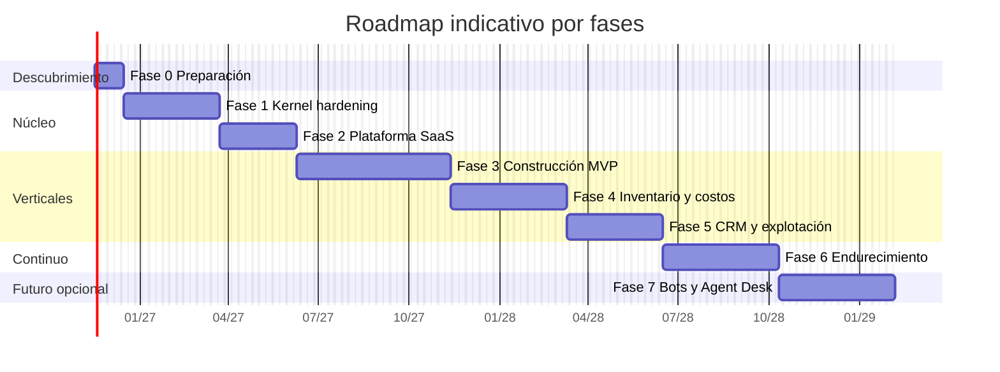
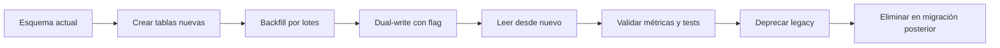

# Roadmap de implementación

> **Tipo:** plan de ejecución por fases.
> **Base:** `CURRENT_STATE.md`, `FEATURE_GAP_ANALYSIS.md`, `PROPOSED_ARCHITECTURE.md` y `DATABASE_DESIGN.md`.
> **Alcance:** llevar Kaleo de kernel administrativo a plataforma SaaS con verticales.
> **Naturaleza:** planificación. No implica cambios de código, migraciones ni compromisos de fecha.

---

## 1. Premisas

1. **No se reescribe la plataforma.** Se evoluciona el código actual con patrón strangler: lo nuevo convive con lo viejo y se corta por feature flags.
2. **Primero integridad, después funcionalidad.** Ningún vertical arranca sobre un tenant que la base no puede aislar.
3. **Construcción primero, CRM segundo.** Construcción valida profundidad; CRM valida reutilización de parties, catálogo y actividades.
4. **Inventario es capacidad compartida.** No pertenece al pack de construcción.
5. **Cada fase termina con criterios de salida verificables.** No se avanza por porcentaje de tareas, sino por evidencia.
6. **Las estimaciones son rangos de esfuerzo**, no fechas. Dependen de tamaño y seniority del equipo.

### Supuestos de estimación

| Supuesto | Valor |
|---|---|
| Equipo | 2–3 backend, 1–2 frontend, 1 QA/automatización, 1 diseño/UX parcial |
| Dedicación | Alta y estable; sin cambios de alcance a mitad de fase |
| Conocimiento | El equipo actual conoce el código |
| Infraestructura | Staging con PostgreSQL real y copia anonimizada |
| Diseño | El design system actual se mantiene |
| IA | Se integra como capacidad asistida, no como motor propio |

Si el equipo es menor, el orden de fases se mantiene y los rangos se multiplican.

---

## 2. Principios de ejecución

- **Aditivo antes que destructivo:** crear, backfill, dual-write, cortar lectura, deprecar.
- **Feature flags por módulo y por tenant:** permiten probar con design partners.
- **Migraciones pequeñas y reversibles:** una intención por migración.
- **Contratos primero:** OpenAPI y tipos antes de la UI compleja.
- **Tests de aislamiento en cada fase:** no son un entregable final.
- **Datos financieros inmutables:** versiones, snapshots y reversos desde el primer día.
- **Documentación viva:** cada fase actualiza docs y ADRs.
- **Sin microservicios, sin Redis, sin buscador externo en esta etapa.**

---

## 3. Vista general de fases

| Fase | Nombre | Resultado principal | Esfuerzo indicativo | Bloquea a |
|---|---|---|---:|---|
| 0 | Preparación | Entorno, baseline y red de seguridad | 2–3 semanas | Todas |
| 1 | Kernel hardening | Tenant, memberships, RBAC y auditoría confiables | 8–12 semanas | 2, 3, 4, 5 |
| 2 | Plataforma SaaS | Módulos, planes, entitlements y shell | 6–9 semanas | 3, 4, 5 |
| 3 | Shared + Construcción MVP | Parties, catálogo, APUs y presupuestos | 12–18 semanas | 4, 5 |
| 4 | Inventario y ejecución | Stock, compras, mano de obra y costos | 10–14 semanas | 5 |
| 5 | CRM y explotación | CRM, reportes, notificaciones e IA piloto con HITL | 8–12 semanas | 6, 7 |
| 6 | Endurecimiento y escala | Seguridad, SLOs y decisión del siguiente pack | Continuo | 7 |
| 7 | Bots & Agent Desk (futuro) | Canales, inbox, agentes, IA y HITL | 10–14 semanas | — |

**Total indicativo hasta CRM operativo:** 46–68 semanas de esfuerzo agregado, paralelizable parcialmente. Con un equipo completo y trabajo en paralelo, el calendario realista es **12–16 meses**. La fase 7 es opcional y solo se ejecuta con demanda validada y las fundaciones de IA, parties y jobs ya operativas.

**Fundaciones adelantadas:** `core.ai`, `party_identities`, inbox/outbox y las colas se preparan en las fases 2, 3 y 5. No se espera a la fase 7 para diseñarlas, pero tampoco se construye el pack antes de tiempo.

### Secuencia

```mermaid
flowchart LR
  F0["Fase 0<br/>Preparación"] --> F1["Fase 1<br/>Kernel hardening"]
  F1 --> F2["Fase 2<br/>Plataforma SaaS"]
  F2 --> F3["Fase 3<br/>Shared + Construcción MVP"]
  F3 --> F4["Fase 4<br/>Inventario y ejecución"]
  F4 --> F5["Fase 5<br/>CRM y explotación"]
  F5 --> F6["Fase 6<br/>Endurecimiento"]
  F6 -.->|demanda validada| F7["Fase 7<br/>Bots & Agent Desk"]

  F1 -.->|auditoría y sesiones| F2
  F2 -.->|registry, entitlements y core.ai| F3
  F3 -.->|parties y party_identities| F4
  F3 -.->|parties y party_identities| F5
  F4 -.->|costos y stock| F5
  F5 -.->|IA validada con HITL| F7
```

### Cronograma indicativo

> Las fechas son ilustrativas y solo sirven para visualizar el orden y la duración relativa. El diagrama muestra la secuencia principal sin paralelismo; no son compromisos.

---

## 4. Fase 0 — Preparación

**Objetivo:** crear la red de seguridad para cambiar el núcleo sin romper producción.

### Alcance

1. **Staging real**
   - PostgreSQL compatible con producción.
   - Copia anonimizada de datos.
   - Mismo modo de conexión (pooler) para detectar problemas de `SET LOCAL`.
2. **Arnés de migraciones**
   - Runner reproducible.
   - Validación forward/backward en staging.
   - Registro de migraciones aplicadas y checksum.
3. **Baseline de calidad**
   - Cobertura actual medida.
   - Lista de tests frágiles.
   - Primer test de aislamiento cross-tenant que falle contra el código actual (documenta la deuda).
4. **Feature flags**
   - Mecanismo simple por empresa y por módulo.
   - Sin dependencia externa en esta fase.
5. **Observabilidad mínima**
   - Request-id persistido en logs.
   - Dashboard de latencia y errores por endpoint.
6. **Backup y restore probados**
   - Restore completo cronometrado.
   - Plan de rollback documentado.
7. **Documentación de línea base**
   - ADRs iniciales aceptados.
   - Glosario del dominio.

### Entregables

- Entorno staging operativo.
- Runner de migraciones y guía de rollback.
- Test de aislamiento fallando (evidencia de la brecha).
- Feature flags básicos.
- Dashboard operativo mínimo.

### Criterios de salida

- [ ] Un restore completo se ejecuta y se documenta.
- [ ] Las migraciones corren en staging desde cero y sobre una copia.
- [ ] Existe al menos un test automatizado que demuestra fuga cross-tenant y queda marcado como pendiente de corregir.
- [ ] El equipo puede desplegar y revertir una migración sin ventana manual.
- [ ] Los ADRs de kernel están aprobados.

### Riesgos

| Riesgo | Mitigación |
|---|---|
| Staging no representa producción | Usar misma versión de PostgreSQL y pooler |
| Datos sensibles en staging | Anonimización y acceso restringido |
| No hay tiempo para tests base | Tratarlo como bloqueante de fase |

---

## 5. Fase 1 — Kernel hardening

**Objetivo:** que la base de datos y el backend garanticen aislamiento, membresía por empresa y trazabilidad. Es la fase más importante del roadmap.

### 5.1 Workstream A — Integridad de tenancy

1. Añadir `UNIQUE (company_id, id)` en entidades padre: `branches`, `roles`, `projects`, `parties`, `catalog_items`, etc.
2. Añadir FKs compuestas en tablas hijas.
3. Introducir `TenantContext` con `AsyncLocalStorage`.
4. Hacer que los repositorios fallen sin contexto, salvo tareas de sistema.
5. Crear rol de aplicación no privilegiado y políticas RLS.
6. `SET LOCAL app.company_id` por transacción.
7. Tests de aislamiento para lectura, escritura, update y delete.
8. Validar comportamiento con pooler en modo transaction.

### 5.2 Workstream B — Memberships e invitaciones

1. Crear `memberships`, `membership_roles`, `membership_branches`, `invitations`.
2. Backfill desde `user_contexts`.
3. Dual-write temporal.
4. Migrar lecturas y guards a memberships.
5. Estado por empresa: `invited`, `active`, `suspended`, `removed`.
6. Suspender o remover en una empresa no afecta a otras.
7. Revocación de sesiones por empresa.
8. Invitaciones por email con token hasheado, expiración y aceptación.
9. Eliminar la búsqueda global de usuarios del flujo de miembros.
10. ✅ Alcance de sede: opt-in por usuario con `membership_branches` (Owner/Admin ven todas).

### 5.3 Workstream C — RBAC v2

1. Namespace de permisos: `core.*`, `construction.*`, `crm.*`, `inventory.*`.
2. Aliases para permisos legacy.
3. Unique de nombre de rol por empresa.
4. Proteger roles del sistema y último owner.
5. Bloquear borrado de rol asignado; exigir reasignación.
6. `token_version` o invalidación de sesión al cambiar roles.
7. Retirar o implementar permisos fantasma.
8. Sembrar roles template por pack.

### 5.4 Workstream D — Auditoría y eventos

1. Auditoría transaccional para acciones críticas.
2. `outbox_events` en la misma transacción.
3. Worker de publicación con reintentos y dead-letter.
4. Añadir `request_id`, `module_code`, snapshots de actor.
5. Cambiar `company_id` a `ON DELETE RESTRICT`.
6. Particiones automáticas y retención configurable.
7. Redacción de secretos y campos sensibles.
8. Reemplazar el fire-and-forget en rutas críticas.

### 5.5 Workstream E — Sesiones y autenticación

1. Email normalizado (`citext` o unique sobre `lower(email)`).
2. Familias de refresh tokens y detección de reuso.
3. Metadata de sesión: IP, user-agent, última actividad.
4. Revocación por empresa y global.
5. Decisión e implementación de almacenamiento de tokens (ver ADR-014).
6. CSP estricta; Swagger solo en su ruta.
7. Slug de empresa único solo entre activas.
8. Tests de reuso de refresh token y de revocación.

### Entregables

- Esquema con FKs compuestas y RLS activo.
- Memberships e invitaciones operativas.
- RBAC namespaced con invalidación.
- Auditoría transaccional y outbox.
- Sesiones revocables por empresa.
- Suite de tests de aislamiento.

### Criterios de salida

- [ ] Un intento de leer o escribir datos de otra empresa falla en al menos: repositorio, FK y RLS.
- [ ] Invitar, aceptar, suspender y remover funciona por empresa sin afectar a otras.
- [ ] Cambiar el rol de un usuario invalida su sesión o actualiza permisos en menos de 60 segundos.
- [ ] Una acción crítica y su evento de outbox se confirman o revierten juntos.
- [ ] La auditoría sobrevive al borrado lógico de la empresa.
- [x] Los tests de aislamiento corren en CI contra PostgreSQL real.
- [ ] Ya no existe búsqueda global de usuarios en el flujo de miembros.

### Riesgos

| Riesgo | Mitigación |
|---|---|
| RLS rompe queries existentes | Despliegue por tablas, feature flag, monitoreo |
| Backfill de memberships inconsistente | Script idempotente, conteos y reconciliación |
| `AsyncLocalStorage` se pierde en callbacks | Tests y revisión de jobs/eventos |
| Pooler filtra contexto de sesión | `SET LOCAL` dentro de transacción y pruebas |
| Doble escritura divergente | Reconciliador y ventana corta |

---

## 6. Fase 2 — Plataforma SaaS

**Objetivo:** convertir Kaleo en una plataforma que habilita módulos, planes y límites por empresa, con navegación construida desde metadatos.

### Alcance

1. **Module registry**
   - `modules`, `module_dependencies`, `company_modules`.
   - Manifests en código.
   - Validación de dependencias y ciclos.
   - Seed de módulos core y shared.
2. **Planes y entitlements**
   - `plans`, `plan_modules`, `plan_limits`.
   - `subscriptions`, `company_entitlements`, `usage_counters`.
   - `EntitlementService` con enforcement server-side.
   - Códigos de error `402`/`403` específicos.
   - Trial y downgrade sin borrado de datos.
3. **Configuración**
   - `company_settings` tipado.
   - Config por módulo.
   - Moneda y país por empresa.
4. **Documentos y archivos**
   - Metadata, versiones, checksum, storage.
   - Links a entidades.
5. **Notificaciones**
   - In-app y email.
   - Preferencias por usuario.
6. **Jobs y outbox**
   - `pg-boss` o equivalente sobre PostgreSQL.
   - Cola de imports, exports, emails y reportes.
   - `outbox_events` transaccional y publicador de jobs.
   - Reintentos, backoff y dead-letter.
7. **`core.ai` (esqueleto)**
   - `ai_tools` sembrado desde manifests.
   - `ai_runs` y `ai_action_requests`.
   - Orquestador con `TenantContext` y `Principal`; sin tools de negocio todavía.
   - Clasificación de riesgo y flujo HITL mínimo, probado con una tool de ejemplo.
8. **API v1**
   - `/api/v1` con namespace por módulo.
   - Catálogo de códigos de error.
   - `Idempotency-Key` en POST financieros.
   - `version`/`If-Match`.
   - OpenAPI como contrato.
9. **Frontend shell**
   - Module registry en el router.
   - Sidebar desde manifests.
   - Module switcher.
   - Navegación filtrada por permiso y entitlement.
10. **Onboarding**
    - Pasos por pack.
    - Activación de módulos.
    - Invitación de equipo.

### Entregables

- Módulos habilitables por empresa.
- Planes, límites y contadores.
- Shell con navegación dinámica.
- Jobs y outbox operativos.
- `core.ai` con tool registry y HITL mínimo.
- API v1 documentada.
- Onboarding mínimo.

### Criterios de salida

- [x] Habilitar un módulo sin sus dependencias falla con un error claro.
- [x] Un límite de plan se impone en el backend aunque la UI lo ignore.
- [x] El sidebar se genera desde manifests y el router valida módulos/permisos contra ellos.
- [x] Un downgrade deja los datos en solo lectura, no los borra.
- [x] Un job de importación corre fuera del request y reporta progreso.
- [x] Un evento de outbox se publica una sola vez y tolera reintentos.
- [x] Una tool de ejemplo se ejecuta con `TenantContext` y una acción de escritura queda pendiente de aprobación humana.
- [ ] OpenAPI valida los tipos del frontend en CI.
- [ ] Los endpoints financieros aceptan idempotencia y concurrencia optimista.

### Riesgos

| Riesgo | Mitigación |
|---|---|
| Explosión de manifests y permisos | Namespace y revisión de contratos |
| Límites inconsistentes | Contadores recalculables y tests |
| Acoplar shell a módulos | Shell solo consume metadata |
| Jobs duplicados | Idempotencia por `event_id` |
| API v1 rompe clientes | Alias legacy y ventana de deprecación |

---

## 7. Fase 3 — Shared foundations + Construcción MVP

**Objetivo:** entregar el primer vertical profundo sobre capacidades compartidas reales.

### 7.1 Shared foundations

1. `parties`, `party_roles`, `party_contacts`, `party_addresses`.
2. `party_identities` para email, teléfono y canales externos; unique `(company_id, kind, normalized_value)`.
3. `units_of_measure` y conversiones.
4. `tax_rates`, `currencies`.
5. `catalog_items`, `item_categories`, `price_lists`, `item_prices`.
6. Búsqueda y deduplicación de parties por `tax_id`, email y teléfono.
7. API y UI de maestros, con la party como ficha única.

> `party_identities` se crea aquí porque depende de `parties`. La ingesta de bots la consumirá en la fase 7; CRM y Construcción pueden usarla antes para evitar duplicados.
>
> Estado: `shared.parties`, roles, identidades, contactos y direcciones ya están
> implementados (migración `054`). Quedan unidades, impuestos, monedas y catálogo
> para completar 7.1.

### 7.2 Construcción

1. **Proyectos**
   - `projects`, `project_members`.
   - Cliente desde parties.
   - Estado, moneda, fechas, ubicación.
2. **Recursos de estimación**
   - `resources` con cinco tipos: material, mano de obra, equipo, transporte, subcontrato.
   - `resource_prices` con vigencia y proveedor.
   - Vínculo opcional a `catalog_items`.
3. **APUs**
   - `apus`, `apu_versions`, `apu_lines`.
   - Rendimiento, unidad de salida, desperdicio.
   - Indirectos, utilidad e impuestos configurables.
   - Snapshot de costo al aprobar.
   - Sub-APUs con control de ciclos.
4. **Memoria de cantidades**
   - `takeoff_sheets`, `takeoff_lines`.
   - Fórmulas y dimensiones.
5. **Presupuestos**
   - `budgets`, `budget_items`, `budget_approvals`.
   - WBS por capítulos.
   - Ítems con APU o precio manual.
   - Versiones y aprobación inmutable.
   - Totales y moneda.
6. **Import/export**
   - Excel de APUs, recursos y presupuestos.
   - Validación, vista previa y confirmación.
   - Errores por fila.
7. **UI**
   - Grid editable tipo hoja de cálculo.
   - Árbol WBS.
   - Editor de APU con panel de insumos y total en vivo.
   - Comparador de versiones.
   - Wizard de importación.
8. **Cálculos**
   - Tests dorados con casos reales.
   - Redondeo y moneda definidos.
   - Snapshot reproducible.

### Entregables

- Maestros compartidos operativos.
- Proyectos, APUs y presupuestos funcionales.
- Import/export Excel.
- UI de estimación.
- Tests de cálculo y aislamiento.

### Criterios de salida

- [ ] Un APU aprobado es reproducible: mismos insumos, precios y versión producen el mismo costo.
- [ ] Editar un APU aprobado crea una nueva versión; no sobrescribe.
- [ ] Un presupuesto aprobado es inmutable y conserva los snapshots usados.
- [ ] Importar un Excel inválido no deja datos parciales.
- [ ] Un ítem de presupuesto no puede referenciar un APU de otra empresa.
- [ ] El total del presupuesto coincide con la suma de ítems y pruebas doradas.
- [ ] Un design partner completa un presupuesto real de principio a fin.

### Riesgos

| Riesgo | Mitigación |
|---|---|
| Fórmulas ambiguas | Definirlas con negocio y tests dorados |
| Importaciones sucias | Validación estricta y staging de filas |
| Explosión de sub-APUs | Límite de profundidad y detección de ciclos |
| UI tipo spreadsheet subestimada | Prototipo temprano y componente dedicado |
| Datos de precios históricos | Vigencias y snapshots |

---

## 8. Fase 4 — Inventario, compras y ejecución

**Objetivo:** conectar el presupuesto con la realidad de obra: stock, compras, mano de obra y costos.

### Alcance

1. **Inventario**
   - `warehouses` por empresa/sede/proyecto.
   - `stock_movements` append-only.
   - `stock_balances` con locks.
   - Transferencias y ajustes.
   - Conteos físicos.
   - Valoración promedio al inicio; FIFO evaluable después.
2. **Compras**
   - `purchase_orders`, líneas.
   - `goods_receipts`, líneas.
   - Imputación opcional a proyecto.
   - Recepción alimenta stock y costo comprometido/real.
3. **Mano de obra**
   - `labor_contracts` por destajo, hora o fijo.
   - `production_records` con aprobación.
   - Cálculo de pagos por producción aprobada.
4. **Costos**
   - `cost_entries` append-only.
   - Comprometido vs. real.
   - Reversos, no updates.
   - Unique por origen para evitar doble posteo.
   - Variaciones por proyecto e ítem.
5. **Programación simple**
   - Actividades, fechas, avance.
   - Dependencias básicas.
   - Gantt de lectura.
6. **Reportes operativos**
   - Presupuesto vs. costo.
   - Stock y mínimos.
   - Compras pendientes.
   - Producción y pagos.
7. **UI**
   - Movimientos de almacén.
   - Órdenes y recepciones.
   - Partes de producción.
   - Dashboard de costos.

### Entregables

- Inventario con ledger y saldos.
- Compras y recepciones.
- Contratos y producción.
- Costos comprometidos y reales.
- Reportes operativos.

### Criterios de salida

- [ ] Ningún movimiento deja stock negativo sin configuración explícita.
- [ ] Una recepción genera stock y costo exactamente una vez.
- [ ] Un reverso corrige el costo sin borrar el original.
- [ ] El costo comprometido y el real se concilian con compras y producción.
- [ ] Dos recepciones concurrentes no duplican stock.
- [ ] El reporte presupuesto vs. real cuadra con los asientos de costo.
- [ ] Un project manager puede operar una semana de obra sin Excel paralelo.

### Riesgos

| Riesgo | Mitigación |
|---|---|
| Doble posteo de costos | Unique por origen e idempotencia |
| Stock negativo | Locks, checks y alertas |
| Valoración inconsistente | Un solo método por empresa al inicio |
| Producción no aprobada | Workflow y permisos |
| Reportes lentos | Índices y jobs de agregación |

---

## 9. Fase 5 — CRM y explotación

**Objetivo:** validar la reutilización con un segundo vertical y agregar la capa de explotación: reportes, notificaciones e IA asistida.

### 9.1 CRM

1. `pipelines`, `pipeline_stages`.
2. `deals`, `deal_stage_history`.
3. `quotes`, `quote_lines` con catálogo.
4. `activities`, `activity_links`.
5. Pipeline kanban y vista lista.
6. Conversión de quote a proyecto de construcción.
7. Reportes de pipeline y conversión.

### 9.2 Reporting

1. `saved_reports`, `report_runs`.
2. Reportes por módulo.
3. Exportación y programación.
4. Permisos por reporte.
5. Snapshot para reportes financieros.

### 9.3 Notificaciones y colaboración

1. In-app, email y preferencias.
2. Comentarios y menciones por entidad.
3. Alertas de stock, costos y vencimientos.

### 9.4 IA piloto

1. Orquestador con `TenantContext` y permisos.
2. Tools de solo lectura primero: consultar presupuesto, costos, stock, deals.
3. Tools de escritura con confirmación: borrador de presupuesto, cotización de CRM.
4. Clasificación `read` / `conversational` / `business_write` / `external`.
5. `ai_action_requests` con aprobación, rechazo y expiración; idempotencia en la ejecución.
6. Auditoría de solicitud, decisión y resultado; sin auditar cada mensaje conversacional.
7. Límite de créditos por plan.
8. Evaluación de precisión y costo; decisión documentada sobre si bots es viable.

> Esta fase valida `core.ai` y el flujo HITL **antes** de abrir canales reales. Si la IA no es confiable en CRM, no se construye el pack de bots.

### Criterios de salida

- [ ] CRM usa parties y catálogo sin duplicar tablas.
- [ ] Una cotización aceptada puede originar un proyecto sin reingreso manual.
- [ ] Los reportes respetan permisos y tenant.
- [ ] La IA no puede leer datos de otra empresa ni ejecutar una escritura sin confirmación.
- [ ] Toda acción de IA queda auditada.
- [ ] El costo de IA por tenant es medible y limitable.

### Riesgos

| Riesgo | Mitigación |
|---|---|
| CRM genérico sin foco | Pipeline mínimo y vínculo con construcción |
| Reportes ad hoc infinitos | Catálogo acotado y saved reports |
| IA con fugas | Tools con tenant, permisos y tests |
| Costos de IA | Créditos y límites por plan |
| Scope creep | Congelar alcance de fase |

---

## 10. Fase 6 — Endurecimiento y escala

**Objetivo:** preparar la plataforma para escala comercial y decidir el siguiente pack con evidencia.

### Alcance

1. **Rendimiento**
   - Pruebas de carga en APUs, presupuestos, stock y reportes.
   - Optimización de queries e índices.
   - Cache de catálogos y permisos si los datos lo justifican.
2. **Seguridad**
   - Pen test.
   - Revisión de dependencias.
   - CSP, cookies y rotación de secretos.
   - Simulación de incidentes y restore.
3. **Calidad**
   - E2E de flujos críticos.
   - Accesibilidad WCAG de componentes nuevos.
   - i18n progresivo.
4. **Operación**
   - SLOs, alertas y runbooks.
   - Métricas de negocio por tenant.
   - Soporte y onboarding escalables.
5. **Integraciones**
   - API keys y webhooks.
   - Exportación contable.
   - Integraciones solicitadas por clientes.
6. **Decisión del siguiente pack**
   - Bots si hay demanda de atención conversacional y la IA piloto es confiable.
   - Comercio si hay demanda de ventas/stock.
   - Energía si hay demanda comercial real.
   - Ninguno si la prioridad es profundizar construcción y CRM.

### Criterios de salida

- [ ] Se cumplen los SLOs definidos en carga.
- [ ] No hay hallazgos críticos abiertos de pen test.
- [ ] Restore e incidente simulados dentro del RTO/RPO.
- [ ] Los flujos E2E críticos corren en CI.
- [ ] La decisión del siguiente pack está documentada con evidencia comercial.
- [ ] La IA piloto tiene métricas de precisión, costo y incidentes; HITL funciona sin excepciones.

---

## 11. Fase 7 — Bots & Agent Desk (futura)

**Objetivo:** habilitar atención conversacional multicanal con bots y agentes humanos sobre las capacidades ya construidas, sin acoplar el kernel al pack.

**Prerrequisitos:** fase 5 cerrada con `core.ai` y HITL validados; `party_identities` operativo; jobs/outbox con métricas; entitlements y RLS probados.

### Alcance

1. **Manifest y registro**
   - `bots.manifest.ts` con permisos, entitlements, webhooks, tools y colas.
   - Seed de `modules`, `permissions`, `ai_tools` y límites de plan.
   - `company_modules` y guards de enablement.
2. **Canales**
   - `bot_channels` con `credential_ref` al gestor de secretos.
   - Webhook firmado por canal; `202 Accepted`.
   - WhatsApp, Telegram, web y webhook genérico; email después.
3. **Ingesta asíncrona**
   - `bot_webhook_events` como inbox idempotente.
   - `outbox_events` + `pg-boss` para `bots.ingest`.
   - Normalización, resolución de party y persistencia de mensajes.
4. **Conversaciones y Agent Desk**
   - `bot_conversations`, `bot_messages`, `bot_conversation_events`.
   - Bandeja, filtros, asignación con `version`, handoff y cierre.
   - SSE o polling con cursor; sin requests largos.
5. **Bot builder**
   - `bot_agents`, `bot_agent_versions`, `bot_agent_version_tools`.
   - Prompt, modelo, tools y modo (`suggest`, `auto_reply`, `human_only`).
   - Sandbox de prueba y activación auditada.
6. **IA y HITL**
   - `core.ai` con principal del bot o del humano.
   - Tools de lectura y conversacionales; escritura solo con `ai_action_requests`.
   - Aprobación con `bots.actions.approve` + permiso destino.
   - Idempotencia, expiración y auditoría completa.
7. **Límites y operación**
   - Mensajes, créditos, canales, agentes y almacenamiento por plan.
   - Backpressure, rate limit, dead-letter y alertas.
   - Métricas: lag, entrega, contención, handoff, CSAT y costo.
8. **Frontend**
   - Bandeja, contexto de party, tarjetas HITL, bot builder y analytics.
   - Accesibilidad y permisos en UI; enforcement en backend.

### Entregables

- Pack `bots` habilitable por empresa.
- Webhook idempotente y procesamiento asíncrono.
- Contactos unificados en `parties`.
- Bandeja de agentes y bot builder versionado.
- Flujo HITL auditado.
- Límites y métricas operativas.

### Criterios de salida

- [ ] Un webhook firmado responde `202` y se procesa fuera del request.
- [ ] Un evento duplicado no duplica conversación ni mensaje.
- [ ] Todo contacto externo queda en `parties` con identidad de canal.
- [ ] CRM y Construcción ven la misma party y su historial autorizado.
- [ ] Una ráfaga de mensajes no bloquea el API ni pierde eventos.
- [ ] La IA no lee datos de otra empresa ni ejecuta escrituras sin aprobación.
- [ ] Toda acción de negocio aprobada queda auditada y es idempotente.
- [ ] Los límites de mensajes/créditos se imponen en servidor.
- [ ] Dead-letter, reintentos y alertas funcionan.
- [ ] Pruebas de carga, seguridad y cross-tenant pasan.
- [ ] El pack se puede deshabilitar sin borrar parties ni datos de otros módulos.

### Riesgos

| Riesgo | Mitigación |
|---|---|
| Ráfagas de webhooks | Inbox rápida, backpressure y workers escalables |
| Duplicados de contacto | `party_identities` unique + upsert idempotente |
| Prompt injection | Allowlist de tools, HITL, sanitización y pruebas |
| Fuga cross-tenant | TenantContext, RLS, validación de jobs y tests |
| Costo de IA | Créditos, límites, modelos económicos y cache |
| Compliance de WhatsApp | Ventanas de 24 h, templates y revisión legal |
| Acoplamiento a CRM/Construcción | Tool contracts y dependencias opcionales |
| PII en logs o prompts | Redacción, retención y prohibición de cuerpos completos |

---

## 12. Workstreams transversales

| Workstream | Fase 0 | Fase 1 | Fase 2 | Fase 3 | Fase 4 | Fase 5 | Fase 6 | Fase 7 |
|---|---|---|---|---|---|---|---|---|
| Migraciones | Runner | Tenancy/memberships | Módulos/planes, core.ai | Shared/construcción, party_identities | Stock/costos | CRM/IA | Optimización | Bots |
| Testing | Baseline | Aislamiento | Entitlements | Cálculos dorados | Concurrencia | E2E/HITL | Carga/pen test | Webhooks/carga |
| Seguridad | Staging | Tokens/RLS | API/errores | Importaciones | Stock | IA | Auditoría externa | Firma/HITL |
| Frontend | Flags | Memberships | Registry/shell | Grid/WBS | Operación | CRM/reportes | Accesibilidad | Agent Desk |
| Docs | ADRs | Tenancy/RBAC | Módulos/API | Construcción | Inventario | CRM/IA | Runbooks | Bots |
| Observabilidad | Dashboard | Auditoría | Jobs/usage | Cálculos | Costos | IA | SLOs | Colas/entrega |

---

## 13. Hitos de release

| Hito | Contenido | Audiencia | Criterio |
|---|---|---|---|
| **R0 — Baseline** | Staging, migraciones, flags | Equipo | Fase 0 cerrada |
| **R1 — Kernel seguro** | Tenancy, memberships, RBAC, auditoría | Interna | Fase 1 cerrada |
| **R2 — Plataforma** | Módulos, planes, shell, jobs | Design partners | Fase 2 cerrada |
| **R3 — Construcción MVP** | APUs y presupuestos | 1–3 design partners | Fase 3 cerrada |
| **R4 — Ejecución** | Stock, compras, costos | Design partners | Fase 4 cerrada |
| **R5 — CRM** | CRM + reportes + IA piloto con HITL | Design partners | Fase 5 cerrada |
| **R6 — General availability** | Escala, seguridad, soporte | Mercado | Fase 6 cerrada |
| **R7 — Bots (opcional)** | Canales, Agent Desk, IA y HITL | Clientes con demanda | Fase 7 cerrada |

**Regla:** ningún hito se libera con hallazgos P0 abiertos.

---

## 14. Estrategia de migración y convivencia

- Cada cambio de modelo sigue este ciclo.
- `user_contexts` se mantiene como vista o tabla legacy hasta completar el corte.
- Los permisos legacy tienen aliases durante la transición.
- La API actual se mantiene con alias hasta que los clientes migren.
- Los módulos nuevos se encienden por empresa.
- Un cambio irreversible requiere backup y ventana explícita.

---

## 15. Definición de terminado

### Por historia

- Criterios de aceptación cumplidos.
- Tests unitarios y de integración.
- Test de aislamiento si toca datos de negocio.
- Permiso y entitlement declarados.
- Auditoría si es acción crítica.
- OpenAPI actualizado.
- UI con estados vacío, carga y error.
- Documentación y ADR si cambia una decisión.
- Si procesa eventos externos: idempotencia y prueba de duplicado.
- Si usa IA: clasificación de riesgo, HITL cuando corresponde y auditoría.

### Por módulo

- Manifest completo.
- Dependencias declaradas.
- Migraciones reversibles.
- Seeds y roles template.
- Reporte o vista operativa.
- Métricas de uso.
- Runbook de soporte.
- Si es un pack: independencia verificada por test de arquitectura.
- Si expone webhooks: firma, replay window y respuesta `202`.
- Si propone acciones de IA: aprobación humana, expiración e idempotencia.

### Por fase

- Criterios de salida verificados.
- Sin P0/P1 abiertos del alcance.
- Demo con design partner.
- Retrospectiva y ajuste del roadmap.

---

## 16. Métricas de éxito

| Dimensión | Métrica | Objetivo inicial |
|---|---|---|
| Aislamiento | Tests cross-tenant que fallan | 0 |
| Seguridad | Hallazgos críticos abiertos | 0 |
| Calidad | Cobertura de cálculos financieros | > 90 % |
| Operación | Errores 5xx por request | < 0.5 % |
| Rendimiento | p95 de listados | < 500 ms |
| Rendimiento | p95 de cálculo de presupuesto | < 2 s |
| Producto | Tiempo a primer presupuesto | < 1 día |
| Producto | Adopción de APUs por empresa activa | > 60 % |
| Confiabilidad | Jobs fallidos sin reintento | 0 |
| Bots (fase 7) | Webhook p95 | < 200 ms |
| Bots (fase 7) | Lag de ingesta p95 | < 5 s |
| Bots (fase 7) | Entrega exitosa | > 99 % |
| Bots (fase 7) | Acciones de IA sin aprobación | 0 |
| Negocio | Design partners activos | 3 |
| Negocio | Retención a 90 días | > 70 % |

---

## 17. Riesgos del roadmap

| Riesgo | Probabilidad | Impacto | Mitigación |
|---|---|---|---|
| Subestimar kernel hardening | Alta | Alto | No paralelizar verticales antes de R1 |
| Scope creep en construcción | Alta | Alto | Congelar MVP y priorizar APUs/presupuestos |
| Datos sucios de Excel | Alta | Medio | Importación con staging y validación |
| Baja adopción por UX compleja | Media | Alto | Design partners y prototipos tempranos |
| Costos de IA | Media | Medio | Créditos y límites |
| Deuda de frontend | Media | Medio | Registry y componentes compartidos |
| Falta de QA dedicado | Media | Alto | Automatización desde Fase 0 |
| Presión comercial por fechas | Alta | Alto | Hitos por evidencia, no por calendario |
| Dependencia de una sola persona | Media | Alto | Documentación y pair work |
| Construir bots antes de validar IA | Media | Alto | Fase 7 solo después de R5/R6 |
| Acoplar bots al kernel | Media | Alto | Manifest, `core.ai` genérico y test de arquitectura |
| Ráfagas de webhooks | Media | Alto | Inbox/outbox, backpressure y carga |
| Duplicar contactos | Media | Medio | `party_identities` unique y merge auditado |

---

## 18. Qué no hacer en este roadmap

- No construir CRM y construcción en paralelo antes de R2.
- No introducir microservicios.
- No reescribir el frontend.
- No implementar nómina completa ni contabilidad general.
- No construir BIM/IFC, marketplace ni app nativa.
- No usar JSONB para APUs, presupuestos, stock o costos.
- No habilitar IA de escritura sin auditoría y confirmación.
- No construir el pack de bots antes de validar `core.ai` y HITL con CRM.
- No procesar webhooks de bots dentro del request.
- No crear tablas de contactos propias del pack; usar `parties`.
- No lanzar a mercado sin pen test y restore probado.

---

## 19. Primeros dos sprints recomendados

### Sprint 1

1. Completar staging y restore.
2. Añadir tests de aislamiento que reproduzcan las fugas P0.
3. Diseñar y aprobar el esquema de memberships e invitaciones.
4. Implementar `TenantContext` y hacer fallar repositorios sin contexto.
5. Definir el catálogo de permisos namespaced y aliases.

### Sprint 2

1. Crear tablas de memberships e invitaciones.
2. Iniciar backfill desde `user_contexts`.
3. Añadir `UNIQUE (company_id, id)` a padres prioritarios.
4. Implementar auditoría transaccional en una ruta crítica como piloto.
5. Configurar RLS en una tabla piloto con rol no privilegiado.
6. Medir y documentar resultados antes de extender.

---

## 20. Resumen

El camino correcto no es agregar pantallas, sino **asegurar el núcleo y luego construir profundidad vertical**:

1. Preparar el entorno y la red de seguridad.
2. Cerrar las brechas P0 de tenancy, memberships, RBAC y auditoría.
3. Convertir Kaleo en plataforma con módulos, planes y shell.
4. Entregar construcción con APUs y presupuestos reproducibles.
5. Conectar ejecución: stock, compras, mano de obra y costos.
6. Validar reutilización con CRM, reportes e IA asistida con HITL.
7. Endurecer, medir y decidir el siguiente vertical con evidencia.
8. Si hay demanda, construir Bots & Agent Desk como pack independiente sobre `core.ai`, `core.jobs` y `shared.parties`.

Las fundaciones se preparan desde temprano; el pack se construye al final. Esa es la diferencia entre escalar sin romper la arquitectura y agregar un módulo que acople todo el kernel.

Las justificaciones de cada decisión están en `TECHNICAL_DECISIONS.md`. El modelo de datos está en `DATABASE_DESIGN.md`. La arquitectura objetivo está en `PROPOSED_ARCHITECTURE.md`. El diseño del pack está en `BOTS_PACK_DESIGN.md`.
