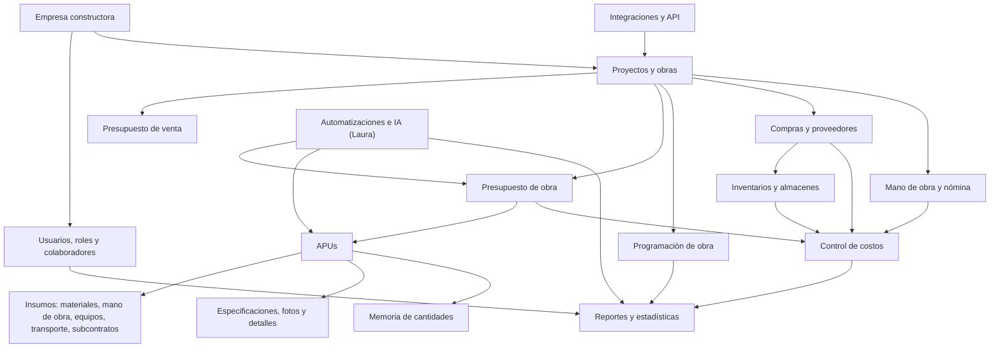

# Análisis funcional de metroKUBIKO

> **Tipo:** análisis de referente funcional, no de implementación.
> **Fecha de consulta:** 9 de noviembre de 2026.
> **Fuentes:** páginas públicas de metroKUBIKO y su blog.
> **Límite:** no se accedió a la plataforma privada, a su API ni a su base de datos.

---

## 1. Objetivo y método

Este documento estudia metroKUBIKO como **referente funcional** para el pack de construcción de Kaleo. No pretende copiar su código, su diseño ni afirmar cómo está construido internamente.

Se consultaron las siguientes páginas:

- `https://www.metrokubiko.com/es/`
- `https://www.metrokubiko.com/apus`
- `https://www.metrokubiko.com/analisis-de-precios-unitarios`
- `https://www.metrokubiko.com/presupuestos-de-obras`
- `https://www.metrokubiko.com/programacion-de-obras`
- `https://www.metrokubiko.com/laura-agente-ia-construccion`
- `https://www.metrokubiko.com/es/precios`

### Niveles de evidencia

| Nivel | Definición |
|---|---|
| **Verificado públicamente** | La empresa lo afirma en su web. No se verificó su funcionamiento real. |
| **Inferido** | Se deduce del discurso comercial o de la lógica del sector. |
| **Desconocido** | No hay información pública suficiente. No se debe asumir. |

> **Advertencia:** todo lo que sigue describe el **modelo funcional comunicado**, no la arquitectura interna de metroKUBIKO.

---

## 2. Resumen del referente

metroKUBIKO es un software colombiano para empresas constructoras, 100 % online, orientado a la gestión de obras, presupuestos, APUs, programación, inventarios, mano de obra, costos y colaboración. Se presenta como una plataforma fácil de usar, con IA y con un modelo freemium/trial.

Su propuesta de valor se apoya en:

- **APUs** como núcleo del presupuesto.
- **Colaboración** entre equipos, colaboradores externos y proveedores.
- **Datos en tiempo real** para control de obra.
- **IA** aplicada a presupuestos, cotizaciones, importación y reportes.
- **Onboarding rápido** y capacitación.
- **Integraciones** con otras herramientas.

---

## 3. Ecosistema funcional

**Lectura:** el proyecto/obra es el eje. El presupuesto se construye con APUs; los APUs consumen insumos; la ejecución alimenta compras, inventario, mano de obra y costos; los reportes consolidan todo. La IA y las integraciones son capas transversales.

---

## 4. Capacidades comunicadas

### 4.1 Empresas y usuarios

**Verificado públicamente:**

- Plataforma para empresas constructoras.
- Colaboración entre equipos y colaboradores externos.
- Control de acceso por permisos.
- Datos centralizados y accesibles desde cualquier dispositivo con internet.

**Inferido:**

- Cada empresa tiene un espacio de trabajo con usuarios y roles.
- Los roles probablemente distinguen administración, presupuesto, obra y consulta.

**Desconocido:**

- Si un usuario puede pertenecer a varias empresas.
- Si existen roles por proyecto, sede o solo por empresa.
- Límites de usuarios por plan.
- Si hay SSO, 2FA o auditoría detallada.

### 4.2 Proyectos y obras

**Verificado públicamente:**

- Gestión de proyectos de construcción.
- Control y seguimiento de avances.
- Programación de obras.
- Alertas y notificaciones.
- Reportes en tiempo real.

**Inferido:**

- El proyecto contiene presupuesto, cronograma, compras, inventario y costos.
- El avance se registra por actividad o por cantidad ejecutada.

**Desconocido:**

- Estructura de obra, capítulos, fases y WBS.
- Si soporta múltiples obras por empresa y múltiples empresas por usuario.
- Si maneja contratos, adendas y cambios de alcance.

### 4.3 Presupuestos

**Verificado públicamente:**

- Presupuestos de obra.
- Presupuesto de venta para contratistas y constructores.
- Generación de presupuestos con IA.
- Reportes y exportación a Excel/PDF.

**Inferido:**

- Presupuesto = conjunto de ítems, cantidades, precios unitarios y totales.
- Los ítems pueden agruparse por capítulos/WBS.
- Debe existir alguna forma de versión o aprobación, aunque no se detalla.

**Desconocido:**

- Versionado, snapshots, aprobaciones y control de cambios.
- Si el presupuesto de venta y el de obra son entidades separadas.
- Cómo maneja impuestos, descuentos, indirectos y utilidad.

### 4.4 APUs

**Verificado públicamente:**

- APUs con cinco categorías de insumos: **equipos, materiales, mano de obra, transportes y subcontratos**.
- Edición tipo hoja de cálculo.
- Múltiples bases de APUs.
- Rendimientos.
- Especificaciones técnicas, fotografías y detalles constructivos.
- Memoria de cantidades.
- Actualización de precios en tiempo real.
- Búsqueda y reutilización de APUs.

**Inferido:**

- Cada APU tiene una unidad de salida, un rendimiento y líneas de insumo.
- El costo unitario se calcula con cantidades, precios y desperdicios.
- Los APUs pueden copiarse entre proyectos y actualizarse por precios.

**Desconocido:**

- Fórmula exacta de rendimiento, desperdicio, indirectos y redondeo.
- Si los APUs se versionan o se sobrescriben.
- Si el precio del insumo se congela al aprobar el presupuesto.
- Si soporta sub-APUs anidados.

### 4.5 Catálogo de insumos y materiales

**Verificado públicamente:**

- Base de datos de materiales, herramientas, equipos, insumos de mano de obra, transportes y subcontratos.
- Actualización de precios.
- Búsqueda de insumos.

**Inferido:**

- Catálogo maestro por empresa, con unidades, precios y proveedores.
- Historial de precios o al menos precio vigente.

**Desconocido:**

- Si el catálogo es global, por empresa o por proyecto.
- Si maneja múltiples monedas, impuestos, mermas o conversiones de unidad.
- Si hay integración con precios de proveedores.

### 4.6 Proveedores

**Verificado públicamente:**

- Gestión de proveedores.
- Colaboración con proveedores.
- Cotización de materiales con IA.

**Inferido:**

- Proveedor = entidad con datos fiscales, contactos y precios.
- Los precios de proveedor alimentan el catálogo y las compras.

**Desconocido:**

- Si hay portal de proveedores.
- Si se comparan cotizaciones.
- Si hay órdenes de compra, recepciones y facturas.

### 4.7 Contratistas y trabajadores

**Verificado públicamente:**

- Contratos de mano de obra por destajo.
- Gestión de nómina.
- Colaboración con contratistas.

**Inferido:**

- Contratistas y trabajadores se asignan a proyectos o actividades.
- El destajo se calcula por cantidad ejecutada y tarifa.
- La nómina se liquida por período.

**Desconocido:**

- Tipos de contrato, prestaciones, seguridad social y legislación aplicable.
- Si la nómina es completa o solo registro de pagos.
- Si hay aprobación de producción y control de avances.

### 4.8 Inventarios y almacenes

**Verificado públicamente:**

- Gestión de inventarios.
- Control logístico.
- Materiales disponibles para la obra.

**Inferido:**

- Almacenes por empresa o proyecto.
- Movimientos de entrada, salida, transferencia y ajuste.
- Consumo de materiales contra el presupuesto.

**Desconocido:**

- Valoración FIFO, promedio o última compra.
- Stock negativo, reservas, lotes o series.
- Inventario por obra vs. inventario central.

### 4.9 Mano de obra y nómina

**Verificado públicamente:**

- Contratos por destajo.
- Nómina.
- Control de costos de mano de obra.

**Inferido:**

- Producción registrada por contratista/trabajador.
- Costo real de mano de obra comparado con presupuesto.

**Desconocido:**

- Nómina electrónica, prestaciones, parafiscales y cumplimiento normativo.
- Si integra con sistemas contables.

### 4.10 Control de costos

**Verificado públicamente:**

- Gerencia y control de costos.
- Reportes en tiempo real.
- Comparación presupuesto vs. ejecución.

**Inferido:**

- Costo comprometido por compras y contratos.
- Costo real por recepciones, consumo y producción.
- Variaciones por proyecto y por ítem.

**Desconocido:**

- Modelo exacto de costo comprometido vs. real.
- Si hay centros de costo, imputación y prorrateo.
- Cómo maneja cambios de alcance y adicionales.

### 4.11 Programación

**Verificado públicamente:**

- Programación de obras.
- Planificación de recursos y etapas.
- Seguimiento de avances.

**Inferido:**

- Actividades con fechas, duración, dependencias y avance.
- Posible Gantt y ruta crítica.

**Desconocido:**

- Si es CPM real, cronograma simple o hitos.
- Si maneja calendarios, turnos, festivos y recursos.
- Si tiene línea base y reprogramación.

### 4.12 Reportes y estadísticas

**Verificado públicamente:**

- Reportes en tiempo real.
- Exportación a Excel y PDF.
- Informes personalizados.
- Alertas y notificaciones.

**Inferido:**

- Reportes de presupuesto, APU, avance, costos, inventario y mano de obra.
- Dashboards por proyecto y por empresa.

**Desconocido:**

- Constructor de reportes, reportes programados y permisos por reporte.
- Si hay BI embebido o solo reportes predefinidos.

### 4.13 Colaboración

**Verificado públicamente:**

- Trabajo colaborativo y simultáneo.
- Colaboradores externos y proveedores.
- Permisos.

**Inferido:**

- Comentarios, menciones y actividad por entidad.
- Roles diferenciados para internos y externos.

**Desconocido:**

- Edición concurrente en tiempo real.
- Notificaciones, menciones y flujos de aprobación.

### 4.14 Roles, permisos y trazabilidad

**Verificado públicamente:**

- Control de acceso por permisos.
- Acciones de IA auditables.
- Datos centralizados y seguros.

**Inferido:**

- RBAC por empresa, posiblemente con permisos por módulo.
- Auditoría de cambios y acciones de usuario.

**Desconocido:**

- Granularidad exacta, scope por proyecto/sede, auditoría antes/después, retención.
- Si hay logs de acceso y exportación.

### 4.15 Automatizaciones e IA

**Verificado públicamente:**

- Agente “Laura” integrado.
- Crea presupuestos, cotiza materiales, importa datos y responde preguntas.
- Registra avances, genera reportes y gestiona documentos.
- Ejecuta tareas operativas dentro de la plataforma.
- Acciones auditables y permisos.

**Inferido:**

- La IA usa herramientas internas conectadas a los módulos.
- Requiere contexto del proyecto y permisos del usuario.
- Puede generar borradores y ejecutar acciones con confirmación.

**Desconocido:**

- Nivel real de autonomía, modelo usado, costos, latencia y precisión.
- Si escribe directamente o propone cambios.
- Cómo evita fugas entre empresas.
- Si entrena con datos del cliente.

### 4.16 Integraciones y API

**Verificado públicamente:**

- API flexible.
- Integración con otras plataformas de gestión.
- Sincronización de datos.

**Inferido:**

- API REST y/o webhooks.
- Integraciones contables, de compras o de productividad.

**Desconocido:**

- Catálogo real de integraciones, autenticación, rate limits, webhooks, sandbox y documentación pública.

---

## 5. Modelo de negocio observado

**Verificado públicamente:**

- Freemium/trial de 3 meses sin tarjeta.
- Registro inmediato.
- Página de precios sin tarifas públicas; invita a contactar.
- Capacitaciones sin costo y contenido educativo.
- Marca enfocada en facilidad de uso y adopción.

**Inferido:**

- Planes por usuarios, proyectos o módulos.
- Ventas asistidas para planes empresariales.
- El contenido educativo y el trial son parte de la estrategia de adquisición.

**Desconocido:**

- Precios, límites y condiciones reales.
- Si el freemium incluye IA o módulos avanzados.
- Contratos, SLA y soporte.

---

## 6. Lecciones para Kaleo

### Adoptar como concepto

1. **Profundidad vertical antes que amplitud.** metroKUBIKO no vende “todo para todos”; vende construcción y resuelve APUs, presupuestos, obra y costos con profundidad.
2. **APU como corazón del producto.** La composición de insumos, rendimientos y precios es el diferencial, no un formulario secundario.
3. **Cinco categorías de insumos.** Material, mano de obra, equipo, transporte y subcontrato cubren el costo real de una actividad.
4. **Experiencia tipo hoja de cálculo.** El sector viene de Excel; la transición debe ser familiar, no un formulario rígido.
5. **Memoria de cantidades y documentación técnica.** El APU no es solo precio: incluye especificaciones, fotos y detalles.
6. **Proyecto como eje.** Presupuesto, compras, inventario, mano de obra y costos deben converger en el proyecto.
7. **Colaboración con permisos.** Constructora, residente, supervisor, comprador, proveedor y cliente necesitan vistas distintas.
8. **Import/export Excel.** Es un requisito de adopción, no un extra.
9. **IA con herramientas y confirmación.** La IA debe aumentar la productividad, no ser un chatbot decorativo.
10. **Onboarding y contenido.** El trial y la capacitación reducen la fricción del sector.

### No copiar

1. **El marketing como arquitectura.** “100 % online”, “IA” y “fácil” no definen un modelo de datos.
2. **La autonomía total de la IA.** Sin permisos, auditoría y confirmación, es un riesgo.
3. **El almacenamiento tipo spreadsheet como modelo.** Kaleo debe usar tablas relacionales y versiones.
4. **Nómina/contabilidad completas antes del núcleo.** Primero APUs, presupuestos y costos.
5. **Integraciones antes de un núcleo confiable.**
6. **Una pantalla monolítica de proyecto.** Mejor módulos con fronteras claras.
7. **Suponer multitenancy, roles o límites que no están documentados.**

---

## 7. Implicaciones para el platform-first de Kaleo

metroKUBIKO valida la decisión de Kaleo de ser una plataforma con verticales, pero **no valida construir todos los verticales a la vez**.

- El pack **Construcción** debe ser el primer vertical profundo: proyectos, APUs, presupuestos, compras, inventario, mano de obra y costos.
- El pack **CRM** debe ser el segundo vertical para validar la reutilización de `parties`, `catalog`, `activities` y `reporting`.
- **Inventario** debe ser una capacidad compartida, no un silo del pack de construcción.
- **APU** no debe compartirse con CRM; es vocabulario de construcción.
- **Parties** debe unificar clientes, proveedores, contactistas y trabajadores para evitar duplicación entre verticales.
- **Catálogo** debe unificar productos/servicios vendibles y materiales comprables; los recursos de mano de obra/equipo del APU son otra cosa.

---

## 8. Preguntas abiertas que no se pueden responder sin acceso privado

1. ¿Cómo modela metroKUBIKO APUs, presupuestos e inventarios?
2. ¿Soporta múltiples empresas por usuario y aislamiento multi-tenant?
3. ¿Qué roles y permisos existen exactamente?
4. ¿Cómo versiona presupuestos y APUs?
5. ¿Cómo calcula costos comprometidos vs. reales?
6. ¿Qué integraciones tiene y con qué profundidad?
7. ¿Cómo evita que Laura acceda a datos de otra empresa?
8. ¿Qué límites y precios tienen los planes?
9. ¿Qué SLA, backups, seguridad y residencia de datos ofrece?
10. ¿Cómo maneja impuestos, monedas y normativa colombiana?

Estas preguntas deben resolverse con discovery de usuarios y, si es posible, con una cuenta de prueba, no por inferencia.
