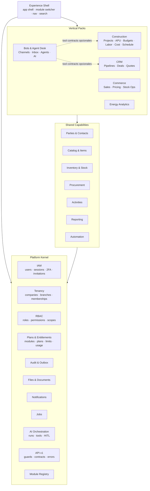
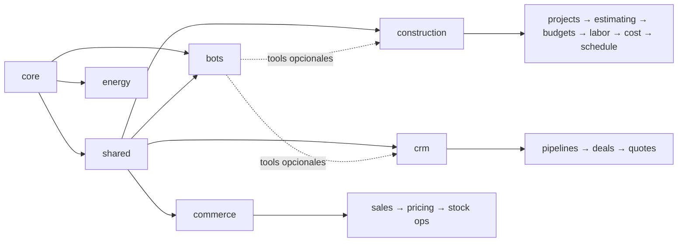
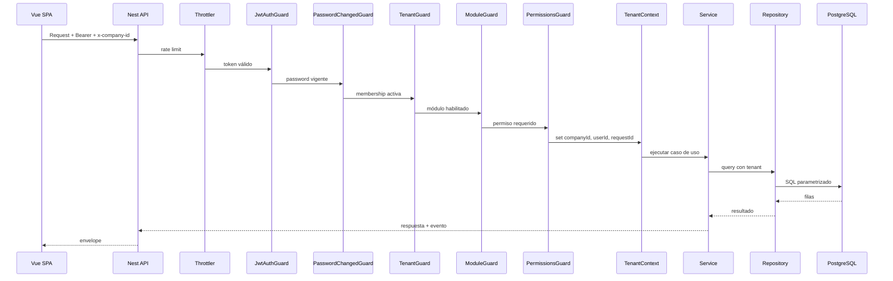
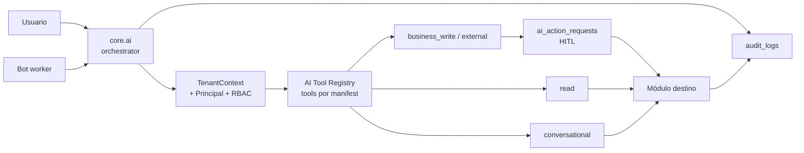
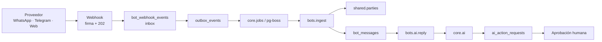

# Arquitectura propuesta

> **Tipo:** propuesta de arquitectura objetivo.
> **Alcance:** plataforma Kaleo con kernel, capacidades compartidas y packs verticales.
> **Base:** estado actual (`CURRENT_STATE.md`), brechas (`FEATURE_GAP_ANALYSIS.md`) y referente (`METROKUBIKO_ANALYSIS.md`).
> **Principio rector:** monolito modular, multi-tenant, contracts-first y migración incremental.

---

## 1. Objetivos y no objetivos

### Objetivos

1. Soportar varios verticales (construcción, CRM, inventario/comercio, energía) sobre un kernel común.
2. Aislar datos por empresa de forma verificable.
3. Permitir planes, módulos y límites por tenant.
4. Reutilizar identidad, permisos, auditoría, archivos, notificaciones y reportes.
5. Mantener el stack actual: NestJS, PostgreSQL/Supabase, Vue 3, Pinia, Vite.
6. Evolucionar sin reescribir el frontend ni romper la identidad visual.
7. Preparar el camino para jobs, integraciones e IA con permisos.

### No objetivos

- Microservicios en esta etapa.
- Una base de datos por tenant.
- Un ERP contable completo.
- Un motor de IA propio.
- Edición colaborativa en tiempo real tipo spreadsheet.
- Aplicación móvil nativa.
- Multi-región o white-label antes de validar dos verticales.

---

## 2. Principios de arquitectura

1. **El kernel no conoce verticales.** No hay “APU”, “deal” ni “stock” en el kernel.
2. **Cada módulo es dueño de sus tablas.** No se permite acceso directo a repositorios de otro módulo.
3. **Comunicación por contratos o eventos.** Servicios públicos, IDs y outbox; nunca SQL cruzado.
4. **Una capacidad compartida nace con dos consumidores reales.** Parties, catálogo e inventario los tienen; otras esperan.
5. **Tenant context explícito y fail-closed.** Toda query de negocio exige `company_id`.
6. **Dinero y cantidades exactos.** `numeric`, moneda y redondeo definidos.
7. **Documentos financieros inmutables.** Versiones, snapshots y reversos; no updates destructivos.
8. **Auditoría y eventos transaccionales.** La trazabilidad no se delega a un fire-and-forget.
9. **Entitlements en servidor.** La UI oculta, el backend impone.
10. **Migración incremental.** Se preserva la identidad visual y tecnológica.

---

## 3. Capas de la plataforma



### Reglas de dependencia

- Kernel → no depende de shared ni de packs. `core.*` nunca importa `modules/*`.
- Shared → depende solo de kernel. `shared.*` nunca conoce packs.
- Packs → dependen de kernel y shared; nunca de otro pack por import directo.
- Un pack puede declarar **dependencias opcionales** de capacidad (`optionalDependsOn`) y consumir tools de otro pack solo a través de `core.ai` o de un contrato público registrado; no accede a sus tablas ni repositorios.
- `bots` es el primer pack que usa este mecanismo: depende de `core.ai` y `shared.parties`, y opcionalmente de tools de `crm` y `construction.*`.
- Experience Shell → consume manifests; no contiene lógica de negocio.
- Un pack puede declarar dependencias de módulos shared, pero no importar sus tablas.

---

## 4. Catálogo de módulos

### Kernel

| Código | Responsabilidad |
|---|---|
| `core.iam` | Usuarios, sesiones, 2FA, passwords, invitaciones |
| `core.tenancy` | Empresas, sedes, memberships |
| `core.rbac` | Roles, permisos, scopes, role templates |
| `core.billing` | Planes, suscripciones, entitlements, usage |
| `core.audit` | Auditoría, outbox, retención |
| `core.files` | Documentos, versiones, storage |
| `core.notifications` | In-app, email, preferencias |
| `core.jobs` | Colas, reintentos, dead-letter |
| `core.ai` | Orquestador de IA, tool registry, `ai_runs`, HITL y auditoría |
| `core.api` | API keys, webhooks, contratos |
| `core.modules` | Registry, dependencias, enable/disable |

### Shared

| Código | Responsabilidad |
|---|---|
| `shared.parties` | Personas/organizaciones, roles, contactos, direcciones e identidades de canal |
| `shared.catalog` | Items, categorías, unidades, impuestos, precios |
| `shared.inventory` | Almacenes, movimientos, saldos, valoración |
| `shared.procurement` | Órdenes de compra, recepciones, facturas |
| `shared.documents` | Documentos y links polimórficos |
| `shared.activities` | Llamadas, reuniones, tareas, notas |
| `shared.reporting` | Reportes guardados, ejecuciones, exportaciones |
| `shared.automation` | Triggers, condiciones, acciones (futuro) |

### Packs

| Código | Responsabilidad |
|---|---|
| `construction.projects` | Proyectos, miembros, ubicaciones |
| `construction.estimating` | Recursos, APUs, takeoffs |
| `construction.budgets` | Presupuestos, WBS, aprobaciones |
| `construction.labor` | Contratistas, contratos, producción |
| `construction.cost` | Comprometido, real, variaciones |
| `construction.schedule` | Actividades, dependencias, avance |
| `crm` | Pipelines, deals, quotes, forecast |
| `commerce` | Ventas, precios, operaciones de stock |
| `energy` | Análisis, dashboards, ingesta |
| `bots` | Canales, inbox, bot builder, atención de agentes y respuestas con IA |

### Dependencias



**Reglas de enablement:**

- `construction.estimating` requiere `construction.projects` y `shared.catalog`.
- `construction.budgets` requiere `construction.estimating`.
- `construction.cost` requiere `construction.budgets` y `shared.procurement`/`shared.inventory`.
- `crm` requiere `shared.parties`.
- `commerce` requiere `shared.catalog` y `shared.inventory`.
- `energy` requiere `core.files` y `shared.reporting`.
- `bots` requiere `core.ai`, `core.jobs`, `core.audit`, `shared.parties` y `shared.documents`; opcionalmente `crm` y `construction.projects` para tools de escritura.
- `core.ai` no requiere ningún pack; las tools se registran desde los manifests habilitados.

---

## 5. Backend: monolito modular

### 5.1 Estructura objetivo

```text
backend/src/
├── kernel/
│   ├── iam/
│   ├── tenancy/
│   ├── rbac/
│   ├── billing/
│   ├── audit/
│   ├── files/
│   ├── notifications/
│   ├── jobs/
│   ├── ai/
│   ├── modules/
│   └── api/
├── shared/
│   ├── parties/
│   ├── catalog/
│   ├── inventory/
│   ├── procurement/
│   ├── documents/
│   ├── activities/
│   └── reporting/
├── modules/
│   ├── construction/
│   │   ├── projects/
│   │   ├── estimating/
│   │   ├── budgets/
│   │   ├── labor/
│   │   ├── cost/
│   │   └── schedule/
│   ├── crm/
│   ├── commerce/
│   ├── energy/
│   └── bots/
│       ├── channels/
│       ├── conversations/
│       ├── agents/
│       ├── inbox/
│       └── webhooks/
└── common/
```

Cada módulo contiene:

```text
<module>/
├── <module>.module.ts
├── <module>.controller.ts
├── <module>.service.ts
├── dto/
├── repositories/
├── domain/
├── events/
├── <module>.manifest.ts
└── <module>.spec.ts
```

### 5.2 Module manifest

Cada módulo declara en código:

```ts
export interface ModuleManifest {
  code: string;                 // "construction.estimating" | "bots"
  name: string;
  version: string;
  vertical: 'construction' | 'crm' | 'commerce' | 'energy' | 'bots' | null;
  dependsOn: string[];          // ["construction.projects", "shared.catalog"]
  optionalDependsOn?: string[]; // capacidades opcionales, sin import de código
  permissions: PermissionDefinition[];
  routes: RouteDefinition[];    // metadata para el shell
  entitlements: EntitlementDefinition[];
  webhooks?: WebhookDefinition[];
  aiTools?: AiToolDefinition[];
  jobQueues?: JobQueueDefinition[];
  onboarding?: OnboardingStep[];
  featureFlags?: string[];
}

export interface AiToolDefinition {
  code: string;                 // "crm.quotes.create"
  moduleCode: string;
  risk: 'read' | 'conversational' | 'business_write' | 'external';
  requiresConfirmation: boolean;
  permission: string;
}

export interface WebhookDefinition {
  code: string;
  path: string;
  auth: 'signature' | 'api_key';
  idempotency: 'provider_event_id' | 'header';
}

export interface JobQueueDefinition {
  name: string;
  concurrency: number;
  retryLimit: number;
  singletonKey?: string;
}
```

El manifest es la fuente de verdad para:

- Registrar el módulo.
- Validar dependencias al habilitarlo.
- Sembrar permisos y tools.
- Construir la navegación.
- Definir límites de plan.
- Declarar webhooks y colas.
- Documentar el módulo.

### 5.3 Reglas de código

- Los controladores no acceden a `DataSource` directamente.
- Los servicios de un módulo no importan repositorios de otro.
- Las consultas cross-module se hacen por servicio público o proyección de lectura.
- Los packs nunca importan código de otro pack; las acciones cross-pack se exponen como tools o contratos públicos.
- `kernel/` y `shared/` no importan `modules/*`; un test de arquitectura lo verifica.
- Los eventos de dominio se publican vía outbox, no dentro del request.
- Los repositorios reciben `TenantContext` y lo aplican.
- No hay SQL concatenado con input de usuario; solo parámetros.

---

## 6. Flujo de un request



**Orden fail-closed:** autenticación → contraseña → tenant → módulo → permiso. Si falta cualquier paso, se rechaza.

---

## 7. Multi-tenancy

### 7.1 Modelo

- Base compartida, esquema compartido.
- `company_id` en toda tabla de negocio.
- FKs compuestas para impedir referencias cross-tenant.
- RLS como segunda capa, con rol no privilegiado.
- `TenantContext` por request/transacción.

### 7.2 Reglas

1. `company_id NOT NULL` en tablas de negocio.
2. `UNIQUE (company_id, id)` en entidades padre.
3. FKs compuestas: `(company_id, project_id) REFERENCES projects(company_id, id)`.
4. `TenantContext` se establece en el guard y se propaga por `AsyncLocalStorage`.
5. Los repositorios fallan si no hay contexto, salvo tareas de sistema explícitas.
6. RLS: `SET LOCAL app.company_id` dentro de la transacción; nunca a nivel de sesión con pooler.
7. Jobs y AI deben establecer contexto de tenant antes de consultar.
8. Tests de aislamiento: intentar leer/escribir con IDs de otra empresa debe fallar.

### 7.3 Usuarios y memberships

- `users` es global.
- `memberships` relaciona usuario y empresa, con estado.
- `membership_roles` permite múltiples roles.
- `membership_branches` define acceso por sede si se habilita.
- Un usuario puede estar activo en una empresa y suspendido en otra.
- Las sesiones pueden revocarse por empresa.

---

## 8. RBAC y permisos

### 8.1 Namespace

```text
core.users.read
core.users.invite
core.roles.update
construction.projects.read
construction.apu.create
construction.budgets.approve
crm.deals.update
inventory.stock.adjust
```

### 8.2 Reglas

- Los permisos existentes se migran con aliases para no romper roles.
- Cada permiso pertenece a un módulo.
- Los roles pueden combinar permisos de varios módulos.
- `Owner` es inmutable y protegido.
- El último owner no puede eliminarse ni degradarse.
- Un rol asignado no puede borrarse sin reasignación.
- Los permisos sensibles se validan contra BD o `token_version`, no solo contra el JWT.
- Los roles template por pack se copian a la empresa al habilitar el módulo.

### 8.3 Scopes

| Scope | Uso |
|---|---|
| `company` | Administración general |
| `branch` | Sede/almacén |
| `project` | Residente, supervisor, colaborador externo |
| `self` | Perfil propio |

El scope se evalúa en el servicio, no solo en el guard.

---

## 9. Planes, módulos y entitlements

### 9.1 Entidades

- `modules`: catálogo de módulos.
- `module_dependencies`: dependencias.
- `company_modules`: módulos habilitados por empresa.
- `plans`: planes comerciales.
- `plan_modules`: módulos incluidos.
- `plan_limits`: límites por módulo/feature.
- `subscriptions`: estado comercial.
- `company_entitlements`: overrides.
- `usage_counters`: consumo por período.

### 9.2 Enforcement

```text
Request → ModuleGuard → EntitlementService.check(company, feature, delta)
        → si pasa, ejecuta
        → si falla, 402/403 con código de negocio
```

- Los límites se validan en el servidor.
- La UI oculta módulos no habilitados, pero no es la autoridad.
- Los límites pueden ser duros o blandos.
- Un downgrade no borra datos: read-only o archivo según política.
- Los contadores se recalculan periódicamente para evitar drift.

### 9.3 Ejemplos de límites

| Feature | Tipo |
|---|---|
| `max_users` | Cantidad |
| `max_projects` | Cantidad |
| `max_apus` | Cantidad |
| `storage_mb` | Almacenamiento |
| `ai_credits_month` | Consumo mensual |
| `bots.messages_month` | Consumo mensual |
| `bots.ai_credits_month` | Consumo mensual |
| `bots.concurrent_conversations` | Gauge |
| `bots.channels` | Cantidad |
| `bots.agents` | Cantidad |
| `api_access` | Booleano |
| `advanced_reports` | Booleano |

---

## 10. Auditoría, outbox y jobs

### 10.1 Auditoría

- Acciones críticas se auditan en la misma transacción.
- Se guarda actor, empresa, entidad, before/after, request-id, IP y user-agent.
- Se redactan secretos y datos sensibles.
- `audit_logs` es append-only.
- Particiones automáticas y retención configurable.
- Borrar una empresa no borra su auditoría; se archiva o se restringe.

### 10.2 Outbox

- Los eventos de dominio se escriben en `outbox_events` dentro de la transacción.
- Un worker los publica a jobs, notificaciones, webhooks o AI.
- Reintentos con backoff y dead-letter.
- Idempotencia por `event_id`.
- La ingesta de bots usa **inbox + outbox**: el webhook persiste el evento y responde `202`; el outbox encola el procesamiento. El API nunca espera a la IA.
- Acciones de IA con escritura generan `ai_action_requests`; la aprobación humana y la ejecución también pasan por la misma trazabilidad.

### 10.3 Jobs

- `pg-boss` o equivalente sobre PostgreSQL; no introducir Redis en esta etapa.
- Usos: importaciones Excel, exportaciones grandes, reportes, emails, sincronización, AI y canales de bots.
- Cada job declara tenant, usuario, módulo y permisos.
- Las colas de bots usan singleton por conversación para preservar orden y evitar respuestas duplicadas.
- Backpressure: si la cola supera el umbral, el webhook responde `429`/`503` y el proveedor reintenta; no se descarta el evento.

---

## 11. API y contratos

### 11.1 Versionado y namespace

```text
/api/v1/core/users
/api/v1/construction/projects
/api/v1/construction/apus
/api/v1/crm/deals
/api/v1/inventory/items
/api/v1/bots/conversations
/api/v1/bots/webhooks/:channelKey
```

- Los endpoints actuales se mantienen como legacy/alias durante la transición.
- El header `x-company-id` se mantiene para la API interna.
- La API pública usa API keys con scopes y company-scoped paths.
- Los webhooks de bots no usan JWT: se autentican con firma HMAC, timestamp y ventana anti-replay; resuelven el tenant por `channelKey`.

### 11.2 Envelope

```json
{
  "success": true,
  "data": {},
  "meta": { "requestId": "...", "page": 1, "limit": 20, "total": 100 }
}
```

```json
{
  "success": false,
  "error": {
    "code": "CONSTRUCTION_APU_NOT_FOUND",
    "message": "El APU no existe",
    "details": {},
    "requestId": "..."
  }
}
```

### 11.3 Reglas

- `Idempotency-Key` en POST financieros.
- `version`/`If-Match` en agregados editables.
- Paginación offset para listados; cursor para auditoría/actividad.
- Límite máximo de página y exportación.
- OpenAPI como fuente de tipos para el frontend.
- Deprecación con ventana y headers.

---

## 12. Frontend

### 12.1 Estructura

```text
frontend/src/
├── app/
│   ├── shell/
│   ├── module-registry.ts
│   └── navigation.ts
├── kernel/
│   ├── auth/
│   ├── companies/
│   ├── members/
│   ├── roles/
│   └── audit/
├── shared/
│   ├── parties/
│   ├── catalog/
│   ├── inventory/
│   └── ui/
├── modules/
│   ├── construction/
│   ├── crm/
│   ├── commerce/
│   ├── energy/
│   └── bots/
│       ├── inbox/
│       ├── agents/
│       ├── channels/
│       └── actions/
└── components/ui/
```

### 12.2 Module registry

- Cada módulo exporta rutas, navegación, permisos, entitlement y onboarding.
- El router agrega rutas de módulos habilitados.
- El sidebar se construye desde el registry, no a mano.
- El module switcher cambia de vertical sin recargar la sesión.
- La navegación se filtra por permiso y entitlement.

### 12.3 Estado

- Pinia para sesión, tenant, UI y preferencias.
- Stores de listado con `createPaginatedStore`.
- Evaluar Vue Query solo para estado servidor complejo; no migrar todo de golpe.
- Servicios por módulo, sin imports cruzados.
- Tipos generados desde OpenAPI; permisos desde `packages/shared`.

### 12.4 Componentes nuevos

| Componente | Uso |
|---|---|
| Grid editable | APUs, presupuestos, takeoff |
| Árbol WBS | Capítulos e ítems |
| Gantt | Programación |
| Wizard de importación | Excel de APUs/presupuestos |
| Visor de documentos | Fotos, planos, especificaciones |
| Command palette | Búsqueda global y acciones |
| Module switcher | Cambio de vertical |
| Data grid con columnas configurables | Todos los módulos |
| Bandeja de conversaciones | Agent Desk de bots |
| Visor de conversación y contexto de party | Atención de agentes |
| Tarjeta de aprobación HITL | Acciones de IA que requieren confirmación |
| Editor de versiones de bot | Prompt, modelo y tools |
| Sandbox de bot | Pruebas antes de activar |

### 12.5 UX

- Un shell, varios módulos.
- Navegación agrupada por vertical, no una lista plana.
- Onboarding por pack.
- Estados vacíos con acción.
- Formularios densos pero accesibles.
- Responsive para campo (tablet) en construcción.
- i18n progresivo; español primero.

---

## 13. IA y automatización

### 13.1 Principios

- La IA es transversal y vive en **`core.ai`**, no dentro de un vertical.
- Cada tool declara módulo, permiso, tenant y riesgo (`read`, `conversational`, `business_write`, `external`).
- El orquestador inyecta `TenantContext` y un `Principal` de mínimo privilegio; no hay autoridad ambiental.
- Las lecturas respetan permisos del usuario o del rol de servicio del bot.
- Las escrituras de negocio requieren confirmación humana (HITL) y se auditan.
- Las respuestas conversacionales se autorizan según el modo del agente y se registran; no son mutaciones de negocio.
- No se entrena con datos del cliente sin consentimiento.

### 13.2 Arquitectura



### 13.3 Casos de uso iniciales

- Consultar presupuesto y costos de un proyecto.
- Explicar variaciones.
- Buscar APUs y recursos.
- Resumir un deal de CRM.
- Detectar stock bajo.
- Generar un borrador de presupuesto a partir de una plantilla.
- Importar un Excel con validación y confirmación.

---

## 14. Seguridad

- Tokens: access en memoria y refresh en cookie `httpOnly` si el dominio es same-site; si no, CSP estricta y evaluación de BFF.
- CSP configurada por entorno; Swagger solo en rutas de docs.
- Rate limit global y por tenant/usuario.
- Validación de DTOs y sanitización.
- Secretos en el gestor del host, nunca en el repo.
- Cifrado en tránsito y en reposo (Supabase).
- RLS con rol no privilegiado.
- Auditoría de accesos y exportaciones.
- Revisión de dependencias en CI.
- Pen test antes de comercializar datos financieros.

---

## 15. Observabilidad y operación

- Request-id en logs, auditoría y errores.
- Logs estructurados con tenant, usuario y módulo.
- Métricas: latencia, errores, pool, jobs, colas, uso por tenant.
- Dashboards y alertas.
- Health checks.
- Sentry con release y entorno.
- Runbooks para incidentes, backups y restauración.
- SLOs antes de escalar.

---

## 16. Testing

| Nivel | Qué cubre |
|---|---|
| Unitario | Cálculos, validadores, servicios |
| Integración | Repositorios con PostgreSQL real |
| Tenant isolation | Intentos cross-tenant |
| Contrato | OpenAPI vs frontend |
| E2E | Flujos críticos por pack |
| Carga | APUs, presupuestos, stock, reportes, ráfagas de webhooks |
| HITL | Propuesta, aprobación, rechazo y expiración de acciones de IA |
| Migraciones | Forward/backward y backfill |

**Regla:** un módulo no se considera terminado sin tests de aislamiento y de sus reglas de negocio críticas.

---

## 17. Evolución desde el código actual

| Actual | Objetivo |
|---|---|
| `user_contexts` | `memberships` + `membership_roles` |
| Permisos `module:action` | Namespace `core.*`, `construction.*`, etc. |
| Router/sidebar manuales | Module registry |
| `analyses` energía | `modules/energy` aislado |
| Auditoría fire-and-forget | Auditoría transaccional/outbox |
| Sin planes | `core.billing` |
| Sin módulos | `core.modules` + `company_modules` |
| Sin parties/catálogo | `shared.parties`, `shared.catalog` |
| Sin inventario | `shared.inventory` |
| Sin jobs | `core.jobs` |
| Sin bots/canales | `modules/bots` + `core.ai` + `shared.parties.party_identities` |

La migración se detalla en `IMPLEMENTATION_ROADMAP.md` y `DATABASE_DESIGN.md`.

---

## 18. Pack de Bots y atención de agentes

> Diseño detallado: **`BOTS_PACK_DESIGN.md`**. Esta sección resume las reglas que afectan a la arquitectura general.

### 18.1 Naturaleza y registro

- `bots` es un **vertical pack**, no parte de `core.*`.
- Se registra con `bots.manifest.ts` y declara:
  - permisos `bots.*`;
  - límites `bots.messages_month`, `bots.ai_credits_month`, `bots.concurrent_conversations`, `bots.channels`, `bots.agents` y `bots.storage_mb`;
  - dependencias `core.ai`, `core.jobs`, `core.audit`, `shared.parties` y `shared.documents`;
  - dependencias opcionales `crm` y `construction.projects` solo para tools.
- El kernel no importa `bots` ni tiene FKs hacia tablas `bot_*`.
- `core.ai` guarda `ai_runs` y `ai_action_requests` con referencias genéricas; desconoce el dominio de bots.

### 18.2 Ingesta asíncrona



- El endpoint de webhook solo verifica firma, resuelve el canal y persiste inbox + outbox; responde `202`.
- `pg-boss` procesa ingestión, IA, entrega y acciones con reintentos y dead-letter.
- La IA nunca se ejecuta dentro del request del webhook.
- Las colas usan singleton por conversación para preservar orden y evitar duplicados.
- Si la cola se satura, se aplica backpressure y el proveedor reintenta; no se descarta el evento.

### 18.3 Contactos en shared.parties

- Toda identidad externa se resuelve contra `parties` mediante `party_identities`.
- `bot_conversations.party_id` y `bot_messages.sender_party_id` referencian `parties`.
- No existe una tabla `bot_contacts` ni una base de contactos paralela.
- CRM y Construcción reutilizan la misma party y acceden al historial por servicio público, no por SQL cruzado.

### 18.4 IA y HITL

- `core.ai` inyecta `TenantContext` y un `Principal` con el rol del agente o del humano.
- Las tools se clasifican en `read`, `conversational`, `business_write` y `external`.
- `business_write` y `external` crean `ai_action_requests` en estado `pending_confirmation`.
- Un humano con `bots.actions.approve` **y** el permiso del módulo destino aprueba o rechaza.
- La IA no puede aprobar su propia acción; la propuesta expira y no se ejecuta sola.
- La ejecución usa idempotencia y genera `audit_logs` para solicitud, decisión y resultado.
- Las respuestas conversacionales se registran en `bot_messages` y se vinculan a `ai_runs`; no se audita cada mensaje individual.

### 18.5 Límites

- El inbound se acepta y almacena aunque se alcance la cuota; se desactivan IA y respuestas salientes.
- Los límites de canales, agentes y almacenamiento bloquean la creación de recursos.
- Los contadores son idempotentes y se reconcilian contra las tablas de mensajes, runs y webhooks.

---

## 19. Decisiones resumidas

| Tema | Decisión |
|---|---|
| Estilo | Monolito modular |
| Tenancy | Base compartida + `company_id` + FKs compuestas + RLS |
| Identidad | Usuarios globales + memberships |
| Módulos | Registry + manifests + entitlements |
| Verticales | Packs independientes sobre shared |
| Dinero | `numeric` + moneda + impuestos |
| APUs/presupuestos | Versiones y snapshots |
| Auditoría | Transaccional + outbox |
| API | `/api/v1` + namespace por módulo |
| Frontend | Module registry + design system |
| IA | `core.ai` + tools con permisos + HITL + auditoría |
| Bots | Vertical pack `bots` sobre `core.ai`, `core.jobs` y `shared.parties` |
| Contactos | `parties` + `party_identities`; sin tablas duplicadas por canal |
| Ingesta | Inbox + outbox + pg-boss; webhook responde `202` |
| Jobs | Outbox + pg-boss |
| Documentación | ADRs y docs-as-code |

Las justificaciones completas están en `TECHNICAL_DECISIONS.md`.
