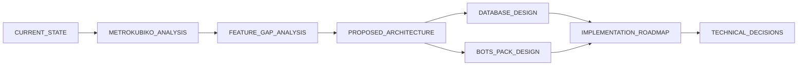
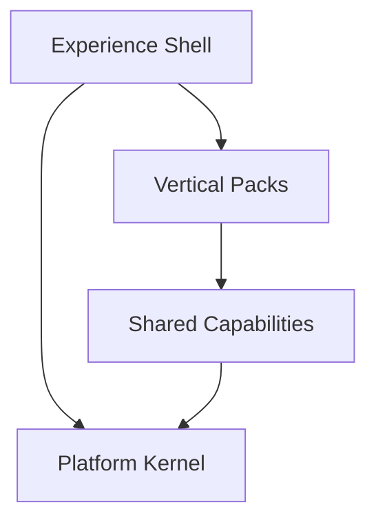

# Arquitectura de Kaleo

> Documentación de evolución de Kaleo hacia una plataforma SaaS multi-vertical.
> **Fecha de corte:** 10 de noviembre de 2026.
> **Estado:** propuesta de arquitectura; no implementada.

---

## 1. Propósito

Esta carpeta reúne el diagnóstico, la referencia funcional, las brechas, la arquitectura objetivo, el diseño de datos, el roadmap y las decisiones técnicas para convertir Kaleo en una plataforma con:

- **Platform Kernel**: identidad, tenancy, RBAC, planes, auditoría, archivos, jobs e IA.
- **Shared Capabilities**: parties, catálogo, inventario, compras, reportes.
- **Vertical Packs**: construcción, CRM, comercio, energía y bots.
- **Experience Shell**: un solo frontend con módulos habilitables.

La conclusión central es que Kaleo **no necesita reescribirse**: necesita endurecer su kernel, ordenar sus capacidades compartidas y construir profundidad vertical en ese orden.

---

## 2. Documentos

| Documento | Contenido | Cuándo leerlo |
|---|---|---|
| [`CURRENT_STATE.md`](./CURRENT_STATE.md) | Auditoría técnica del código y la base actual, hallazgos P0/P1/P2 y madurez | Primero |
| [`METROKUBIKO_ANALYSIS.md`](./METROKUBIKO_ANALYSIS.md) | Análisis funcional del referente público, con niveles de evidencia | Para entender el modelo de negocio |
| [`FEATURE_GAP_ANALYSIS.md`](./FEATURE_GAP_ANALYSIS.md) | Matriz de brechas por kernel, shared y packs | Para priorizar |
| [`PROPOSED_ARCHITECTURE.md`](./PROPOSED_ARCHITECTURE.md) | Arquitectura objetivo, módulos, flujos, API, frontend e IA | Para diseñar |
| [`DATABASE_DESIGN.md`](./DATABASE_DESIGN.md) | ERD, diccionario de tablas, constraints, RLS y migración | Para modelar datos |
| [`BOTS_PACK_DESIGN.md`](./BOTS_PACK_DESIGN.md) | Diseño del pack de bots: manifest, canales, inbox, parties, IA y HITL | Para preparar el vertical futuro |
| [`IMPLEMENTATION_ROADMAP.md`](./IMPLEMENTATION_ROADMAP.md) | Fases, entregables, criterios de salida, riesgos y estimaciones | Para ejecutar |
| [`TECHNICAL_DECISIONS.md`](./TECHNICAL_DECISIONS.md) | ADRs con contexto, decisión, alternativas y consecuencias | Para justificar |

### Orden de lectura recomendado

Para una lectura ejecutiva: `CURRENT_STATE` → `FEATURE_GAP_ANALYSIS` → `IMPLEMENTATION_ROADMAP`.

Para una lectura técnica: `PROPOSED_ARCHITECTURE` → `DATABASE_DESIGN` → `TECHNICAL_DECISIONS`.

---

## 3. Resumen de la propuesta

| Capa | Ejemplos |
|---|---|
| Kernel | IAM, tenancy, RBAC, billing, audit, files, jobs, `core.ai` |
| Shared | Parties, catalog, inventory, procurement, reporting |
| Packs | Construction, CRM, commerce, energy, bots |
| Shell | Navegación, module switcher, búsqueda, onboarding |

**Secuencia de construcción:** kernel → shared → construcción → inventario/ejecución → CRM → endurecimiento → bots (si hay demanda).

El pack de bots no se construye al inicio: se preparan sus fundaciones (`core.ai`, `party_identities`, outbox/colas, entitlements) y se activa cuando la IA con HITL ya está validada en CRM.

---

## 4. Hallazgos que motivan el cambio

| ID | Hallazgo | Documento |
|---|---|---|
| P0-1 | Búsqueda global de usuarios filtra PII entre tenants | `CURRENT_STATE.md` |
| P0-2 | Sedes no aplicadas como frontera de acceso | `CURRENT_STATE.md` |
| P0-3 | Inactivación y remoción global de miembros | `CURRENT_STATE.md` |
| P0-4 | La base no garantiza aislamiento tenant | `CURRENT_STATE.md` |
| P0-5 | Auditoría no transaccional y eliminada en cascada | `CURRENT_STATE.md` |
| P0-6 | `analyses` JSONB no sirve para APUs ni presupuestos | `CURRENT_STATE.md` |

Estos hallazgos son la razón por la que el roadmap **no empieza con pantallas nuevas**.

---

## 5. Convenciones de la documentación

### Niveles de evidencia

| Nivel | Significado |
|---|---|
| **Verificado en código** | Se leyó el archivo o la definición SQL |
| **Verificado en backup** | Se observó la estructura o los datos del dump |
| **Verificado públicamente** | La empresa lo afirma en su web; no se probó el producto |
| **Inferido** | Se deduce del comportamiento o del discurso |
| **Desconocido** | No hay información suficiente; no se asume |

### Términos

| Término | Definición |
|---|---|
| **Tenant** | Empresa (`companies`) que posee los datos |
| **Membership** | Pertenencia de un usuario a una empresa, con estado y roles |
| **Kernel** | Núcleo técnico reutilizable, sin lógica de vertical |
| **Shared capability** | Capacidad usada por dos o más packs |
| **Vertical pack** | Módulo de negocio específico (construcción, CRM, bots, etc.) |
| **APU** | Análisis de precio unitario de una actividad de construcción |
| **Entitlement** | Derecho de una empresa a usar una feature según su plan |
| **Snapshot** | Copia inmutable de precios o datos usada por un documento |
| **Ledger** | Registro append-only de movimientos |
| **Party identity** | Canal verificable de una party: email, teléfono, WhatsApp, Telegram, web |
| **Inbox** | Tabla que registra un evento externo una sola vez antes de procesarlo |
| **Outbox** | Evento de dominio escrito en la misma transacción para publicarse después |
| **HITL** | Human-in-the-loop: una persona aprueba una acción antes de que se ejecute |
| **Agent Desk** | Bandeja donde agentes humanos atienden conversaciones asistidas por IA |
| **`core.ai`** | Orquestador genérico de IA del kernel: tools, runs y aprobaciones |

### Reglas de escritura

- Documentación en español; nombres de archivo en inglés.
- Diagramas en Mermaid. GitHub y la mayoría de visores Markdown los renderizan; VitePress requiere un plugin de Mermaid, que no se instala en esta fase de documentación.
- Las decisiones se registran como ADR y no se reescriben: se reemplazan.
- Las estimaciones son rangos de esfuerzo, no compromisos de fecha.
- No se afirma arquitectura interna de terceros.

---

## 6. Alcance y límites

### Incluido

- Diagnóstico del repositorio y del backup.
- Referente funcional público de metroKUBIKO.
- Arquitectura objetivo y modelo de datos.
- Roadmap por fases y ADRs.

### Excluido

- Implementación de código.
- Ejecución de migraciones.
- Instalación de dependencias.
- Cambios de configuración.
- Acceso a la plataforma privada de metroKUBIKO.
- Pruebas de carga, penetración o producción.

---

## 7. Principios que no se negocian

1. El tenant se garantiza en la base, no solo en el código.
2. La identidad es global; la pertenencia es por empresa.
3. Los módulos se declaran con manifests, no se improvisan.
4. El dinero es exacto, versionado y auditable.
5. La auditoría es transaccional.
6. La IA no escribe sin permisos, confirmación y auditoría.
7. Inventario es compartido, no un silo de construcción.
8. APUs y presupuestos son relacionales, no JSONB opaco.
9. La migración es incremental y con evidencia.
10. No se construye un vertical nuevo sobre un kernel inseguro.
11. `parties` es la única fuente de contactos; los canales solo agregan identidades.
12. Los webhooks de canales se procesan por inbox + outbox, nunca dentro del request.
13. `core.*` no depende de ningún pack; `bots` se registra por manifest.
14. Una acción de IA que escribe en el negocio requiere aprobación humana y auditoría.

---

## 8. Estado de los entregables

| Entregable | Estado |
|---|---|
| Auditoría de estado actual | Completo |
| Análisis del referente | Completo |
| Matriz de brechas | Completo |
| Arquitectura propuesta | Completo |
| Diseño de base de datos | Completo |
| Diseño del pack de bots | Completo (propuesta futura) |
| Roadmap de implementación | Completo |
| Decisiones técnicas | Completo |

**Siguiente paso:** revisar y aprobar los ADRs de kernel, preparar staging y ejecutar la Fase 0 del roadmap. El pack de bots queda documentado y no se implementa hasta cerrar las fases 5 y 6.

---

## 9. Mantenimiento

- Actualizar `CURRENT_STATE.md` solo con nueva evidencia verificable.
- Agregar ADRs nuevos en lugar de editar decisiones aceptadas.
- Mantener el roadmap al cerrar cada fase, con criterios de salida cumplidos.
- Revisar `DATABASE_DESIGN.md` antes de cada migración.
- No convertir este directorio en documentación de implementación; para eso están los docs de cada módulo.
