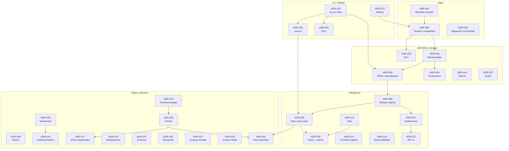

# Decisiones técnicas (ADRs)

> **Tipo:** registro de decisiones de arquitectura.
> **Estado:** propuestas aprobadas para planificación; la implementación las valida.
> **Formato:** contexto → decisión → alternativas → consecuencias.
> **Regla:** una decisión cambia con un ADR nuevo que reemplaza al anterior, no editando el historial.

---

## 1. Cómo usar este documento

- Cada decisión tiene un identificador estable (`ADR-001`).
- **Estado:** `propuesta`, `aceptada`, `reemplazada`, `obsoleta`.
- **Consecuencias positivas y negativas** son parte de la decisión; no se omite el costo.
- Si una decisión deja de cumplirse, se crea un ADR de reemplazo y se marca el anterior.
- Las decisiones de producto que afectan arquitectura también se registran aquí.

### Mapa de decisiones



---

## 2. Índice de decisiones

| ID | Decisión | Estado |
|---|---|---|
| ADR-001 | Monolito modular | Aceptada |
| ADR-002 | Multi-tenancy de base y esquema compartidos | Aceptada |
| ADR-003 | Usuarios globales con memberships por empresa | Aceptada |
| ADR-004 | Invitaciones en lugar de búsqueda global de usuarios | Aceptada |
| ADR-005 | RBAC con namespace, scopes e invalidación | Aceptada |
| ADR-006 | Module registry con manifests en código | Aceptada |
| ADR-007 | Planes, módulos y entitlements impuestos en servidor | Aceptada |
| ADR-008 | Dinero y cantidades con `numeric` y moneda explícita | Aceptada |
| ADR-009 | Documentos financieros versionados e inmutables | Aceptada |
| ADR-010 | Auditoría transaccional y outbox | Aceptada |
| ADR-011 | Jobs con `pg-boss` sobre PostgreSQL | Aceptada |
| ADR-012 | API v1, OpenAPI y catálogo de errores | Aceptada |
| ADR-013 | Frontend con module registry | Aceptada |
| ADR-014 | Access token en memoria y refresh en cookie `httpOnly` | Aceptada |
| ADR-015 | Inventario como capacidad compartida con ledger | Aceptada |
| ADR-016 | Parties unificadas para clientes, proveedores y contactos | Aceptada |
| ADR-017 | APUs y presupuestos relacionales y versionados | Aceptada |
| ADR-018 | IA con tools, permisos y confirmación humana | Aceptada |
| ADR-019 | Idempotencia y concurrencia optimista | Aceptada |
| ADR-020 | RLS como defensa en profundidad | Aceptada |
| ADR-021 | Metadata de archivos en BD y binarios en object storage | Aceptada |
| ADR-022 | Sedes como scope opcional, no obligatorio | Aceptada |
| ADR-023 | Testing con PostgreSQL real, aislamiento y casos dorados | Aceptada |
| ADR-024 | Observabilidad con request-id, métricas y Sentry | Aceptada |
| ADR-025 | Migración incremental tipo strangler | Aceptada |
| ADR-026 | Búsqueda con PostgreSQL full-text primero | Aceptada |
| ADR-027 | Energía como pack aislado | Aceptada |
| ADR-028 | Custom fields solo para metadata no crítica | Aceptada |
| ADR-029 | Bots como vertical pack independiente | Aceptada |
| ADR-030 | Ingesta de bots con inbox + outbox y pg-boss | Aceptada |
| ADR-031 | Identidades de canal en `shared.parties` | Aceptada |
| ADR-032 | Human-in-the-loop para acciones de IA | Aceptada |
| ADR-033 | `core.ai` como orquestador genérico del kernel | Aceptada |

---

## ADR-001 — Monolito modular

**Estado:** aceptada  
**Fecha:** 2026-11-09

### Contexto

Kaleo es un monorepo NestJS + Vue con módulos por dominio. La escala actual y prevista no justifica microservicios, pero sí exige fronteras claras para incorporar verticales sin acoplar todo.

### Decisión

Mantener un **monolito modular**: un proceso backend, una base PostgreSQL, módulos con tablas propias y comunicación por servicios públicos y eventos de dominio.

### Alternativas consideradas

| Alternativa | Por qué no |
|---|---|
| Microservicios | Complejidad operativa, transacciones distribuidas y equipo insuficiente |
| Monolito sin módulos | Acoplamiento y deuda inmanejable al sumar verticales |
| Serverless por función | Frío, difícil de operar y de mantener transacciones |

### Consecuencias

**Positivas:** transacciones simples, despliegue único, menor costo, debugging sencillo, equipo actual puede mantenerlo.

**Negativas:** requiere disciplina para no importar repositorios cruzados; un deploy afecta todo; hay que vigilar el tamaño del proceso.

**Reglas derivadas:** cada módulo tiene manifest, tablas propias, servicio público y eventos; no hay SQL cruzado entre módulos.

---

## ADR-002 — Multi-tenancy de base y esquema compartidos

**Estado:** aceptada  
**Fecha:** 2026-11-09

### Contexto

Hoy los datos se separan por `company_id` solo por disciplina del código. La base no impide referencias cross-tenant. Se necesita aislamiento verificable sin multiplicar bases ni esquemas por cliente.

### Decisión

Una base y un esquema compartidos, con `company_id NOT NULL` en tablas de negocio, `UNIQUE (company_id, id)` en padres, FKs compuestas en hijos y RLS como segunda capa con un rol no privilegiado.

### Alternativas consideradas

| Alternativa | Por qué no ahora |
|---|---|
| Base por tenant | Costo operativo y de migraciones; útil solo para clientes regulados |
| Esquema por tenant | Multiplica migraciones y conexiones; complejidad prematura |
| Solo filtro en aplicación | Ya demostró ser insuficiente |
| Solo RLS | No protege contra referencias inválidas entre filas |

### Consecuencias

**Positivas:** aislamiento en dos capas, migraciones únicas, costo bajo, soporte de muchos tenants.

**Negativas:** riesgo de tabla “ruidosa” entre tenants; RLS mal configurado puede degradar rendimiento; requiere tests y monitoreo.

**Reglas derivadas:** toda query de negocio exige `TenantContext`; `SET LOCAL app.company_id` dentro de transacción; nunca `SET` a nivel de sesión con pooler.

---

## ADR-003 — Usuarios globales con memberships por empresa

**Estado:** aceptada  
**Fecha:** 2026-11-09

### Contexto

`user_contexts` mezcla membership, rol y sede en una sola fila. Inactivar o remover afecta al usuario en todas las empresas. No hay estado por empresa ni múltiples roles limpios.

### Decisión

Mantener `users` como identidad global y crear `memberships` por empresa con estado (`invited`, `active`, `suspended`, `removed`), `membership_roles` M:N y `membership_branches` opcional.

### Alternativas consideradas

| Alternativa | Por qué no |
|---|---|
| Usuario por empresa | Duplica identidades y contraseñas |
| Mantener `user_contexts` | No resuelve estado, múltiples roles ni suspensión por empresa |
| Un rol por membership | Limita roles combinados y templates |

### Consecuencias

**Positivas:** una identidad, varias empresas, suspensión local, múltiples roles, sesiones revocables por empresa.

**Negativas:** backfill y dual-write; mayor complejidad en guards; hay que definir precedencia de roles.

**Reglas derivadas:** el lock de login es global solo por seguridad de cuenta; la suspensión operativa es por membership. El último owner de una empresa no puede removerse.

---

## ADR-004 — Invitaciones en lugar de búsqueda global de usuarios

**Estado:** aceptada  
**Fecha:** 2026-11-09

### Contexto

El flujo actual permite buscar cualquier usuario por nombre o email y adjuntarlo a una empresa. Eso filtra PII entre tenants y no garantiza consentimiento.

### Decisión

Eliminar la búsqueda global del flujo de miembros. Incorporar usuarios solo por **invitación a un email** con token hasheado, expiración, rol inicial y aceptación explícita.

### Alternativas consideradas

| Alternativa | Por qué no |
|---|---|
| Búsqueda limitada a la empresa | No permite invitar usuarios nuevos |
| Código de invitación compartido | Difícil de revocar y auditar |
| Adjuntar por ID | Requiere conocer el ID y no hay consentimiento |

### Consecuencias

**Positivas:** elimina enumeración cross-tenant, deja traza, permite expiración y revocación, mejor experiencia.

**Negativas:** requiere email transaccional confiable; flujo de aceptación con login/registro; tokens deben hashearse.

**Reglas derivadas:** unique de invitación pendiente por empresa y email; reenvío invalida la anterior; aceptar crea o activa membership.

---

## ADR-005 — RBAC con namespace, scopes e invalidación

**Estado:** aceptada  
**Fecha:** 2026-11-09

### Contexto

Los permisos actuales son `module:action`, sin namespace de plataforma ni scope. El JWT puede quedar obsoleto hasta 15 minutos. Borrar un rol elimina memberships en cascada.

### Decisión

Permisos namespaced (`core.users.read`, `construction.apu.create`), módulo propietario, scopes (`company`, `branch`, `project`, `self`) y `token_version` para invalidar sesiones al cambiar roles. Roles asignados no se borran sin reasignación.

### Alternativas consideradas

| Alternativa | Por qué no |
|---|---|
| Mantener `module:action` | Colisiona entre verticales y no escala |
| ABAC puro | Complejidad prematura; RBAC + scope cubre el caso |
| Validar permisos en BD en cada request | Costo alto; `token_version` es suficiente para el riesgo actual |

### Consecuencias

**Positivas:** permisos claros por vertical, cambios de rol efectivos, sin pérdida silenciosa de acceso.

**Negativas:** migración de permisos y aliases; invalidar sesión al cambiar rol; roles template que mantener.

**Reglas derivadas:** permisos sensibles se validan contra estado actual o `token_version`; el owner es inmutable; el último owner no se degrada.

---

## ADR-006 — Module registry con manifests en código

**Estado:** aceptada  
**Fecha:** 2026-11-09

### Contexto

Router, sidebar, permisos y planes se mantienen a mano. Agregar verticales multiplicaría el drift entre backend, frontend y base de datos.

### Decisión

Cada módulo declara un **manifest en código** con código, versión, vertical, dependencias, permisos, rutas, entitlements y onboarding. El registry valida dependencias y alimenta permisos, navegación y planes.

### Alternativas consideradas

| Alternativa | Por qué no |
|---|---|
| Configuración solo en BD | Difícil de versionar y testear; deriva del código |
| Registro manual en cada capa | Es el problema actual |
| Plugins dinámicos en runtime | Complejidad y seguridad prematuras |

### Consecuencias

**Positivas:** una fuente de verdad, navegación consistente, validación de dependencias, onboarding por pack.

**Negativas:** hay que mantener manifests sincronizados con el código; cambios de contrato requieren disciplina.

**Reglas derivadas:** un módulo no se habilita si falta una dependencia; el shell solo consume metadata; el manifest se testea.

---

## ADR-007 — Planes, módulos y entitlements impuestos en servidor

**Estado:** aceptada  
**Fecha:** 2026-11-09

### Contexto

No existen planes, límites ni módulos por empresa. Ocultar funcionalidad en la UI no es seguridad ni control comercial.

### Decisión

Modelar `plans`, `plan_modules`, `plan_limits`, `subscriptions`, `company_entitlements` y `usage_counters`. El backend valida módulo y límite antes de ejecutar; la UI solo refleja el estado.

### Alternativas consideradas

| Alternativa | Por qué no |
|---|---|
| Límites solo en frontend | Bypass trivial |
| Límites por configuración estática | No permite overrides ni trials |
| Cobro embebido desde el inicio | Se puede integrar después; primero entitlement |

### Consecuencias

**Positivas:** control comercial real, overrides por cliente, downgrade seguro, métricas de uso.

**Negativas:** contadores pueden desviarse; requiere reconciliación; más tablas y guards.

**Reglas derivadas:** límite duro devuelve error de negocio; downgrade no borra datos; contadores se recalculan periódicamente.

---

## ADR-008 — Dinero y cantidades con `numeric` y moneda explícita

**Estado:** aceptada  
**Fecha:** 2026-11-09

### Contexto

No existe modelo de dinero, moneda ni redondeo. APUs, presupuestos y costos no admiten `float` ni supuestos implícitos.

### Decisión

Usar `numeric(18,2)` para totales, `numeric(18,6)` para precios unitarios y cantidades, `numeric(9,4)` para porcentajes, `char(3)` para moneda con catálogo, y reglas de redondeo por moneda.

### Alternativas consideradas

| Alternativa | Por qué no |
|---|---|
| `float`/`double` | Errores de redondeo inaceptables en dinero |
| Enteros en centavos | Rígido para unidades fraccionarias y precios de 6 decimales |
| Solo `numeric` sin moneda | Impide multi-moneda y auditoría |

### Consecuencias

**Positivas:** exactitud, reproducibilidad, soporte multi-moneda, tests claros.

**Negativas:** más disciplina en DTOs y cálculos; conversiones de unidad requieren cuidado.

**Reglas derivadas:** no se mezclan monedas en una suma; todo documento financiero guarda su moneda; el redondeo se aplica una vez y se documenta.

---

## ADR-009 — Documentos financieros versionados e inmutables

**Estado:** aceptada  
**Fecha:** 2026-11-09

### Contexto

APUs, presupuestos, contratos y costos cambian con el tiempo. Un update destructivo impide explicar por qué un número era distinto ayer.

### Decisión

Versionar APUs y presupuestos; aprobar congela una versión inmutable con snapshots de precios; los costos son append-only y se corrigen con reversos, no con updates.

### Alternativas consideradas

| Alternativa | Por qué no |
|---|---|
| Update directo con historial de auditoría | No reconstruye el cálculo exacto |
| Solo auditoría before/after | Útil, pero no reemplaza el snapshot |
| Event sourcing completo | Excesivo para esta etapa |

### Consecuencias

**Positivas:** reproducibilidad, trazabilidad, comparación de versiones, confianza del cliente.

**Negativas:** más tablas y flujos; requiere UI de versiones; el almacenamiento crece.

**Reglas derivadas:** una versión aprobada no se edita; editar crea borrador nuevo; un presupuesto aprobado referencia versiones concretas de APU.

---

## ADR-010 — Auditoría transaccional y outbox

**Estado:** aceptada  
**Fecha:** 2026-11-09

### Contexto

La auditoría actual es fire-and-forget, puede registrar rollbacks y se elimina en cascada con la empresa. Los eventos de dominio no existen.

### Decisión

Escribir auditoría y `outbox_events` en la misma transacción que el cambio de negocio. Un worker publica eventos con reintentos e idempotencia. La auditoría es append-only y sobrevive al borrado lógico.

### Alternativas consideradas

| Alternativa | Por qué no |
|---|---|
| Mantener fire-and-forget | Pérdida de trazas y falsos positivos |
| Trigger de BD para todo | Difícil de enriquecer con actor y request-id |
| Cola externa directa | No es atómica con la transacción |

### Consecuencias

**Positivas:** trazabilidad confiable, eventos consistentes, base para notificaciones, webhooks e IA.

**Negativas:** más escritura por transacción; worker que operar; limpieza de outbox.

**Reglas derivadas:** acciones críticas no se confirman sin auditoría; secretos se redactan; `request_id` se propaga.

---

## ADR-011 — Jobs con `pg-boss` sobre PostgreSQL

**Estado:** aceptada  
**Fecha:** 2026-11-09

### Contexto

Importaciones, exportaciones, reportes y emails no deben bloquear requests. No hay infraestructura de colas y no se quiere introducir Redis en esta etapa.

### Decisión

Usar `pg-boss` o equivalente sobre PostgreSQL, con outbox como origen de eventos, reintentos, backoff y dead-letter.

### Alternativas consideradas

| Alternativa | Por qué no ahora |
|---|---|
| Redis + BullMQ | Otra dependencia operativa |
| Cron sin cola | Sin reintentos ni concurrencia controlada |
| Servicio externo | Costo y lock-in prematuros |

### Consecuencias

**Positivas:** una sola infraestructura, transacciones y colas en el mismo motor, operación simple.

**Negativas:** carga adicional en PostgreSQL; límites de throughput; hay que monitorear colas.

**Reglas derivadas:** cada job declara tenant, usuario, módulo y permisos; jobs idempotentes; dead-letter visible.

---

## ADR-012 — API v1, OpenAPI y catálogo de errores

**Estado:** aceptada  
**Fecha:** 2026-11-09

### Contexto

La API no tiene versión explícita, los errores no tienen código de negocio estable y los tipos del frontend se mantienen a mano.

### Decisión

Namespace `/api/v1` por módulo, envelope consistente, catálogo de códigos de error, OpenAPI como contrato y generación de tipos para el frontend en CI.

### Alternativas consideradas

| Alternativa | Por qué no |
|---|---|
| Sin versionado | Rompe clientes y complica integraciones |
| GraphQL | No es necesario para el dominio actual y agrega complejidad |
| Tipos manuales | Drift inevitable |

### Consecuencias

**Positivas:** contratos estables, mejor DX, integraciones más simples, errores consumibles.

**Negativas:** mantener OpenAPI y aliases; disciplina de deprecación.

**Reglas derivadas:** `Idempotency-Key` en POST financieros; `version`/`If-Match`; request-id en errores.

---

## ADR-013 — Frontend con module registry

**Estado:** aceptada  
**Fecha:** 2026-11-09

### Contexto

El router y el sidebar son listas planas manuales. Agregar módulos multiplica el mantenimiento y el riesgo de mostrar rutas sin permiso o sin plan.

### Decisión

Cada módulo exporta rutas, navegación, permisos, entitlement y onboarding. El router y el sidebar se construyen desde el registry y se filtran por permiso y entitlement.

### Alternativas consideradas

| Alternativa | Por qué no |
|---|---|
| Mantener listas manuales | Drift y olvidos |
| Generar todo desde backend en runtime | Acopla el frontend al backend y complica el tipado |
| Microfrontends | Complejidad prematura |

### Consecuencias

**Positivas:** navegación consistente, menos duplicación, módulos habilitables, mejor onboarding.

**Negativas:** el registry debe testearse; lazy loading y orden de rutas requieren cuidado.

**Reglas derivadas:** el shell no contiene lógica de negocio; una ruta sin manifest no existe.

---

## ADR-014 — Access token en memoria y refresh en cookie `httpOnly`

**Estado:** aceptada  
**Fecha:** 2026-11-09

### Contexto

Hoy access y refresh tokens viven en `localStorage`, expuestos a XSS. El refresh token es especialmente sensible.

### Decisión

Mantener el access token en memoria y el refresh token en cookie `httpOnly`, `Secure` y `SameSite` adecuada. Si el despliegue no permite same-site, evaluar BFF o CSP estricta como mitigación.

### Alternativas consideradas

| Alternativa | Por qué no |
|---|---|
| Ambos en localStorage | Riesgo actual |
| Ambos en cookies | CSRF y complejidad si la API es cross-site |
| BFF completo | Costo alto; evaluar si el dominio lo exige |

### Consecuencias

**Positivas:** reduce robo de tokens por XSS, refresh no accesible a JavaScript.

**Negativas:** requiere configurar CORS/CSRF y cookies; sesión se pierde al recargar si no se refresca; hay que ajustar el cliente Axios.

**Reglas derivadas:** CSP estricta; refresh rotation con detección de reuso; logout revoca cookie y token.

---

## ADR-015 — Inventario como capacidad compartida con ledger

**Estado:** aceptada  
**Fecha:** 2026-11-09

### Contexto

metroKUBIKO comunica inventario dentro de construcción, pero Kaleo aspira a comercio y otros verticales. Un inventario de construcción duplicaría stock y costos en el futuro.

### Decisión

Implementar `shared.inventory` con almacenes, movimientos append-only, saldos y valoración. Construcción y comercio lo consumen; ninguno es dueño de las tablas.

### Alternativas consideradas

| Alternativa | Por qué no |
|---|---|
| Inventario dentro de construcción | Duplicaría lógica al abrir comercio |
| Solo stock por proyecto | No cubre almacén central ni comercio |
| Sin ledger, solo saldos | No auditable ni reproducible |

### Consecuencias

**Positivas:** reutilización real, trazabilidad, costos consistentes, base para comercio.

**Negativas:** el modelo debe soportar ambos casos desde el inicio; más disciplina en imputación.

**Reglas derivadas:** movimientos inmutables; saldo con lock; transferencia atómica; imputación opcional a proyecto.

---

## ADR-016 — Parties unificadas para clientes, proveedores y contactos

**Estado:** aceptada  
**Fecha:** 2026-11-09

### Contexto

Construcción necesita clientes, proveedores, contratistas y trabajadores. CRM necesita clientes y contactos. Crear tablas separadas duplicaría personas y relaciones.

### Decisión

Una tabla `parties` por empresa con `party_roles` M:N (`customer`, `supplier`, `contractor`, `employee`, `contact`), contactos y direcciones.

### Alternativas consideradas

| Alternativa | Por qué no |
|---|---|
| `customers` y `suppliers` separados | Duplicación y datos inconsistentes |
| Solo contactos de CRM | No cubre proveedores ni trabajadores |
| Tercero global compartido entre empresas | Fuga de datos y conflictos de propiedad |

### Consecuencias

**Positivas:** una persona una vez, reutilización entre verticales, reportes consistentes.

**Negativas:** roles múltiples pueden confundir; hay que validar deduplicación por `tax_id`/email.

**Reglas derivadas:** una party pertenece a una empresa; los roles se agregan sin duplicar; trabajadores pueden ser party o membership según el caso.

---

## ADR-017 — APUs y presupuestos relacionales y versionados

**Estado:** aceptada  
**Fecha:** 2026-11-09

### Contexto

`analyses` usa JSONB para energía. Reutilizar ese patrón para APUs impediría integridad, consultas, versionado y cálculo confiable.

### Decisión

Modelar APUs con `apus`, `apu_versions` y `apu_lines`; presupuestos con `budgets`, `budget_items` y `budget_approvals`. Nada de EAV ni JSONB para costos, cantidades o estructura.

### Alternativas consideradas

| Alternativa | Por qué no |
|---|---|
| JSONB por APU | Sin FKs, sin constraints, difícil de consultar y versionar |
| EAV universal | Complejidad, rendimiento y validación débiles |
| Tabla única de ítems | Mezcla conceptos y pierde integridad |

### Consecuencias

**Positivas:** integridad, consultas eficientes, versiones, snapshots, tests.

**Negativas:** más tablas y migraciones; el editor debe manejar estructura relacional.

**Reglas derivadas:** un APU aprobado es inmutable; un presupuesto aprobado referencia versiones; los totales se recalculan y verifican.

---

## ADR-018 — IA con tools, permisos y confirmación humana

**Estado:** aceptada  
**Fecha:** 2026-11-09

### Contexto

La IA es un diferenciador del referente, pero también un riesgo de fuga de datos y acciones no auditadas. Kaleo no debe construir un motor propio.

### Decisión

Un orquestador de IA con tools por módulo. Cada tool declara tenant, permiso, riesgo y esquema. Lecturas respetan permisos; escrituras requieren confirmación; toda llamada se audita. Se usan proveedores externos con acuerdos de datos.

### Alternativas consideradas

| Alternativa | Por qué no |
|---|---|
| Chat sin tools | Poco útil y propenso a inventar |
| IA con acceso directo a BD | Fuga y acciones incontroladas |
| Motor propio | Costo y complejidad injustificables |

### Consecuencias

**Positivas:** productividad real, control de riesgo, auditoría, límites por plan.

**Negativas:** costo variable, latencia, necesidad de evaluación y prompts cuidados.

**Reglas derivadas:** ninguna escritura sin confirmación; el contexto de tenant se inyecta en el orquestador; no se entrena con datos del cliente sin consentimiento.

---

## ADR-019 — Idempotencia y concurrencia optimista

**Estado:** aceptada  
**Fecha:** 2026-11-09

### Contexto

No hay protección contra POST duplicados ni lost updates. En documentos financieros y stock eso produce errores costosos.

### Decisión

`Idempotency-Key` con hash de request y respuesta guardada en POST financieros; `version`/`If-Match` en agregados editables; locks de fila en stock; unique por origen en costos.

### Alternativas consideradas

| Alternativa | Por qué no |
|---|---|
| Sin idempotencia | Duplicados por reintentos |
| Solo locks pesimistas | Bloqueos y mala UX |
| Solo unique | No cubre respuestas parciales ni reintentos |

### Consecuencias

**Positivas:** reintentos seguros, menos duplicados, mejor concurrencia.

**Negativas:** tablas adicionales, limpieza de claves, manejo de conflictos en UI.

**Reglas derivadas:** una key con hash distinto devuelve `409`; la respuesta se replica; las claves expiran.

---

## ADR-020 — RLS como defensa en profundidad

**Estado:** aceptada  
**Fecha:** 2026-11-09

### Contexto

RLS está habilitado pero sin políticas y la API usa un rol privilegiado. Eso da falsa seguridad.

### Decisión

Crear un rol de aplicación no owner, sin `BYPASSRLS`, políticas por tabla basadas en `app.company_id` y `FORCE ROW LEVEL SECURITY`. La API se conecta con ese rol. `SET LOCAL` dentro de transacción.

### Alternativas consideradas

| Alternativa | Por qué no |
|---|---|
| Confiar solo en FKs compuestas | No protege lecturas accidentales |
| RLS con rol owner | El owner puede saltarla salvo `FORCE` |
| RLS global sin contexto | Bloquea jobs y tareas de sistema |

### Consecuencias

**Positivas:** segunda capa real, protege ante olvidos de filtro.

**Negativas:** rendimiento, complejidad de políticas para `users`/`companies`, riesgo con pooler.

**Reglas derivadas:** jobs y sistema setean contexto; tests intentan fugar datos; se mide impacto antes de extender a todas las tablas.

---

## ADR-021 — Metadata de archivos en BD y binarios en object storage

**Estado:** aceptada  
**Fecha:** 2026-11-09

### Contexto

Los análisis guardan metadata de archivo, pero no hay modelo general de documentos, versiones ni permisos.

### Decisión

Guardar metadata, checksum, versión y relaciones en PostgreSQL; binarios en object storage (Supabase Storage o equivalente). La descarga se autoriza en backend.

### Alternativas consideradas

| Alternativa | Por qué no |
|---|---|
| Binarios en PostgreSQL | Costo y backups pesados |
| Solo filesystem local | No escala ni sobrevive a contenedores |
| Enlaces públicos | Fuga de datos |

### Consecuencias

**Positivas:** backups livianos, URLs firmadas, versiones, control de acceso.

**Negativas:** consistencia entre BD y storage; limpieza de huérfanos; costos de almacenamiento.

**Reglas derivadas:** checksum y tamaño; cuarentena de archivos; límites por plan; borrado lógico con purga diferida.

---

## ADR-022 — Sedes como scope opcional, no obligatorio

**Estado:** aceptada  
**Fecha:** 2026-11-09

### Contexto

`branch_id` existe en memberships pero no se aplica. Aplicarlo siempre complicaría empresas pequeñas; ignorarlo permite acceso indebido donde se usa.

### Decisión

La sede es un scope de datos **opcional por empresa**. Si se activa, se aplica en servicios y queries; si no, todas las sedes son accesibles según permiso. Un usuario puede tener sedes asignadas.

### Alternativas consideradas

| Alternativa | Por qué no |
|---|---|
| Aplicar siempre | Fricción innecesaria en empresas de una sede |
| Ignorar siempre | Semántica falsa y riesgo |
| Convertir sede en tenant | Duplica la complejidad de tenancy |

### Consecuencias

**Positivas:** flexibilidad, menor fricción, camino claro para empresas grandes.

**Negativas:** dos modos que testear; la UI debe reflejar el modo.

**Reglas derivadas:** el modo se guarda en `company_settings`; los guards y servicios leen el modo; tests para ambos.

---

## ADR-023 — Testing con PostgreSQL real, aislamiento y casos dorados

**Estado:** aceptada  
**Fecha:** 2026-11-09

### Contexto

Hay buenos tests unitarios, pero faltan integración real, aislamiento cross-tenant y validación de cálculos financieros.

### Decisión

Tres capas obligatorias: unitarios, integración contra PostgreSQL real y casos dorados de cálculo. Todo módulo de negocio incluye tests de aislamiento. CI ejecuta migraciones y pruebas de contrato.

### Alternativas consideradas

| Alternativa | Por qué no |
|---|---|
| Solo unitarios con mocks | No detectan SQL, constraints ni RLS |
| Solo E2E | Lentos y frágiles |
| Datos en memoria | No representan PostgreSQL |

### Consecuencias

**Positivas:** confianza real, menos regresiones, contratos verificados.

**Negativas:** CI más lento; requiere contenedores o servicio PostgreSQL; más mantenimiento.

**Reglas derivadas:** un módulo no está terminado sin tests de aislamiento y cálculo; los casos dorados se versionan con el negocio.

---

## ADR-024 — Observabilidad con request-id, métricas y Sentry

**Estado:** aceptada  
**Fecha:** 2026-11-09

### Contexto

Sentry existe, pero no hay métricas de negocio, latencia por endpoint, colas ni uso por tenant.

### Decisión

Propagar `request-id` a logs, auditoría y errores. Logs estructurados con tenant, usuario y módulo. Métricas de latencia, errores, jobs y uso. Sentry con release. Dashboards y alertas mínimas.

### Alternativas consideradas

| Alternativa | Por qué no |
|---|---|
| Solo Sentry | No mide latencia ni capacidad |
| APM comercial completo | Costo prematuro |
| Sin métricas | No se puede operar a escala |

### Consecuencias

**Positivas:** diagnóstico rápido, capacidad medible, soporte con contexto.

**Negativas:** costo de instrumentación y almacenamiento; hay que cuidar PII en logs.

**Reglas derivadas:** no loguear tokens ni bodies sensibles; request-id en toda respuesta de error.

---

## ADR-025 — Migración incremental tipo strangler

**Estado:** aceptada  
**Fecha:** 2026-11-09

### Contexto

La plataforma está en uso y no se puede detener para un big-bang. El esquema actual tiene datos y flujos que deben seguir funcionando.

### Decisión

Evolucionar con tablas nuevas, backfill, dual-write, corte de lectura y deprecación. Feature flags por empresa. Migraciones aditivas, `NOT VALID` + `VALIDATE`, índices `CONCURRENTLY`.

### Alternativas consideradas

| Alternativa | Por qué no |
|---|---|
| Reescribir desde cero | Riesgo y pérdida de continuidad |
| Big-bang | Ventana inaceptable |
| Mantener todo legacy | Deuda imposible de pagar |

### Consecuencias

**Positivas:** riesgo controlado, rollback posible, aprendizaje con datos reales.

**Negativas:** convivencia temporal, doble escritura, reconciliación, más tests.

**Reglas derivadas:** cada corte tiene métrica y criterio; legacy se elimina en migración posterior; backup antes de cambios irreversibles.

---

## ADR-026 — Búsqueda con PostgreSQL full-text primero

**Estado:** aceptada  
**Fecha:** 2026-11-09

### Contexto

La búsqueda global es una necesidad futura, pero introducir Elastic/OpenSearch ahora agrega infraestructura sin volumen que lo justifique.

### Decisión

Usar `tsvector`, índices GIN y trigramas de PostgreSQL para búsqueda de parties, catálogo y proyectos. Reevaluar un buscador externo cuando el volumen o la relevancia lo exijan.

### Alternativas consideradas

| Alternativa | Por qué no ahora |
|---|---|
| Elasticsearch/OpenSearch | Operación y costo prematuros |
| `ILIKE` sin índices | Lento a escala |
| Buscador externo gestionado | Lock-in y costo |

### Consecuencias

**Positivas:** sin infraestructura nueva, transaccional, suficiente para el volumen inicial.

**Negativas:** relevancia limitada; multi-idioma y facetas complejas después.

**Reglas derivadas:** columnas generadas `tsvector`; índices GIN; búsqueda siempre tenant-scoped.

---

## ADR-027 — Energía como pack aislado

**Estado:** aceptada  
**Fecha:** 2026-11-09

### Contexto

`analyses` es un modelo JSONB específico de energía. El producto comunica construcción y CRM; energía no es el núcleo.

### Decisión

Mantener energía como pack aislado (`energy`) sobre `analyses`, sin reutilizar su modelo para APUs, presupuestos ni costos. Se puede congelar o comercializar por separado.

### Alternativas consideradas

| Alternativa | Por qué no |
|---|---|
| Convertir energía en kernel | Contamina el modelo genérico |
| Reutilizar `analyses` para todo | JSONB sin integridad |
| Eliminar energía | Puede tener valor comercial futuro |

### Consecuencias

**Positivas:** foco, modelo limpio para verticales transaccionales, bajo costo de mantener la demo.

**Negativas:** dos modelos de datos conviven; hay que aislar rutas y permisos.

**Reglas derivadas:** `energy` no comparte tablas con construcción; permisos propios; no se prioriza hasta validar demanda.

---

## ADR-028 — Custom fields solo para metadata no crítica

**Estado:** aceptada  
**Fecha:** 2026-11-09

### Contexto

Los clientes pedirán campos adicionales. Un sistema EAV universal es tentador, pero degrada integridad y rendimiento en datos financieros.

### Decisión

Permitir custom fields solo en entidades de metadata (parties, proyectos, contactos) con definiciones tipadas y validación. Prohibirlos para APUs, presupuestos, stock y costos.

### Alternativas consideradas

| Alternativa | Por qué no |
|---|---|
| EAV universal | Sin constraints, consultas lentas, difícil de mantener |
| JSONB libre en todo | Sin validación ni integridad |
| No permitir nada | Fricción para clientes |

### Consecuencias

**Positivas:** flexibilidad controlada, integridad en lo crítico.

**Negativas:** dos mecanismos de datos; hay que documentar límites.

**Reglas derivadas:** definiciones por empresa y entidad; tipos validados; no se usan en cálculos financieros.

---

## ADR-029 — Bots como vertical pack independiente

**Estado:** aceptada  
**Fecha:** 2026-11-10  
**Relacionada con:** ADR-006, ADR-033

### Contexto

Kaleo necesita preparar un módulo de creación de bots y atención de agentes (chat y webhooks) sin convertirlo en parte del kernel ni acoplar los verticales existentes. El diseño aprobado exige que `core.*` nunca dependa de un pack.

### Decisión

`bots` es un **vertical pack** registrado por `manifest.ts`; declara permisos `bots.*`, entitlements de mensajes/créditos/canales/agentes, dependencias de kernel y shared, dependencias opcionales de `crm` y `construction.projects` solo por tool contracts, webhooks y colas. El kernel no importa `modules/bots` ni tiene FKs hacia tablas `bot_*`.

### Alternativas consideradas

| Alternativa | Por qué no |
|---|---|
| Incluir bots en `core.*` | Rompe la independencia y obliga a desplegar canales con el kernel |
| Microservicio separado desde el inicio | Añade operación y consistencia distribuida sin necesidad probada |
| Un pack que importe CRM/Construcción | Acopla verticales y multiplica el mantenimiento |

### Consecuencias

**Positivas:** aislamiento, enablement por empresa, límites por plan, posibilidad de deshabilitar el pack sin afectar otros módulos, reutilización de `core.ai` y `shared.parties`.

**Negativas:** más manifests, permisos y pruebas de arquitectura; la integración cross-pack depende de contratos de tools.

**Reglas derivadas:** un test de CI falla si `kernel/` o `shared/` importan `modules/bots`; `ai_runs` y `ai_action_requests` usan referencias genéricas; el pack se enciende solo con `company_modules`.

---

## ADR-030 — Ingesta de bots con inbox + outbox y pg-boss

**Estado:** aceptada  
**Fecha:** 2026-11-10  
**Relacionada con:** ADR-010, ADR-011, ADR-029

### Contexto

WhatsApp, Telegram y otros canales entregan ráfagas de webhooks y reintentan ante errores. Procesar mensajes, IA y entrega dentro del request bloquearía el servidor y perdería eventos.

### Decisión

El webhook solo verifica firma, resuelve el canal, inserta `bot_webhook_events` (inbox idempotente) y `outbox_events` en una transacción, y responde `202 Accepted`. Un publicador encola jobs de `pg-boss`: `bots.ingest`, `bots.ai.reply`, `bots.deliver` y `bots.actions.execute`, con reintentos, backoff, dead-letter y singleton por conversación o acción.

### Alternativas consideradas

| Alternativa | Por qué no |
|---|---|
| Procesar en el request | Latencia, timeouts y pérdida de eventos |
| Cola en memoria | No sobrevive reinicios ni escala horizontalmente |
| Redis/Kafka desde el inicio | Operación adicional sin volumen que la justifique |

### Consecuencias

**Positivas:** API rápida, tolerancia a ráfagas, reintentos seguros, trazabilidad por `correlation_id`, escalado horizontal de workers.

**Negativas:** consistencia eventual, necesidad de idempotencia y observabilidad de colas.

**Reglas derivadas:** un evento duplicado no duplica mensaje; un job es idempotente; si la cola se satura se aplica backpressure y el proveedor reintenta; no se descarta un evento silenciosamente.

---

## ADR-031 — Identidades de canal en `shared.parties`

**Estado:** aceptada  
**Fecha:** 2026-11-10  
**Relacionada con:** ADR-016, ADR-029

### Contexto

Los usuarios externos llegan por WhatsApp, Telegram, email o web. Si cada canal guarda su propio contacto, CRM y Construcción terminan con bases duplicadas y el historial se fragmenta.

### Decisión

Toda identidad externa se registra en `party_identities` (`company_id`, `party_id`, `kind`, `value`, `normalized_value`) con unique `(company_id, kind, normalized_value)`. `bot_conversations.party_id` y `bot_messages.sender_party_id` referencian `parties`. No existe una tabla `bot_contacts` ni un directorio paralelo.

### Alternativas consideradas

| Alternativa | Por qué no |
|---|---|
| Tabla de contactos por canal | Duplica personas y rompe el historial compartido |
| Guardar solo el número en el mensaje | No permite CRM ni trazabilidad |
| Una party por conversación | Crea duplicados y pierde continuidad |

### Consecuencias

**Positivas:** contacto único entre canales y módulos, deduplicación por unique, historial compartido por `party_id`, menos limpieza posterior.

**Negativas:** necesita normalización cuidadosa (E.164, emails), resolución de conflictos y una operación de merge auditada.

**Reglas derivadas:** la resolución usa upsert idempotente; un conflicto de identidad se revisa, no se sobrescribe; CRM y Construcción acceden por servicio público, no por SQL cruzado.

---

## ADR-032 — Human-in-the-loop para acciones de IA

**Estado:** aceptada  
**Fecha:** 2026-11-10  
**Relacionada con:** ADR-018, ADR-033

### Contexto

ADR-018 exige confirmación humana para escrituras, pero el crecimiento de canales y tools hace necesario un flujo verificable, idempotente y auditable, incluso cuando la acción nace en una conversación.

### Decisión

Las tools se clasifican en `read`, `conversational`, `business_write` y `external`. Las dos últimas crean `ai_action_requests` en `pending_confirmation`; un humano con `bots.actions.approve` **y** el permiso del módulo destino aprueba o rechaza. La IA no puede aprobar su propia acción. La propuesta expira, la ejecución usa `idempotency_key` y se auditan solicitud, decisión y resultado.

### Alternativas consideradas

| Alternativa | Por qué no |
|---|---|
| Aprobar dentro del prompt | La IA podría autoaprobarse |
| Ejecutar y auditar después | El daño ya ocurrió |
| Aprobación implícita por rol | Un permiso amplio habilita escrituras no revisadas |

### Consecuencias

**Positivas:** control real de acciones, evidencia de aprobación, menos riesgo de fraude o error, trazabilidad end-to-end.

**Negativas:** fricción operativa, latencia humana, necesidad de notificaciones y UI de aprobación.

**Reglas derivadas:** doble aprobación no ejecuta dos veces; una acción expirada no se ejecuta; si falta permiso o módulo, falla cerrada; la auditoría incluye `correlation_id`, resumen redactado y `before`/`after` cuando aplique.

---

## ADR-033 — `core.ai` como orquestador genérico del kernel

**Estado:** aceptada  
**Fecha:** 2026-11-10  
**Relacionada con:** ADR-018, ADR-029, ADR-032

### Contexto

La IA es transversal: CRM, Construcción, Inventario y Bots la necesitan. Si cada pack implementa su orquestador, se duplican permisos, auditoría y control de costos. Si el orquestador conoce bots, el kernel deja de ser independiente.

### Decisión

`core.ai` es un orquestador genérico del kernel con `ai_tools` (catálogo global sembrado desde manifests), `ai_runs` (ledger de ejecución y costo) y `ai_action_requests` (propuestas HITL). Inyecta `TenantContext` y un `Principal` de mínimo privilegio, resuelve tools por `module_code` y usa referencias genéricas (`subject_type`, `subject_id`), sin FKs ni imports hacia packs.

### Alternativas consideradas

| Alternativa | Por qué no |
|---|---|
| Orquestador por pack | Duplica RBAC, auditoría y límites |
| `core.ai` con lógica de bots | Acopla el kernel a un vertical |
| Servicio externo de agentes | Pierde control de tenant, permisos y datos |

### Consecuencias

**Positivas:** una sola política de IA, reutilización por todos los packs, límites y costos centralizados, auditoría consistente.

**Negativas:** el kernel crece en responsabilidad; hay que versionar tools y evitar que `core.ai` se vuelva un god object.

**Reglas derivadas:** `core.ai` no importa `modules/*`; las tools se registran por manifest; sin `TenantContext` no se ejecuta; el principal del bot nunca hereda permisos de owner; las tools de escritura siempre pasan por ADR-032.

---

## 3. Decisiones pendientes

Estas decisiones no bloquean el inicio, pero deben resolverse antes de la fase indicada.

| Tema | Fase | Pregunta | Criterio |
|---|---|---|---|
| Valoración de inventario | 4 | ¿Promedio o FIFO? | Volumen, requisitos contables y complejidad |
| Multi-moneda transaccional | 4 | ¿Tipos de cambio por fecha? | Demanda real de clientes |
| Sub-APUs anidados | 3 | ¿Profundidad máxima? | Casos reales y rendimiento |
| Indirectos por APU o presupuesto | 3 | ¿Dónde se aplican? | Práctica del sector y tests |
| Retención de auditoría | 2 | ¿Cuánto tiempo? | Jurisdicción y contratos |
| Nómina completa | 5+ | ¿Construir o integrar? | Demanda y normativa |
| Siguiente pack | 6 | ¿Bots, comercio o energía? | Evidencia comercial y madurez de `core.ai` |
| BFF vs. cookie cross-site | 1 | ¿Dominios same-site? | Infraestructura de despliegue |
| Motor de reportes | 5 | ¿Predefinidos o builder? | Uso real de design partners |
| Merge de parties | 3 | ¿Automático o asistido? | Recomendación: asistido y auditado; nunca automático |
| Retención de conversaciones | 7 | ¿12, 24 meses o configurable? | PII, contratos y jurisdicción |
| Aprobación HITL delegada | 7 | ¿Permitir delegación? | Recomendación: no en la primera versión |
| Partición de mensajes | 7 | ¿Desde el inicio o por umbral? | Volumen real y costo operativo |
| Prompt completo en `ai_runs` | 5 | ¿Guardar o solo hash? | Recomendación: hash + salida redactada |

---

## 4. Plantilla para nuevos ADRs

```markdown
## ADR-XXX — Título

**Estado:** propuesta | aceptada | reemplazada | obsoleta
**Fecha:** YYYY-MM-DD
**Reemplaza a:** ADR-XXX (opcional)

### Contexto

Qué problema existe y por qué hay que decidir ahora.

### Decisión

Qué se decide, en una frase verificable.

### Alternativas consideradas

| Alternativa | Por qué no |
|---|---|

### Consecuencias

**Positivas:**

**Negativas:**

**Reglas derivadas:**
```

---

## 5. Resumen

Las decisiones anteriores se pueden reducir a siete invariantes:

1. **El tenant se garantiza en la base, no solo en el código.**
2. **La identidad es global; la pertenencia y el estado son por empresa.**
3. **Los módulos se declaran, no se improvisan.**
4. **El dinero y los documentos financieros son exactos, versionados y auditables.**
5. **La migración es incremental y cada fase deja evidencia.**
6. **Las personas son una sola: `parties` es la fuente de contactos y `party_identities` solo agrega canales.**
7. **La IA propone; un humano decide y la acción queda auditada.**

Si una implementación futura contradice uno de estos invariantes, requiere un ADR explícito y una justificación de negocio, no una excepción silenciosa.
